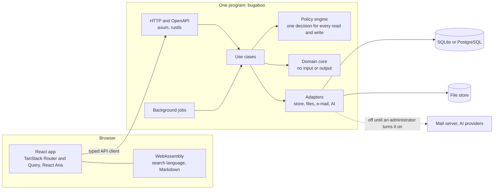

# Contributing to Bugaboo

Thank you for helping. Before your first contribution can be merged, please
read and accept the contributor license agreement below.

## How to contribute

- Open an issue first for anything larger than a small fix, so the approach
  can be agreed on.
- Follow [`CLAUDE.md`](CLAUDE.md), [`docs/coding-standards.md`](docs/coding-standards.md)
  and the words in [`docs/glossary.md`](docs/glossary.md): tests with every
  change, zero warnings, no duplicated logic, and commit messages in the
  Conventional Commits style (the commit-msg hook checks them).
- Set up with `cargo xtask setup` (see [Working on Bugaboo](#working-on-bugaboo)
  below); it installs the Git hooks.
- Run the checks before you push: the pre-push hook runs the full check, and
  `cargo xtask check all` runs it by hand. Run the test suites that cover
  your change.
- Pull requests are squash-merged: the pull request title becomes the commit
  message, so write it as a Conventional Commit.

## Working on Bugaboo

### Set up and run

You need Git, Node.js 26 and Rust. The Rust version is pinned in `rust-toolchain.toml`, and
`rustup` installs it for you. Windows, Linux and WSL are supported.

```sh
git clone https://github.com/Nusi42/Bugaboo.git
cd Bugaboo
cargo xtask setup
```

`cargo xtask setup` installs the pinned developer tools into `.tools/`, the npm packages, the
browsers for the tests and the Git hooks.

Start the server and the browser app on a sample organization of 50 made-up people:

```sh
cargo xtask dev --sample
```

The command prints where the file `sign-in.txt` is. It lists every person of the sample with a
random password; sign in as the first person, an administrator. Without `--sample`,
`cargo xtask dev` starts on an empty data folder and the setup wizard guides the first start.

Check and test your changes:

```sh
cargo xtask check all     # every check of the project
cargo xtask ci            # checks, tests, the browser build and the browser tests
```

The way of working, the rules for code and the list of checks are in [`docs/`](docs/README.md).

### The pictures of the front page

The pictures and recordings of [README.md](README.md) are made by a script, so they can be made
again after the look of a screen has changed:

```sh
cargo build -p bb-server
npm run build
npm run readme-media
```

It starts a server with an empty data folder, sets up Quillmoor Cycle Works, a made-up bicycle
workshop, through the API (`web/app/e2e/support/readme-organization-data.ts` says what it holds),
drives a browser through the screens (`web/app/e2e/readme-media.spec.ts`) and writes the pictures
and GIFs to `docs/media/`. The pictures are taken at twice the size of the window, so their text
stays sharp; the front picture cycles through the four themes. With `BB_README_FRAMES=<folder>` it
also writes every picture of a recording as a PNG, to look at them one by one.

### Architecture

Bugaboo is a modular monolith: one Rust program with a pure domain core and adapters around it, and a React app that talks to it only through the public API.



- **API first.** The description of the API is generated from the Rust code, and the TypeScript client is generated from that description, so the browser app can do nothing the API does not allow.
- **One event log.** Every change is written once to an append-only log with an outbox. History, notifications, the security log and search indexing all read from it.
- **Two databases, one schema.** The schema is written once in Rust and runs on SQLite and PostgreSQL; the tests run on both.
- **One search language.** It is one Rust crate, also compiled to WebAssembly, so the search box in the browser behaves exactly like the server.
- **Many small checks.** Rules about the code are checked by machines (`cargo xtask check all`), and the checks are checked too.

The details are in [`docs/architecture/`](docs/architecture/README.md) and the [decision records](docs/adr/README.md).

### Repository layout

| Path        | Purpose                                                          |
|-------------|------------------------------------------------------------------|
| `crates/`   | The Rust crates: the domain core, the adapters, the server       |
| `web/`      | The browser app and its packages (TypeScript, React)             |
| `xtask/`    | The commands and checks: `cargo xtask ...`                       |
| `docs/`     | Development documentation: specifications, design, decisions     |
| `userDocs/` | Documentation for people who use and run Bugaboo                 |
| `design/`   | The theme file that holds every style of the app                 |

## Why there is an agreement

Bugaboo is licensed under the GNU Affero General Public License v3.0 or later
([`LICENSE`](LICENSE)). The maintainer also offers Bugaboo under other terms,
for example an edition with closed additions, and needs the right to include
every contribution in both. The agreement keeps your copyright with you and
grants that right; it does not take away anything you may do with your own
contribution.

Dependencies under the GPL family (GPL, LGPL, AGPL) cannot be accepted for
the same reason; the checks refuse them (see
[`docs/adr/0036-license.md`](docs/adr/0036-license.md)).

## Contributor license agreement

By submitting a contribution (a pull request, a patch or any other material
sent for inclusion in Bugaboo), you agree to the following terms for that
contribution and every later one.

1. **Definitions.** "You" are the person or the legal entity submitting a
   contribution. "Contribution" is any original work of authorship,
   including changes and additions to existing work, that you submit for
   inclusion in Bugaboo. "Maintainer" is the person who holds the copyright
   in Bugaboo and publishes it, and anyone to whom the maintainer transfers
   the project.

2. **Copyright license.** You grant the maintainer a perpetual, worldwide,
   non-exclusive, no-charge, royalty-free, irrevocable license to use,
   reproduce, prepare derivative works of, publicly display, publicly
   perform, sublicense and distribute your contributions and such derivative
   works, under any terms the maintainer chooses: open-source licenses
   (including, but not limited to, the GNU Affero General Public License) as
   well as proprietary or commercial licenses.

3. **Patent license.** You grant the maintainer and everyone who receives
   Bugaboo from the maintainer a perpetual, worldwide, non-exclusive,
   no-charge, royalty-free, irrevocable patent license to make, have made,
   use, offer to sell, sell, import and otherwise transfer your
   contributions, where such a license is needed for patent claims you can
   license that are necessarily infringed by your contribution alone or by
   its combination with Bugaboo.

4. **Your rights stay yours.** You keep the copyright in your contributions
   and may use them in any other way you like. The maintainer is not
   obliged to use or publish a contribution.

5. **What you confirm.** Each contribution is your original work, or you
   have the right to submit it under these terms (for example, your employer
   has agreed, or it is code under a license that allows it, which you name
   in the submission). To your knowledge it does not infringe the rights of
   others. If you submit material of third parties, you say so and name its
   license.

6. **No warranty.** Unless required by law, you provide your contributions
   "as is", without warranties or conditions of any kind.

7. **Agreement.** You accept these terms by submitting a contribution and by
   confirming it in the pull request with a comment such as "I have read the
   contributor license agreement in CONTRIBUTING.md and accept it", or with
   the signature requested by the repository's CLA tool, if one is set up.
