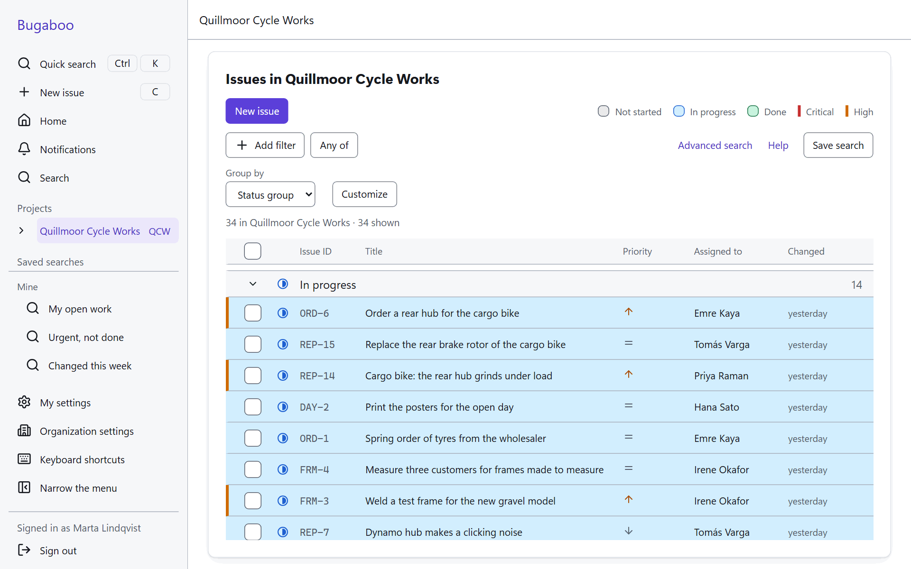
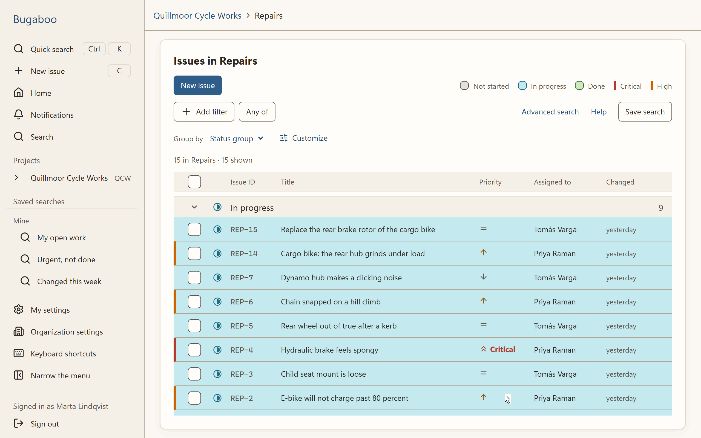

<p align="center">
  
</p>

<p align="center">
  <a href="LICENSE"></a>
  <a href="docs/adr/0040-version-numbers.md"></a>
  <a href="#where-it-stands"></a>
  <a href="web/packages/api-client/LICENSE"></a>
</p>

# Bugaboo

**An issue tracker for teams that you run on your own server: for the work, the people who do it, and the AI agents that help them.** Plain words, every screen on a phone as well as on a computer, and privacy built in.

*Bug* plus *boo*, as in shooing a bug away: you hush it, mark it done, and it is gone.

<p align="center">
  
</p>

<sub>All pictures on this page show **Quillmoor Cycle Works, a made-up bicycle workshop**, with made-up people. Its repairs, frames, orders and open day are only the example. The top picture shows its list in the four themes of the app.</sub>

> **Before version 1.0.** What you see below works and is tested, but Bugaboo is not released yet. Time and working-hours tracking is the next part to be built. Do not use it for real work yet.

## Who it is for

Bugaboo is for a team that wants to keep track of its work in one place it owns: a workshop, an office, a school, a club, a software team. Each piece of work is an *issue*: a repair, a question, an order, a bug. People report issues, pick them up, talk about them and mark them done.

- **One program to install.** The server and the app in the browser are one program, with its database built in. No cloud account, no outside service.
- **Plain words for everyone.** The screens are written for people who are not experts, with the same words everywhere ([glossary](docs/glossary.md)). It works with a keyboard and a screen reader, and on phones, tablets and computers alike.
- **Privacy by design.** No tracking, no outside scripts or fonts, only the cookies it needs. It is built for teams in Germany and elsewhere in the EU, with the GDPR in mind ([more below](#privacy)).
- **Shared memory for people and AI agents.** Everything about a piece of work stays on its issue, so whoever picks it up next, a person or an agent, starts from what the last one knew ([more below](#ai-agents-and-bugaboo-as-shared-memory)).

## A short tour

### Find anything in a moment

Press `Ctrl` `K` and type: quick search finds issues, saved searches, projects and pages while you type. Lists can be filtered, grouped and saved, and a search language with a visual builder answers questions like *everything about brakes that is not done*.

<p align="center">
  
</p>

### Everything about a piece of work on one page

An issue holds its description, its status, the person it is assigned to, labels, tags and the fields your team adds, such as *Customer* or *Frame size*. Sub-issues, links to other issues, files, comments and the history of every change are there too.

<p align="center">
  
</p>

### Report an issue in a few seconds

*New issue* is one key away (`C`). A draft is kept if you close the window, and each team can choose which fields the form shows.

<p align="center">
  
</p>

### Your own way of working

Each project can have its own statuses and the steps between them, drawn as a map. A step can ask for something first, such as who does the work. You change a workflow as a draft, try it, and publish it when it is right.

<p align="center">
  <picture>
    <source media="(prefers-color-scheme: dark)" srcset="docs/media/workflows-dark.png">
    
  </picture>
</p>

### Who sees and does what

Roles and permissions are set up in the browser, for the whole organization or for one project. A customer can be a *Guest* in one project, a field can be hidden from a role, and *Check access* answers what one person can do, project by project. One set of rules decides every read and every change: in the browser, in search, in notifications, and later for AI apps too.

<p align="center">
  <picture>
    <source media="(prefers-color-scheme: dark)" srcset="docs/media/roles-dark.png">
    
  </picture>
</p>

### On a computer and on a phone

<table>
  <tr>
    <td width="68%">
      <picture>
        <source media="(prefers-color-scheme: dark)" srcset="docs/media/issue-page-dark.png">
        
      </picture>
    </td>
    <td width="32%" align="center">
      <picture>
        <source media="(prefers-color-scheme: dark)" srcset="docs/media/issue-list-phone-dark.png">
        
      </picture>
    </td>
  </tr>
</table>

These pictures follow the light or dark setting of your GitHub. The app has four themes, two light and two dark, and settings for the size of text and the spacing.

### Also there today

Signing in with a password, a passkey or a two-step code; invitations and groups; notifications in the app and by e-mail; files with previews; saved searches you can share; keyboard shortcuts you can change; and a security log that shows when somebody tampered with it.

## AI agents and Bugaboo as shared memory

*Planned for milestone M8 of the [roadmap](docs/04-milestones.md). None of it is built yet.*

An AI agent starts fresh every time. It remembers nothing of yesterday and knows only what is written down where it can read it. A person keeps much of a task in their head; an agent cannot.

Bugaboo is meant to be the place where it is written down. When you hand an issue to an agent, the issue holds everything: the **brief** (what is wanted, and when it is done), each **attempt** with its plan, steps and results, the **questions** the agent asked and your **answers**. The next agent, or a person, continues where the last one stopped instead of starting from nothing. And the work stays in your hands:

- **Reached through MCP,** the open standard through which AI apps and agents use other programs. An AI app works as you and can do what you can do, no more.
- **Permissioned like everything else.** An agent can do at most what its person can, sees only what that person may see, and is never the person an issue is assigned to.
- **Asks instead of guessing.** A question waits on the issue and you get a notification. You can ask an agent to show its plan before it starts.
- **Every result is reviewed.** You accept it, send it back with a note, or throw it away, and then everything the agent changed is undone in one step.
- **Off until you turn it on.** An administrator decides whether AI is used at all, for the organization or for a project.

The details are in the [decision record about agents](docs/adr/0029-ai-agents.md) and the [feature list](docs/01-feature-list.md) (AI-20 to AI-38).

## What comes next

In the order of the [roadmap](docs/04-milestones.md):

1. **Time and working hours:** a timer and time entries on issues, estimates, a weekly timesheet, and the daily start and end of work that German working-time rules ask for.
2. **The timeline:** issues as bars on **Gantt charts**, with dependencies (*must finish first*), dates worked out from estimates and work days, and warnings when a plan does not fit. A theme editor comes with it.
3. **The assistant, AI apps and agents** ([above](#ai-agents-and-bugaboo-as-shared-memory)).
4. **The privacy tools and what a first release needs:** export and removal of personal data, backups and updates.
5. **Then:** boards, calendars, a map of how issues relate, dashboards, documents, connections to other tools, and live updates.

Every planned feature is in the [feature list](docs/01-feature-list.md).

## Where it stands

<p align="center">
  
</p>

Six of the 16 milestones are done. The version number counts toward the plan ([how](docs/adr/0040-version-numbers.md)): today it is **0.3.0**, **0.9.0** will mean that every planned feature is built, and **1.0.0** comes after the last milestone.

## Try it

Bugaboo is not released yet, so you run it from its source. You need [Git](https://git-scm.com), [Node.js](https://nodejs.org) 26 and [Rust](https://rustup.rs), on Windows, Linux or WSL:

```sh
git clone https://github.com/Nusi42/Bugaboo.git
cd Bugaboo
cargo xtask setup
cargo xtask dev --sample
```

The last command starts Bugaboo on a sample organization of 50 made-up people and shows the address to open. It also says where the file `sign-in.txt` is: sign in as the first person in it, an administrator. Without `--sample`, Bugaboo starts empty and a short setup guides you.

## Privacy

Bugaboo runs where you put it and sends nothing anywhere unless an administrator turns it on (e-mail now, AI later). It has no tracking and loads nothing from other websites. Every stored field that holds personal data is marked as such, so that it can be exported, removed and kept only as long as the rules of the organization say; the tools for this come with the first release. Bugaboo helps an organization meet the GDPR; the organization that runs it stays responsible.

## Contributing

How Bugaboo is built and checked, its architecture, how to make the pictures on this page again, and the contributor license agreement are in [CONTRIBUTING.md](CONTRIBUTING.md).

## License

Bugaboo is free software under the [GNU Affero General Public License, version 3 or later](LICENSE) (`AGPL-3.0-or-later`). In plain words: you may use it, change it and run your changed version. If you give a changed version to others, or let others use it over a network, you must share its source under the same license.

The client library of its API, [`@bugaboo/api-client`](web/packages/api-client), is under the [MIT license](web/packages/api-client/LICENSE), so your own programs can use it without taking on the AGPL.

The maintainer also offers Bugaboo under other terms, for example for a commercial edition; ask if you need that.
