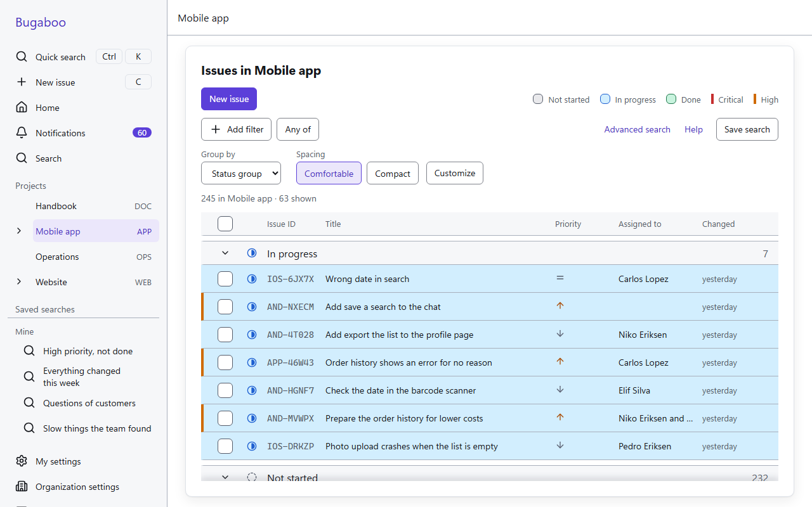
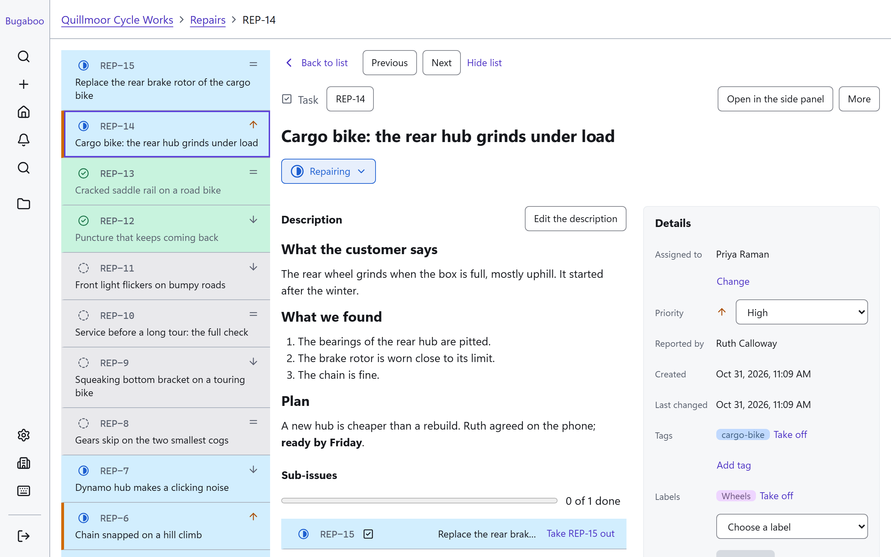
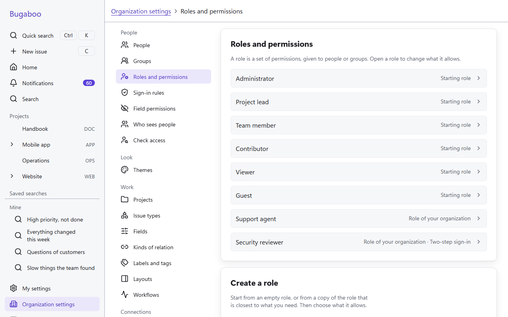
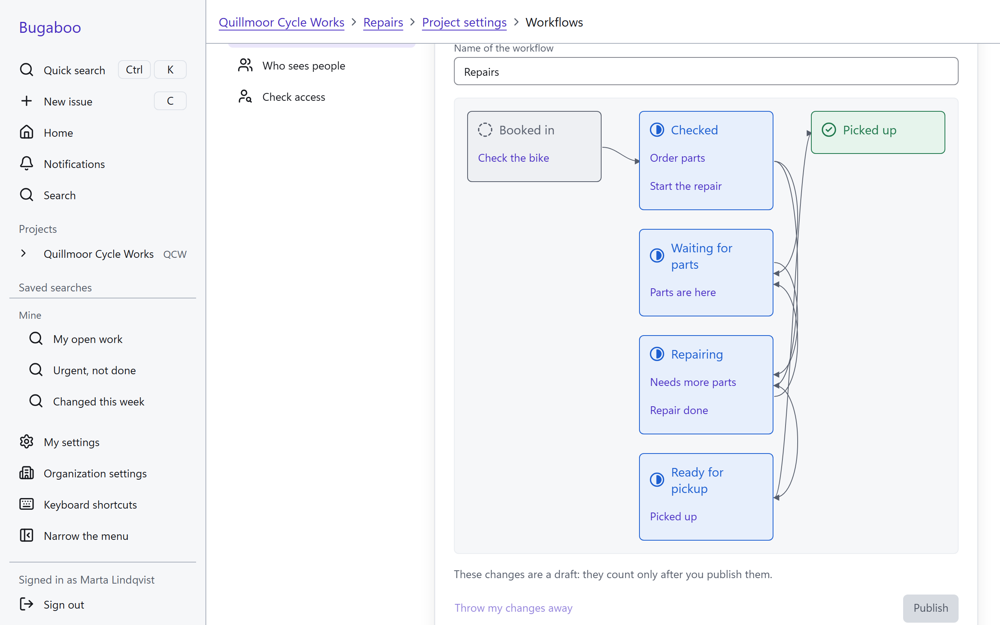
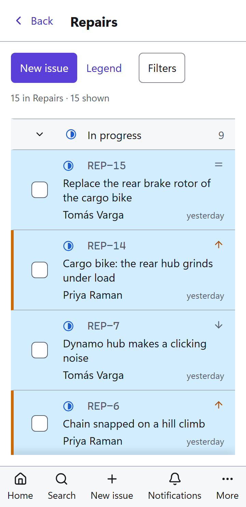
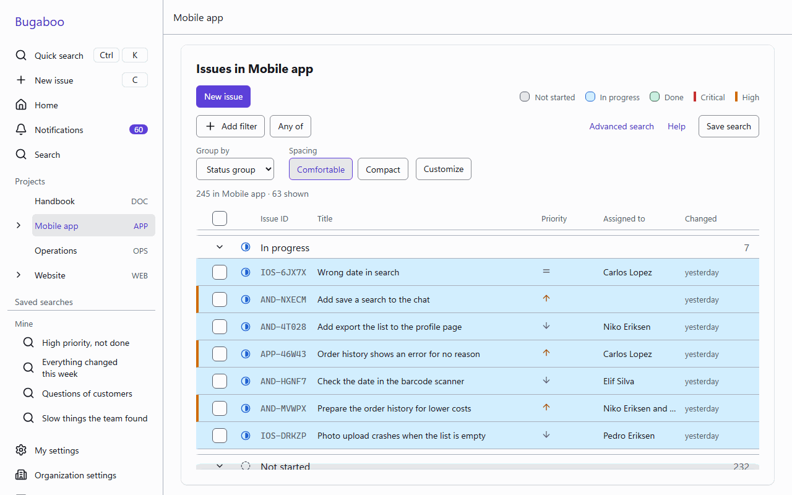
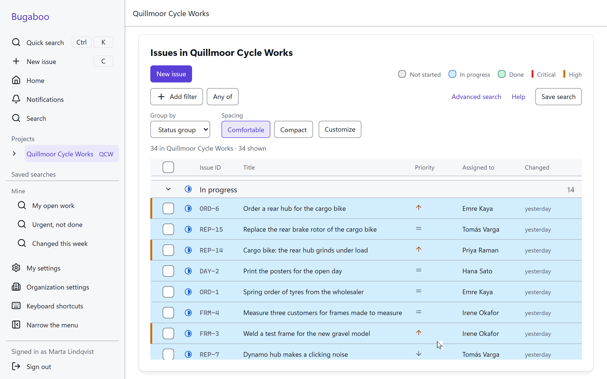
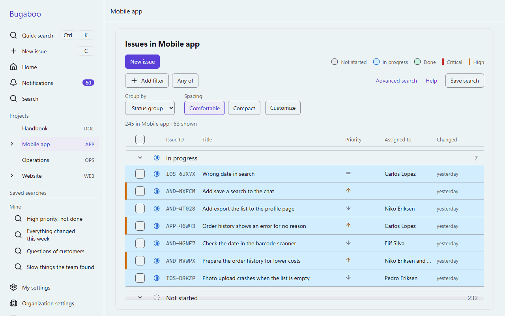

<p align="center">
  
</p>

# Bugaboo

Bugaboo is a self-hosted issue tracker with time and working-hours tracking, built with privacy in mind for teams in Germany and elsewhere. It is one program that you run on your own server, with the browser app inside it.

> **Status: under development, before version 1.0.** The foundations work and are tested: signing in, people and permissions, projects, issues, workflows, files, notifications and search. Time and working-hours tracking is the next part to be built. Expect changes, and do not rely on it for production data yet.

## Why Bugaboo

Most issue trackers are either hosted by somebody else or hard to run, and the ones that also track time or working hours are usually separate products. Bugaboo is meant to be one small program that a team can install in minutes and understand:

- **One file to install.** The server and the browser app are one program. SQLite is built in, so there is nothing else to set up. PostgreSQL is available for larger installations.
- **Plain words for everyone.** The screens are written for people who are not tech experts, with the same plain words everywhere (see the [glossary](docs/glossary.md)). Phones, tablets and computers are all first-class, and the app is built to the accessibility guidelines WCAG 2.2 AA.
- **Privacy by design.** No tracking, no third-party scripts, no outside fonts, only essential cookies. Every stored field that holds personal data is marked in the data model, and export, removal and keep-and-delete rules are generated from those marks. Bugaboo supports an organization in meeting the GDPR; the organization that runs it stays responsible.
- **Time and working hours.** Besides time spent on issues, Bugaboo is designed to record the daily start and end of work, as German working-time rules ask for.
- **One way in for every kind of access.** A single permission engine decides every read and write, for the browser, the API, search, notifications and the AI integration alike. A new role or field can do nothing until somebody grants it access.

## What it looks like

<p align="center">
  <picture>
    <source media="(prefers-color-scheme: dark)" srcset="docs/media/issue-list-dark.png">
    
  </picture>
</p>

The pictures and recordings are made from a sample organization with made-up people. The pictures follow your light or dark setting on GitHub.

<table>
  <tr>
    <td width="50%">
      <picture>
        <source media="(prefers-color-scheme: dark)" srcset="docs/media/issue-page-dark.png">
        
      </picture>
      <br>One issue, with its description, status, people, labels and own fields.
    </td>
    <td width="50%">
      <picture>
        <source media="(prefers-color-scheme: dark)" srcset="docs/media/roles-dark.png">
        
      </picture>
      <br>Roles and permissions that an administrator sets up in the browser.
    </td>
  </tr>
  <tr>
    <td width="50%">
      <picture>
        <source media="(prefers-color-scheme: dark)" srcset="docs/media/workflows-dark.png">
        
      </picture>
      <br>Workflows: the statuses an issue can have and the changes between them.
    </td>
    <td width="50%" align="center">
      <picture>
        <source media="(prefers-color-scheme: dark)" srcset="docs/media/issue-list-phone-dark.png">
        
      </picture>
      <br>The same list on a phone.
    </td>
  </tr>
</table>

### In motion

<p align="center">
  
</p>

<p align="center">
  
</p>

<p align="center">
  
</p>

## Features

What works today:

- **Signing in:** passwords, passkeys, two-step codes and backup codes, invitations, a one-time setup code for the first start, rate limits and a tamper-evident security log.
- **People and permissions:** groups, built-in and own roles, per-field and per-person visibility, and a page that answers what one person can do, project by project.
- **Projects:** a tree of projects and sub-projects, each with its own roles, fields, layouts and workflows.
- **Issues:** own issue types and fields, sub-issues and relations, labels and tags, Markdown descriptions and comments that look the same in the browser and on the server, and edit locks with kept drafts instead of lost work.
- **Workflows:** statuses as data, with changes that can ask for something first, such as who the issue is assigned to.
- **Files:** attachments checked by their content, with previews made in a separate process.
- **Notifications:** in the app and by e-mail, with a check at the moment of sending that the person may still see the issue.
- **Search and lists:** a query language with a visual builder, full-text search, saved searches that can be shared, and lists that can be grouped and customized.
- **Look:** four themes (two light, two dark), size and spacing settings, and one theme file that holds every style.

What is planned, in the order of the [roadmap](docs/04-milestones.md):

- **Next:** time on issues (a timer and manual entries, estimates, a weekly timesheet) and working hours.
- **Then:** a timeline, a theme editor, an assistant and connections for AI apps (always off until an administrator turns them on), the privacy tools and operations needed for a first release, boards, calendars, documents, and live updates.

The full list is in the [feature list](docs/01-feature-list.md).

## Getting started

Bugaboo is not released yet, so you run it from source. You need Git, Node.js 26 and Rust. The Rust version is pinned in `rust-toolchain.toml`, and `rustup` installs it for you. Windows, Linux and WSL are supported.

Clone the repository (the green *Code* button on the GitHub page shows its address), go into the folder and set up:

```sh
git clone <address of this repository>
cd Bugaboo
cargo xtask setup
```

`cargo xtask setup` installs the pinned developer tools into `.tools/`, the npm packages, the browsers for the tests and the Git hooks.

Start the server and the browser app on a sample organization of 50 made-up people:

```sh
cargo xtask dev --sample
```

The command prints where the file `sign-in.txt` is. It lists every person of the sample with a random password; sign in as the first person, an administrator. The browser app is at the address the command shows. Without `--sample`, `cargo xtask dev` starts on an empty data folder and the setup wizard guides the first start.

Check and test your changes:

```sh
cargo xtask check all     # every check of the project
cargo xtask ci            # checks, tests, the browser build and the browser tests
```

The way of working, the rules for code and the list of checks are in [`docs/`](docs/README.md).

### Making the pictures again

The pictures and recordings above are made by a script, so they can be made again after the look of a screen has changed:

```sh
npm run readme-media
```

It starts a server on the sample organization, drives a browser through the screens (the script is `web/app/e2e/readme-media.spec.ts`) and writes the pictures and GIFs to `docs/media/`.

## Architecture

Bugaboo is a modular monolith: one Rust program with a pure domain core and adapters around it, and a React app that talks to it only through the public API.

```mermaid
flowchart LR
    subgraph Browser
        App["React app<br/>TanStack Router and Query, React Aria"]
        Wasm["WebAssembly<br/>search language, Markdown"]
    end
    subgraph Server["One program: bugaboo"]
        Api["HTTP and OpenAPI<br/>axum, rustls"]
        Uses["Use cases"]
        Policy["Policy engine<br/>one decision for every read and write"]
        Core["Domain core<br/>no input or output"]
        Jobs["Background jobs"]
        Adapters["Adapters<br/>store, files, e-mail, AI"]
    end
    Db[("SQLite or PostgreSQL")]
    Files[("File store")]
    App -->|"typed API client"| Api
    App --- Wasm
    Api --> Uses
    Uses --> Policy
    Uses --> Core
    Uses --> Adapters
    Jobs --> Uses
    Adapters --> Db
    Adapters --> Files
    Adapters -.->|"off until an administrator turns it on"| Out["Mail server, AI providers"]
```



- **API first.** The description of the API is generated from the Rust code, and the TypeScript client is generated from that description, so the browser app can do nothing the API does not allow.
- **One event log.** Every change is written once to an append-only log with an outbox. History, notifications, the security log and search indexing all read from it.
- **Two databases, one schema.** The schema is written once in Rust and runs on SQLite and PostgreSQL; the tests run on both.
- **One search language.** It is one Rust crate, also compiled to WebAssembly, so the search box in the browser behaves exactly like the server.
- **Many small checks.** Rules about the code are checked by machines (`cargo xtask check all`), and the checks are checked too.

The details are in [`docs/architecture/`](docs/architecture/README.md) and the [decision records](docs/adr/README.md).

## Repository layout

| Path        | Purpose                                                          |
|-------------|------------------------------------------------------------------|
| `crates/`   | The Rust crates: the domain core, the adapters, the server       |
| `web/`      | The browser app and its packages (TypeScript, React)             |
| `xtask/`    | The commands and checks: `cargo xtask ...`                       |
| `docs/`     | Development documentation: specifications, design, decisions     |
| `userDocs/` | Documentation for people who use and run Bugaboo                 |
| `design/`   | The theme file that holds every style of the app                 |

## License

Bugaboo is free software under the [GNU Affero General Public License, version 3 or later](LICENSE) (`AGPL-3.0-or-later`).

The generated client of the API, [`@bugaboo/api-client`](web/packages/api-client), is under the [MIT license](web/packages/api-client/LICENSE), so your own programs can use it without taking on the AGPL.

In plain words: you may use Bugaboo, change it and run a changed version for yourself, even a version that you keep closed. If you give a changed version to others, or let others use it over a network, you must make the source of your version available under the same license.

The maintainer also offers Bugaboo under other terms, for example for a commercial edition with additions that are not published. If you would like other terms, ask the maintainer.

To make that possible for the whole code, contributions come with a contributor license agreement. You keep your copyright. Read [CONTRIBUTING.md](CONTRIBUTING.md) before you open a pull request.
