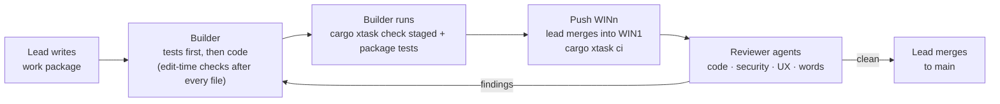

# 04 — Milestones

Status: **Draft for review** · Phase 4 of 5 · 2026-10-04

How Bugaboo gets built: in 16 milestones, each ending in something you can try. **M0–M9** deliver every feature marked M (the first usable release, *MVP*); **M10–M15** deliver every feature marked V1 (*1.0*). Features marked L (later) are not scheduled. Every M and V1 feature appears in exactly one milestone; a check keeps it that way (PLAN-TRACE).

## How we work

### Who does what

| Role | Who | Does |
|------|-----|------|
| **Product owner** | The maintainer | Decide, try each milestone, comment on its review page, approve or ask for changes |
| **Lead** | The main Claude session, high effort | Splits a milestone into work packages, starts builders and reviewers, merges, writes the milestone review page |
| **Builders** | Implementation agents, medium effort | Build one work package each, in their own Git worktree, tests first |
| **Reviewers** | Separate agents with a fresh context | Review every work package adversarially: code, security, UX, words |

### Work packages

The lead splits each milestone into **work packages** (about half a day to a day of agent work each), written to `docs/milestones/Mx/WP-nn-name.md` before any code:

- **Goal** and the feature IDs it covers;
- **Where:** crates, packages and folders it may touch (so packages can run in parallel without clashing);
- **Acceptance tests:** written first, in plain words, then as code;
- **Checks** that must pass and any new check it adds (with the catalogue entry and examples);
- **Docs** to update: user docs for anything people see, architecture or a decision record for any boundary change.

### Life of a work package

1. **Where:** each builder works in its own clone (`bugaboo.winN`, branch `WINn`, ADR-0024), outside the main checkout (`<master>`).
2. **Build:** the builder reads `CLAUDE.md`, the glossary, the coding standards and the relevant decision records; writes the acceptance tests; implements until they pass. Edit-time checks (Claude Code hooks) catch problems after every file.
3. **Self-check:** `cargo xtask check staged` and the package's tests are green before the branch is pushed. The builder reports the exact commands it ran and their results.
4. **CI:** `cargo xtask ci` in `bugaboo.win1`, on Windows and in WSL, both databases.
5. **Review:** at least one reviewer agent with a fresh context reads the diff against the work package, the decision records and the security rules. Packages that touch sign-in, permissions, files, search, AI or personal data always get the security review as well. UI packages get a UX review from screenshots (four themes × computer and phone) compared with the UX design. Every review applies the SSOT/DRY/ODR review gate of coding-standards §1 to the diff and the code it touches; a finding there blocks the merge.
6. **Fix and merge:** findings go back to the builder; the lead merges the builder's `WINn` branch into `WIN1`, runs `cargo xtask ci` again, and fast-forwards `main` in the master repository. `main` is always green.

### Working in a folder

- **Never build, install or run anything in the master repository** (`<master>`, which may live in a synced folder). Work only in your own folder `<work root>/bugaboo.winN`, on your branch `WINn` (ADR-0024).
- A builder's folder starts from `main`: `git fetch origin && git checkout -B WINn origin/main`, then `cargo xtask setup` (pinned tools and Git hooks, coding-standards §7).
- Commit on your branch and push it to `origin` when the work package is done. Never push to `main`: only the lead moves it, by a fast-forward in the master.
- Ports come from your folder's block in `tools/dev/ports.json` (ADR-0023).
- **CodeGraph** keeps one index per work folder, never in the master. If your folder has no `.codegraph/codegraph.db`, run `codegraph init` in it, then pass your folder as `projectPath` to `codegraph_explore` (or run `codegraph explore` there). The lead's index is in `bugaboo.win1`.

### Definition of done (every work package)

- The listed features work as described in the feature list and UX design.
- Acceptance tests written first and passing; no lower test coverage in touched crates.
- All checks green; no new suppressions without reason and issue number.
- Every user-facing text in the message catalog, in plain words from the glossary.
- New stored fields have personal-data marks; new dependencies have register entries.
- User docs updated for anything people see; architecture or decision records updated for boundary changes.
- No second definition, copied logic or hand-kept duplicate knowledge (SSOT, DRY, ODR review gate, coding-standards §1); LINT-DRY green.
- Reviewed by a reviewer agent; findings fixed.
- Screenshots in four themes on computer and phone for every changed screen.

### Testing in every milestone

The test layers, the sample organization and the ports are described in architecture §11. In short:

- **Every pull request:** unit, property, use-case and repository tests (both databases), API tests, the permission matrix, end-to-end tests for touched screens, accessibility checks.
- **Every night:** the full end-to-end suite, the 10-person concurrency run (30 minutes), benchmarks on 1 M issues, dependency and vulnerability scans.
- **Every milestone:** the sample organization grows with the milestone's features, so every demo runs on realistic data.
- **Every bug found later** gets a test that would have caught it, and if it's a kind of mistake, a check.

### Milestone review (the exit gate)

At the end of each milestone, the lead publishes a **milestone review page** (`docs/reviews/Mx.html`, commentable on your phone like the design pages) with:

1. **What's done:** each feature ID with its status and evidence (tests, screenshots).
2. **Try it yourself:** a step-by-step demo on the sample organization. Run `cargo xtask dev` on your PC and open `http://localhost:47200` (or on your phone in the same network, with the address shown by the command).
3. **Screenshots:** every changed screen in four themes, computer and phone.
4. **Results:** checks, tests, concurrency run, benchmarks against the budgets, accessibility.
5. **Reviews:** findings from the security, architecture, UX and words reviews, and how they were fixed.
6. **Known issues** and **questions for you**.

You comment on the page. The lead fixes what you ask for, updates the page, and closes the milestone when you approve. The milestone is tagged (`m3-done`), and the lessons go into the docs and checks before the next milestone starts.

### The lead's routine

A session can end at any time, and a new one starts in the master and continues where the last one stopped. Everything needed to go on is in the repository.

1. **Read [`STATUS.md`](STATUS.md) first.** It holds the current milestone and wave, each work package's state and folder, open questions for the maintainer, and the next action.
2. **Agents belong to the session that started them.** A new session finds no running builders or reviewers. Resume a package marked *building* from its branch and folder as `STATUS.md` describes, never by waiting for it.
3. **Update `STATUS.md` after every step** (builder started, report in, review in, merge, decision), commit it on `WIN1` and fast-forward `main`, so the master's copy is always current. Before a long step (a builder, a review, a CI run), write into "Next action" what is running and how to resume it. A commit that changes only docs needs the Git hooks to pass; code needs `cargo xtask ci` before `main` moves.
4. **Builders** (Sonnet, medium effort) work in `bugaboo.win2` and up, reset to `main` first (see "Working in a folder"). **Reviewers** start with a fresh context.
5. **Every builder prompt** names the work package file, the folder and the branch, and points to the rules: this section's "Working in a folder", the coding standards (including the SSOT/DRY/ODR review gate) and the glossary. Every reviewer prompt names the review gate too.
6. **Merge** into `WIN1` with Git's own subject, the only form the commit-message check accepts for a merge: `git merge --no-ff origin/WINn -m "Merge branch 'WINn' (Mx WP-nn name)"`. Then `cargo xtask ci`, push `WIN1`, and `git merge --ff-only WIN1` in the master.
7. **"Can I close this session?"** Answer with: running background agents and commands; uncommitted or unpushed work in each `bugaboo.winN` (`git status --short`, `git log origin/WINn..WINn`); `main` against `WIN1`; whether `STATUS.md` is current. Say "safe" only when all are clean, or when `STATUS.md` names exactly what a running builder will leave behind.
8. **Memory** lives in `bugaboo.win1/.claude/memory/` (ADR-0024). Commit memory changes with the next `STATUS.md` update.
9. **The maintainer reviews on a phone:** milestone review pages and changed design docs go out as commentable HTML pages; replies stay short and name feature IDs. The links to these pages are private: keep them in `~/.config/bugaboo/links.md`, outside the repository, and name the page in the docs instead (coding-standards §2).

## Overview

| Milestone | Name | Phase | Features |
|-----------|------|-------|----------|
| **M0** | Foundation | MVP | 2 |
| **M1** | Server core and signing in | MVP | 23 |
| **M2** | People, permissions, projects and the app shell | MVP | 24 |
| **M3** | Issues, fields and editing | MVP | 23 |
| **M4** | Workflows, files and notifications | MVP | 12 |
| **M5** | Search and lists | MVP | 12 |
| **M6** | Time and working hours | MVP | 10 |
| **M7** | Timeline and theme editor | MVP | 8 |
| **M8** | Assistant and AI apps | MVP | 15 |
| **M9** | Privacy, operations and the first release | MVP | 14 |
| **M10** | Board, calendar, relation map and dashboards | 1.0 | 10 |
| **M11** | Documents | 1.0 | 11 |
| **M12** | Teams, integrations and AI 1.0 | 1.0 | 16 |
| **M13** | Admin power tools | 1.0 | 15 |
| **M14** | Sold and served | 1.0 | 15 |
| **M15** | Live updates and 1.0 | 1.0 | 2 |

## M0 — Foundation

**Phase:** MVP · **Goal:** A clean, checked workspace where agents can build safely: every rule is enforced from the first line of code.

**Features:**

- `COMP-02` Third-party components register
- `COMP-06` Architecture documentation

**Work packages (outline):**

- Work folders as in ADR-0024: the main checkout is the master (`main`, never built in); `<work root>/bugaboo.win1` (branch `WIN1`) for the lead and integration, `bugaboo.win2` and up for builders
- `main` kept green by the local CI runner (`cargo xtask ci`: everything CI would run, both databases, on Windows and in WSL); nightly runs via a scheduled task. A GitHub Actions workflow is prepared but switched on only when the repository moves to GitHub
- `.cargo/config.toml` with an optional, ignored `config.local.toml` for machine-specific settings; the BUILD-LOCATION guard
- Rust workspace with all crates as empty shells, dependency rules, `#![forbid(unsafe_code)]`, `rust-toolchain.toml`
- `cargo xtask`: check runner reading `tools/checks/catalog.toml`; `cargo xtask setup` installs all tools on Windows, Linux and WSL
- First checks active: FMT-*, LINT-RUST, LINT-TS, LINT-TYPES, LINT-CSS, LINT-SPELL, LINT-CI, GIT-*, SEC-SECRETS, ARCH-DEPS, ARCH-NO-UNSAFE, ARCH-MAP-SYNC, DEV-PORTS, DEP-REGISTER, DEP-LICENSES, DOC-GENERATED, DOC-ADR-ENFORCED and all META checks, each with its bad and good example
- lefthook, Claude Code hooks (`.claude/settings.json`) and `CLAUDE.md` with the agent rules
- Browser app skeleton: Vite 8, React 19, TypeScript 7, oxlint + tsgolint, oxfmt, Vitest, Playwright, all on the ports from `tools/dev/ports.json`
- `design/tokens.json` with the four themes; `cargo xtask gen tokens` generates CSS and TS (the design pages switch to the generated CSS); since M2C both are `design/theme.kdl` and `cargo xtask gen theme` (ADR-0026); `messages/en.json` with typed keys
- The docs-to-HTML builder moves into `cargo xtask docs`
- `bugaboo` binary serving the embedded app ("Hello" screen with the theme picker) and `/health`

**Demo (exit):** On a fresh Windows PC and in WSL: clone, `cargo xtask setup`, `cargo xtask check all` is green; every check's bad example fails; `cargo xtask dev` shows the app on 47200 (server) and 47201 (Vite) in all four themes.

**Tests and checks added:** Every check has passing and failing examples (META-FIXTURES); hooks fire in a test repository; Playwright smoke test of the hello screen in four themes.

## M1 — Server core and signing in

**Phase:** MVP · **Goal:** A secure server that installs, sets itself up and lets people sign in.

**Features:**

- `OPS-01` single self-contained binary
- `OPS-02` Embedded database by default
- `OPS-03` bugaboo setup interactive wizard, then the remaining …
- `OPS-08` Health endpoint, structured logs, and an admin …
- `OPS-10` Bootstrap settings live in a small config file or …
- `SEC-10` HTTPS by default
- `SEC-11` Strict browser security headers
- `SEC-12` Sessions use __Host- cookies
- `SEC-14` Rate limiting and brute-force protection on sign-in, the …
- `SEC-15` A tamper-evident, append-only security log records …
- `SEC-16` Secrets at rest are encrypted with an instance master …
- `AUTH-01` Local accounts with Argon2id password hashing
- `AUTH-02` Passkeys / WebAuthn
- `AUTH-03` Two-step sign-in
- `AUTH-06` Invitations
- `AUTH-09` First-run setup is protected by a one-time setup code …
- `PRIV-01` Privacy by design and by default
- `PRIV-02` Personal-data map
- `PRIV-10` Security of processing
- `UX-07` English only, but ready for translation
- `COMP-07` Security and data-flow documentation
- `COMP-13` ePrivacy
- `DIST-01` One codebase and one server binary for both models.

**Work packages (outline):**

- bb-core basics: IDs, error codes, domain events; personal-data marks (derive macro)
- bb-store: schema and migrations defined once, running on SQLite and PostgreSQL; event log and outbox; job queue
- Settings registry (ADR-0018) core; start-up config (`bugaboo.toml`)
- bb-api skeleton: problem+json errors, OpenAPI generation, generated TypeScript client, security headers, CSP, rate limits, compression
- Sessions, CSRF, master key and secret encryption, hash-chained security log
- Sign-in: passwords (Argon2id), passkeys, two-step codes and backup codes, invitations
- `bugaboo setup` and the browser first-run wizard with the setup code
- Threat model and data-flow documentation (COMP-07)

**Demo (exit):** Install on Windows and WSL, run setup, create the administrator with a passkey, sign out and in again with password plus two-step code; the security log shows every step.

**Tests and checks added:** Repository tests on both databases (ARCH-DB-PARITY); SEC-HEADERS; sign-in end-to-end tests; brute-force and timing tests; DATA-MARKS, DATA-MIGRATIONS, ARCH-ERRORS active.

## M2 — People, permissions, projects and the app shell

**Phase:** MVP · **Goal:** The permission engine, the project tree and the app's frame, in all four themes and on phones.

**Features:**

- `SEC-01` Central policy engine
- `SEC-02` Users
- `SEC-03` Permission inheritance down the project hierarchy, with …
- `SEC-04` Field-level permissions
- `SEC-06` Field permissions apply everywhere a value could leak
- `SEC-08` Built-in starting roles
- `PRJ-01` Projects nested to any depth, each with a unique short …
- `PRJ-02` Settings are inherited down the tree, with per-project …
- `PRJ-03` Move or re-parent projects
- `AUTH-07` Access keys
- `PRIV-12` Who sees people
- `PRIV-13` No counts that leak
- `CFG-04` Personal preferences
- `CFG-06` Settings apply in layers
- `THM-01` Four built-in themes
- `THM-02` The system default is used
- `THM-06` Honors prefers-contrast and prefers-reduced-motion
- `UX-01` Fully responsive layout
- `UX-04` Accessibility to WCAG 2
- `UX-05` Keyboard-first power use
- `UX-06` Optimistic updates and skeleton loading, with a perceived …
- `PERF-02` Lean responses
- `PERF-03` Compression and caching validators for API responses
- `PERF-04` Frontend budgets, enforced in CI

**Work packages (outline):**

- bb-policy: permission catalogue, roles, groups, assignments on the project tree, explicit deny, field masks, `Authorized<T>`, `PersonRef` (who sees people)
- Generated permission-matrix tests (SEC-MATRIX)
- Projects and sub-projects, short names, moving projects with a preview of permission changes
- Organization settings shell (list → editor pattern), People, Groups, Roles & permissions, field-permission matrix, Who sees people, Check access
- Access keys
- App shell: sidebar, top bar, phone bottom bar, focus view and side panel frames, quick-search frame, keyboard shortcut system, optimistic-update helpers
- Four themes with Match my device; My settings › Appearance and Region
- Lean API conventions: `?fields=`, cursor paging, ETags; bundle budget active
- Sample organization, part 1: 50 people, groups, roles, 4 projects with sub-projects (`cargo xtask dataset sample`)

**Demo (exit):** On the sample organization: an admin creates a role, hides Cost center from Contributors and names from Guests, checks Ana's access with an explanation, and the app looks right on a phone and in all four themes.

**Tests and checks added:** SEC-MATRIX, ARCH-AUTHZ-ONLY, ARCH-API-OUT, ARCH-PERMS, ARCH-PERSON-REF, ARCH-LEAN, ARCH-NO-COUNTERS, PERF-BUNDLE and TEST-A11Y active; TEST-SAMPLE-DATA for people and projects.

## M3 — Issues, fields and editing

**Phase:** MVP · **Goal:** Create, read and change issues with own fields, relations and safe editing.

**Features:**

- `ISS-01` Issues with an issue ID, title, Markdown description …
- `ISS-01a` Issue IDs, counting or random
- `ISS-02` Configurable issue types
- `ISS-03` Sub-issues
- `ISS-04` Related issues
- `ISS-05` Comments with Markdown, @mentions and editing
- `ISS-06` A full activity/change history per issue, filtered by …
- `ISS-07` Follow
- `ISS-09` Change many issues at once, each with a preview and a …
- `ISS-11` Draft autosave while creating or editing
- `ISS-17` Edit locks and confirmed saves
- `CF-01` Field types
- `CF-03` Fields have a scope
- `CF-04` Custom styles
- `CF-06` Every custom field has its own permissions and is fully …
- `CF-07` Fields are managed entirely in UI dialogs
- `CF-08` Own fields everywhere
- `TAG-01` Free-form tags with autocomplete
- `TAG-02` Managed labels
- `TAG-03` Rename and merge tags or labels across all issues
- `TAG-04` Tags and labels work everywhere
- `SEC-13` All user-written rich text is sanitized with an allowlist
- `CFG-01` Layout editor

**Work packages (outline):**

- Issue types, issue IDs (counting and random, with redirects), sub-issues, relations with editable kinds
- Own fields (typed value table), field editor with choices, looks and validation
- Issue page in focus view and side panel; new-issue form; layout editor with role-based fields
- bb-markdown (and its WebAssembly build) for descriptions and comments; comments with mentions; history from events
- Edit locks with heartbeats, drafts and confirmed saves; version checks everywhere
- Tags and labels; changing many issues at once with a preview
- Following issues
- Sample organization, part 2: about 10,000 issues, comments, relations, own fields

**Demo (exit):** In the sample organization: create a bug as a Guest (short form) and as a Team member (full form), relate it to two issues, edit the description in two browsers at once (lock, Edit anyway, Compare and save).

**Tests and checks added:** TEST-EDIT-LOCKS; first TEST-CONCURRENT run (10 people) on both databases; ARCH-EVENTS, ARCH-VERSIONED, TEST-ISSUE-IDS, ARCH-WASM active.

## M4 — Workflows, files and notifications

**Phase:** MVP · **Goal:** Issues move through workflows, carry files, and people get told what matters.

**Features:**

- `WF-01` A workflow is a set of statuses and the status changes …
- `WF-02` visual workflow editor
- `WF-03` Rules on each status change
- `WF-04` Must be filled in
- `WF-06` Default workflows ship as editable templates
- `ATT-01` Upload by drag-and-drop, paste or the file picker, on …
- `ATT-02` Safe storage and serving
- `ATT-03` Size and type limits
- `ATT-04` Image and PDF previews, generated on the server and …
- `ATT-07` Attachment access follows the parent issue's permissions …
- `NTF-01` In-app notifications
- `NTF-02` E-mail notifications, configurable per user and per event

**Work packages (outline):**

- Workflows: statuses, status groups, allowed status changes with Who can do it, Only if, Must be filled in, Ask for
- Workflow editor: plain list and drawing view; starter workflows
- Attachments: upload, resumable, content-addressed storage, type checks, safe serving, previews
- Notifications in the app and by e-mail, filtered by the recipient's permissions

**Demo (exit):** Move a bug from Open to Done through its workflow (with Ask for), attach a screenshot by pasting, and see the notification and e-mail arrive for a follower — without fields that person may not see.

**Tests and checks added:** Workflow rule tests; upload security tests (wrong types, SVG, oversized); notification permission tests in SEC-MATRIX.

## M5 — Search and lists

**Phase:** MVP · **Goal:** Find anything fast, in plain words or filter buttons, without ever seeing what you shouldn't.

**Features:**

- `QRY-01` Advanced search
- `QRY-02` Simple search
- `QRY-03` One grammar for both client and server
- `QRY-04` Plain helper words such as me, today, this week, in last …
- `QRY-05` Security:
- `QRY-06` Saved searches
- `ISS-13` Full-text search over titles, descriptions and comments
- `CFG-02` Configurable lists
- `CFG-08` Quick search
- `SEC-17` Search safety
- `PERF-01` Server response targets at 1
- `PERF-05` No N+1 queries

**Work packages (outline):**

- bb-searchlang: grammar, parser, printer, checker, suggestions; WebAssembly build for the editor
- Search compiler with permission predicates and full-text search on both databases
- Search bar: Simple, Advanced and switching without loss; saved searches with sharing
- Issue list: columns, grouping, virtualized scrolling, bulk bar
- Quick search (Ctrl+K)
- Large dataset generator and nightly benchmarks

**Demo (exit):** Search the sample organization in both modes; a Contributor's search on Cost center behaves like an unknown field; 1 M-issue benchmark meets the budget.

**Tests and checks added:** TEST-SEARCH-ROUNDTRIP, PERF-N1, PERF-BENCH active; search entry point in SEC-MATRIX.

## M6 — Time and working hours

**Phase:** MVP · **Goal:** Track time on issues and legally required working hours, with accounting fields.

**Features:**

- `TIME-01` Start/stop timer on any issue
- `TIME-02` Manual time entries with date, duration, description, an …
- `TIME-03` Estimated time
- `TIME-04` weekly timesheet
- `TIME-08` Working hours per day
- `TIME-09` Working-time rules
- `TIME-10` Trustworthy records
- `TIME-12` Who sees working hours
- `TIME-13` Activity
- `PRIV-09` Protecting employee data

**Work packages (outline):**

- Timer, time entries with activity and cost center, estimates and roll-ups
- Timesheet with work-day rows and time on issues
- Working hours: start/end/breaks, Germany rule preset, warnings, reasons for past changes
- Visibility of working hours; no scores or rankings
- Sample organization, part 3: six months of working hours and time entries

**Demo (exit):** Ana starts her work day, runs a timer, takes a break and ends the day; the timesheet shows a rule warning on a long day; Ben can't see Ana's working hours.

**Tests and checks added:** Working-time rule tests (property tests on day boundaries and time zones); TEST-CONCURRENT timer scenarios.

## M7 — Timeline and theme editor

**Phase:** MVP · **Goal:** Plan on a timeline and make Bugaboo look like your organization.

**Features:**

- `PLAN-01` Timeline
- `PLAN-02` Dependencies
- `PLAN-03` Drag to move or resize bars, with undo and a permission …
- `PLAN-04` Group rows by project, goal, assigned person, release or …
- `PLAN-08` Restricted issues are left out entirely; there are no …
- `THM-03` theme editor
- `THM-04` Custom themes at instance level or personal level
- `UX-02` Touch-friendly targets and gestures

**Work packages (outline):**

- Timeline (Gantt chart): rows, zoom, drag, dependencies as relations, unscheduled tray, phone list
- Theme editor with readability ratings; personal and organization themes; import and export
- Touch gestures and phone polish across all screens

**Demo (exit):** Plan the sample Mobile app goal on the timeline by dragging; create a custom theme that fails readability and fix it.

**Tests and checks added:** STY-CONTRAST active; timeline keyboard alternatives in TEST-A11Y; phone screenshots for every screen.

## M8 — Assistant and AI apps

**Phase:** MVP · **Goal:** AI that helps as the person, never more, and outside AI apps through MCP.

**Features:**

- `AI-01` Provider abstraction
- `AI-02` Off by default.
- `AI-03` AI field exclusion
- `AI-04` The AI always acts as the current user, with that user's …
- `AI-05` Prompt-injection safeguards
- `AI-10` Assistant side panel, available wherever you are and …
- `AI-20` A built-in MCP server so external agents can work with …
- `AI-21` MCP tools
- `AI-22` MCP authentication via OAuth 2
- `AI-23` Every MCP call goes through the same policy engine
- `COMP-08` People know when AI is involved
- `COMP-09` Machine-readable marking
- `COMP-10` No AI decisions about people
- `COMP-11` AI literacy guide
- `PRIV-08` Outside services

**Work packages (outline):**

- Provider interface (Anthropic, OpenAI-compatible, local) — off by default, with the data processing agreement step
- One tool registry; context builder with AI exclusions and untrusted-content fencing
- Assistant panel with proposals and Apply; marking of AI-written text
- MCP server with OAuth 2.1 and access keys; consent
- AI literacy guide in the user docs

**Demo (exit):** Connect Claude Code to the sample organization through MCP as a Contributor and see that hidden fields stay hidden; the assistant summarizes an issue and proposes a change that is only saved after Apply.

**Tests and checks added:** ARCH-AI-TOOLS active; prompt-injection test set; assistant and MCP entry points in SEC-MATRIX.

## M9 — Privacy, operations and the first release

**Phase:** MVP · **Goal:** Everything needed to run the MVP for real: GDPR features, installers, backups, releases.

**Features:**

- `PRIV-03` Download my data
- `PRIV-04` Remove a person
- `PRIV-05` Keep and delete rules
- `PRIV-06` People can correct their own profile data; admins can …
- `OPS-04` Run as a service
- `OPS-06` Automatic schema migrations on upgrade, with an automatic …
- `OPS-07` Online backup and restore, both from the CLI and the …
- `SEC-18` Supply chain
- `COMP-01` SBOM for every release
- `COMP-03` Vulnerability handling
- `COMP-04` Secure by default and security updates
- `COMP-15` Accessibility
- `DIST-03` Operator access
- `DIST-07` Updates

**Work packages (outline):**

- Download my data, Remove a person, keep-and-delete rules and jobs
- Service install on Windows and Linux; upgrades with automatic backup; backup and restore
- Release pipeline: build matrix, signing, SBOM, third-party notices, support period
- Security policy, `security.txt`, vulnerability and reporting runbook
- Operator access with customer approval (for the later served model)
- Accessibility statement and full accessibility pass
- Release candidate: external security review recommended

**Demo (exit):** Install the signed MVP on a clean Windows PC and in WSL, restore a backup, download someone's data, remove a person; the release page shows SBOM and licenses.

**Tests and checks added:** Full nightly suite green for 7 nights; long TEST-CONCURRENT; DEP-SBOM; upgrade test from M8 build.

## M10 — Board, calendar, relation map and dashboards

**Phase:** 1.0 · **Goal:** More ways to see and plan work.

**Features:**

- `PLAN-05` Deadline drivers
- `PLAN-06` Board
- `PLAN-09` Calendar
- `ISS-16` Relation map
- `ISS-08` Releases
- `CFG-03` Dashboards
- `CFG-05` Customizable navigation
- `PRJ-06` Across projects
- `QRY-07` "E-mail me this search"
- `QRY-08` Totals for dashboards and reports

**Work packages (outline):**

- Board with rows and card limits; calendar; relation map with list form
- Releases (found in, planned for); deadline drivers on the timeline
- Dashboards with ready-made boxes; pinned navigation; cross-project views
- E-mailed searches; totals for reports

**Demo (exit):** Walk a blocking chain on the relation map, drag a card across the board and an issue across the calendar, build a dashboard from ready-made boxes.

**Tests and checks added:** Relation-map permission tests (no chains through hidden issues); visual tests of all views in four themes.

## M11 — Documents

**Phase:** 1.0 · **Goal:** Each project's documents, as first-class as issues.

**Features:**

- `DOC-01` Documents per project
- `DOC-02` Versioning
- `DOC-03` Permissions are inherited from the project, with …
- `DOC-04` Links between documents and issues, in both directions
- `DOC-05` Full-text search over pages and file contents, with …
- `DOC-06` Page templates, editable in the UI
- `DOC-07` Pages use edit locks and confirmed saves, with a compare …
- `DOC-08` Trash with restore, and retention rules per project
- `DOC-09` AI and MCP
- `ATT-05` Optional malware-scanning hook, with files quarantined …
- `ATT-06` Pluggable storage

**Work packages (outline):**

- Folders, pages (Tiptap editor) and files; versions and compare; templates; trash
- Edit locks for pages; live issue chips; document search
- Virus-scanning hook; S3-compatible storage

**Demo (exit):** Write a page that mentions issues, compare two versions, lock a file, find text inside a PDF.

**Tests and checks added:** Document permission tests; edit-lock concurrency scenarios for pages.

## M12 — Teams, integrations and AI 1.0

**Phase:** 1.0 · **Goal:** Company sign-in, automation hooks and the rest of the assistant.

**Features:**

- `AUTH-04` SSO via OIDC, with mapping from identity-provider groups …
- `AUTH-08` Bot accounts
- `NTF-03` Outgoing webhooks, HMAC-signed, filtered by event and search
- `NTF-04` REST API with an OpenAPI 3
- `NTF-05` CSV import/export, and full JSON export of a project
- `AI-06` Usage limits and cost budgets per user and per instance
- `AI-11` Ask in your own words
- `AI-12` Summarize an issue or a long comment thread, and catch up …
- `AI-13` Turn rough text, logs or a pasted stack trace into a …
- `AI-14` Suggestions
- `AI-24` Per-client consent screen and a Connected apps page where …
- `QRY-09` Ask in your own words
- `SEC-05` Restricted issues
- `SEC-07` See as …
- `SEC-19` Security self-check page that flags weak configuration …
- `SEC-20` Encrypted backups

**Work packages (outline):**

- Company sign-in (OIDC) with group mapping; bot accounts
- Webhooks; public REST API with OpenAPI; CSV and JSON export
- Restricted issues; See as …; safety check page; encrypted backups
- Assistant: ask in your own words, summaries, write it up for me, suggestions; budgets; connected-apps page

**Demo (exit):** Sign in with a company account, restrict a security issue to one group and verify it's invisible everywhere (search, map, e-mail, MCP), turn a pasted stack trace into a bug report.

**Tests and checks added:** Restricted-issue cases in SEC-MATRIX; webhook signature tests.

## M13 — Admin power tools

**Phase:** 1.0 · **Goal:** The configuration depth for larger organizations.

**Features:**

- `CF-02` Cascading select
- `CF-05` Conditional styling rules
- `WF-05` Then automatically …
- `WF-07` Workflow versioning
- `ISS-10` Issue templates
- `ISS-12` Clone issues, and move them between projects
- `PRJ-04` Archive projects and restore them
- `PRJ-05` Project templates
- `CFG-07` Export and import of configuration as versioned JSON, for …
- `THM-05` A project accent color, and branding set by admins
- `TIME-05` Reports by person, project, issue, tag, activity, cost …
- `TIME-06` Time entry permissions
- `TIME-07` Period locking
- `TIME-11` Export of working hours for payroll and HR
- `UX-03` Installable PWA, with read-only offline cache of recently …

**Work packages (outline):**

- Two-level choices, look rules, Then automatically …, workflow versions with migration helper
- Issue templates, clone and move, project archive and templates, configuration export and import
- Logo and project colors
- Time reports, time-entry permissions, closed months, payroll export
- Installable web app with offline reading

**Demo (exit):** Copy a project's setup to a new project, publish a workflow change that moves issues, close a month and export it for payroll.

**Tests and checks added:** Configuration export/import round-trip tests; workflow migration tests.

## M14 — Sold and served

**Phase:** 1.0 · **Goal:** Ready to sell, ready to host.

**Features:**

- `DIST-02` Served = one isolated instance per customer
- `DIST-04` Sold model licensing
- `DIST-05` Served model paperwork
- `DIST-06` Switching
- `DIST-08` Incident reporting runbook
- `COMP-05` Technical documentation file
- `COMP-12` Data Act switching
- `COMP-14` NIS2 support for customers
- `COMP-16` Product liability
- `OPS-05` Packages
- `OPS-09` Prometheus metrics endpoint
- `OPS-11` In-app update notification with signed update verification
- `OPS-12` Try it out
- `PRIV-07` Record of processing
- `PRIV-11` Data breach help

**Work packages (outline):**

- Control plane (minimal) and isolated instances per customer in the EU
- License files for the sold model; signed update check
- Export and import between self-hosted and hosted
- Packages (winget, MSI, deb, rpm, container image); metrics endpoint; Try it out with sample data
- Technical documentation file, record of processing, data-breach help, incident runbook

**Demo (exit):** Move the sample organization from a self-hosted install to a hosted instance and back; install from winget; generate the technical documentation file.

**Tests and checks added:** Switching round-trip tests; isolation tests between hosted instances.

## M15 — Live updates and 1.0

**Phase:** 1.0 · **Goal:** Screens update by themselves, then the 1.0 release.

**Features:**

- `ISS-14` Live updates
- `PERF-06` Live updates send small change events, not full objects

**Work packages (outline):**

- Live updates over Server-Sent Events, filtered per viewer
- 1.0 hardening: performance tuning, full accessibility and security reviews, legal review, release

**Demo (exit):** Two people watch the same board; changes appear within a second without reloading; then the signed 1.0 release.

**Tests and checks added:** Live-update permission tests; 30-day nightly stability; external security test before release.

## Later (not scheduled)

`AUTH-05`, `ISS-15`, `WF-08`, `PLAN-07`, `AI-15`, `AI-16`, `NTF-06`, `NTF-07`, `NTF-08`, `NTF-09`, `DOC-10`. They stay possible: the architecture leaves room for each of them.

## Decisions

- **Git host:** the repository stays local in its current folder for now; GitHub (private, with GitHub Actions) comes later. Until then, `cargo xtask ci` on this PC is the CI: it runs exactly what GitHub Actions will run, on Windows and in WSL, against SQLite and PostgreSQL. Moving to GitHub later only adds a remote and switches on the prepared workflow.
- **Master and work folders (ADR-0024):** the main checkout is the master and is never built in; it may live in a folder that a sync service watches. All work happens in clones under `<work root>` (`bugaboo.win1` for the lead, `bugaboo.win2` and up for builders, each on its own branch `WINn`), so build output and `node_modules` never touch the synced folder. `main` only moves by fast-forward after `cargo xtask ci` passed in `win1`.

## Open questions

None yet. Comment on this page.
