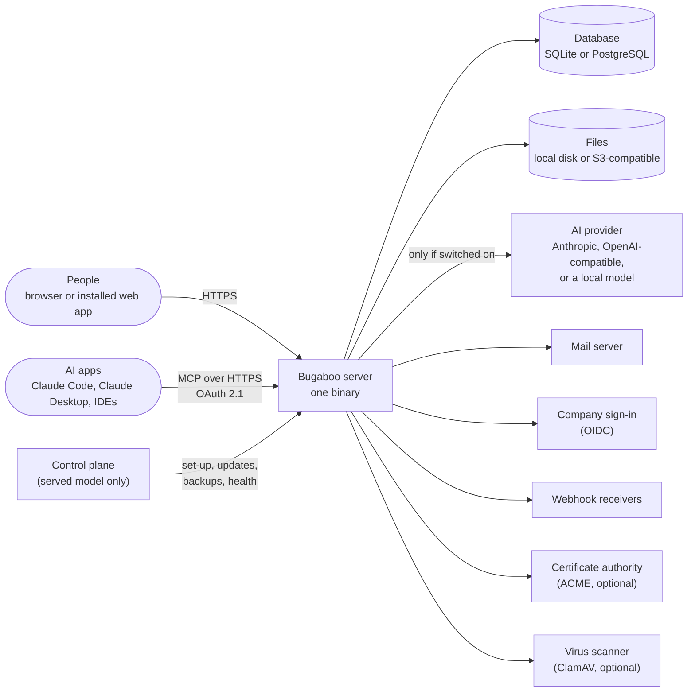

# Context

## What Bugaboo talks to

| Neighbor | Direction | Trust | Notes |
|----------|-----------|-------|-------|
| People (browser) | in | Untrusted input, authenticated identity | Everything they send is validated and checked by the policy engine. |
| AI apps (MCP) | in | Authenticated, scoped; output untrusted | Act as the person who connected them; scopes can only narrow permissions. |
| AI provider | out | Untrusted output | Receives only fields the person may read and that are not excluded from AI. Off by default. |
| Mail server | out | Trusted transport | Notification content is filtered by the **recipient's** permissions. |
| Company sign-in (OIDC) | out/in | Trusted identity source | Group claims can map to Bugaboo groups. |
| Webhook receivers | out | Untrusted | Payloads signed (HMAC); each webhook runs as an agent of the organization with its own role (ADR-0029). |
| Control plane | in | Trusted operator, **no customer data** | Served model only. Emergency data access needs the customer's approval (DIST-03). |

## Trust boundaries

1. **Browser ↔ server:** the browser is never trusted. The UI is a normal API client (principle 3); the server re-checks everything.
2. **Server ↔ AI provider:** prompts carry only permitted data; answers are treated like text from a stranger. They may propose changes, never make them.
3. **Issue and document content:** written by people, so it is untrusted in every place it is shown or sent: sanitized for the browser, fenced for the assistant, escaped for e-mail.
4. **Operator ↔ customer data (served):** our staff and the control plane sit outside the customer's data. Access is an exception with approval and a log entry.
