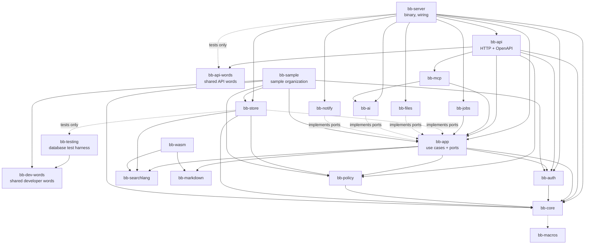

# Building blocks

## Repository layout

```text
bugaboo/
├── Cargo.toml              Rust workspace
├── crates/                 server code (Rust)
│   ├── bb-core/            domain types, IDs, error codes, domain events, field types — no I/O
│   ├── bb-macros/          derive macros (entities, personal-data marks, settings)
│   ├── bb-policy/          authorization engine, permission catalogue, Authorized<T>
│   ├── bb-searchlang/      search language: parse, print, check, suggest — no I/O, also WebAssembly
│   ├── bb-markdown/        Markdown → safe HTML, issue-number chips — no I/O, also WebAssembly
│   ├── bb-app/             use cases per feature (ports = traits for storage, files, mail, AI)
│   ├── bb-store/           database adapter: schema, migrations, repositories, search compiler
│   ├── bb-files/           file adapter: content-addressed storage, type checks, previews, scanning
│   ├── bb-auth/            passwords, passkeys, two-step codes, sessions, access keys, OIDC, OAuth 2.1
│   ├── bb-ai/              AI provider adapters, context builder, tool registry
│   ├── bb-mcp/             MCP server (uses the tool registry)
│   ├── bb-notify/          in-app, e-mail and webhook delivery
│   ├── bb-jobs/            background job runner and schedules
│   ├── bb-api/             HTTP: routes, OpenAPI, security headers, rate limits, static app
│   ├── bb-api-words/       the words of the API description that code, tests and checks share (no dependencies)
│   ├── bb-dev-words/       the words the developer tools, the tests and xtask share: databases, test variables, the sample layout
│   ├── bb-wasm/            WebAssembly bindings for searchlang, markdown, validation
│   ├── bb-testing/         test harness: runs one test body on SQLite and PostgreSQL (dev dependency only)
│   ├── bb-sample/          sample-organization generator, developer tool (not shipped before OPS-12)
│   └── bb-server/          the `bugaboo` binary: CLI, setup wizard, service install, wiring
├── xtask/                  the single check/build runner (cargo xtask …)
├── tools/                  check catalogue, pinned tool versions, dev ports
├── design/tokens.json      design tokens — source of all colors, fonts, sizes
├── messages/en.json        message catalog — source of all user-facing text
├── web/                    browser app (TypeScript)
│   ├── app/                the React app: routes and feature folders
│   └── packages/
│       ├── api-client/     types generated from OpenAPI (never edited by hand) and the thin client on top
│       ├── ui/             shared components on React Aria + generated token CSS
│       ├── wasm/           generated bindings to bb-wasm
│       └── messages/       generated, typed message keys
├── docs/                   development docs (this)
└── userDocs/               user and admin docs
```

## Module map



### Dependency rules (checked by `cargo xtask check only ARCH-DEPS`)

1. `bb-core`, `bb-searchlang` and `bb-markdown` do no I/O and depend on no other Bugaboo crate except `bb-core` (searchlang and markdown not even that; `bb-core` uses `bb-macros` for derives at compile time only), so they compile to WebAssembly.
2. `bb-app` knows **ports** (traits) only. It never imports `bb-store`, `bb-files`, `bb-ai` or `bb-notify`. Tests run use cases against in-memory fakes.
3. Only `bb-policy` can create `Authorized<T>`. Its constructor is private to the crate.
4. Only `bb-api` and `bb-mcp` speak HTTP. Only `bb-server` wires adapters to ports, and from M2 WP-06 on also the developer program `bb-sample` (`cargo xtask check only ARCH-HTTP-EDGE`).
5. The browser app talks to the server only through `@bugaboo/api-client` (`cargo xtask check only ARCH-WEB-API`), and has no hand-written types for what the server sends (`LINT-API-TYPES`).
6. A crate may name itself as a dev-dependency to switch on its own `testing` feature for its integration tests (`bb-api` does, for `Options::for_tests`); that is no edge between two crates (`cargo xtask check only ARCH-DEPS`).

## The core modules

### bb-core

Newtype IDs (`IssueId`, `ProjectId`, …, all UUIDv7 inside, readable keys like `WEB-142` outside), field types and values, domain entities, **domain events**, and the **error code catalogue** (one Rust enum; becomes OpenAPI, the TypeScript union and message keys). Entities carry personal-data marks (ADR-0015). It also holds the **settings registry** (ADR-0018: every setting is declared once, in `settings/`), the **message keys** generated from `messages/en.json` as Rust constants and functions (UX-07), and the entity list behind the generated personal-data page `docs/privacy/personal-data.md`. The HTTP layer (`bb-api`) and the binary (`bb-server`) use `bb-core` directly for error codes and message text.

### bb-policy

- **Permission catalogue** (one Rust enum with plain-language descriptions as message keys) and the **starting roles** (one definition, used once to make editable copies and for *Reset to the starting permissions*), as [ADR-0025](../adr/0025-roles-groups-and-assignments.md) decides.
- **Evaluation:** given an actor (and an access key's choice) and a place, computes the effective permission set, the **field mask** (hidden / can see / can change per field, per issue type later) and the *Who sees people* levels, from roles, groups and assignments on the project tree with *No access* ([§7, Authorization model](07-cross-cutting.md#authorization-model)). No I/O: the assignments come in through a port of `bb-app`. Cached per request.
- **`PersonRef`:** resolves every person shown for the viewer, the kind of people information and the place (ADR-0022). **Check access:** the decision with its reasons as data.
- **Visibility:** project tree, restricted issues, documents.
- **Search predicates:** turns the actor's visibility into query-builder expressions that `bb-store` adds to every query.
- **`Authorized<T>`:** the only way data leaves the domain. It carries the field mask, so projections drop hidden fields automatically.

### bb-searchlang

Lexer, parser, syntax tree, canonical printer, checker and suggestions. Knows nothing about databases or permissions: the caller passes a **field catalogue** (the fields this person may read), so a hidden field fails exactly like an unknown one. Simple search (filter buttons) edits the same syntax tree.

### bb-app — use cases by feature

`projects`, `issues`, `relations`, `fields`, `workflows`, `tags`, `releases`, `search`, `boards`, `timeline`, `calendar`, `relation_map`, `time` (timers, time entries, working hours, rules), `documents`, `attachments`, `notifications`, `assistant`, `privacy`, `settings`, `themes`, `people` (people and groups), `roles` (roles and who has which role), `access` (field permissions, *Who sees people*, *Check access*), `admin`.

Every use case has the same shape:

```rust
pub async fn change_status(
    ctx: &Ctx,               // actor, request id, clock, ports
    cmd: ChangeStatus,       // validated input
) -> Result<Authorized<IssueView>, AppError>
```

1. Ask `bb-policy` whether the actor may do it.
2. Load, change and validate inside one transaction.
3. Append domain events (same transaction). A command use case writes only through the `ChangeStore` port (`record_change`), which `bb-store` implements; a use case whose input type ends in `Query` only reads. Enforced by: ARCH-EVENTS.
4. Return the result through `Authorized<T>`.

### bb-store

sqlx connection pools, migrations (defined once with the query builder, run on both databases), repositories implementing `bb-app` ports, the **search compiler** (syntax tree + permission predicates → SQL), full-text search adapters, the event log and outbox, the job queue tables, the security log (hash chain), stored secrets (envelope encryption) and setting values. It is the only crate that touches a database; it takes the time and the IDs from its caller and gets no clock of its own. Enforced by: ARCH-SQL-EDGE (no other crate may depend on a database library, and no SQL text is built with `format!`), DATA-MARKS (every table belongs to an entity with personal-data marks), ARCH-SETTINGS (setting values are read and written only in `settings.rs`).

`bb-app` also holds the real clock and secure random source (`context::SystemClock`, `context::SystemIds`), because `bb-core` does no I/O; `bb-server` passes them to the use cases and the store.

### bb-testing

Test-support crate, used only as a **dev dependency** (`[dev-dependencies]`) and never shipped (ARCH-DEPS fails on any other kind of dependency on it). `each_database` runs one async test body against every database named in `BB_TEST_DATABASES` (`sqlite`, `postgres`; default `sqlite`), each with a brand-new empty database that is removed afterwards (also when the test panics), hands the body a typed pool (`Pool::Sqlite` or `Pool::Postgres`), and records what ran for ARCH-DB-PARITY. It depends on `bb-dev-words` only, which names the databases and the variables. How it is wired to `cargo xtask db` and `cargo xtask ci` is in [testing](11-testing.md#database-tests).

### bb-api

axum router; extractors that turn a session cookie, access key or OAuth token into an **actor**; CSRF and origin checks; security headers and CSP; rate limits (`limits`); the one cookie module (`cookies`); `?fields=` projections; cursor pagination; ETags; problem+json errors (`errors`: `ApiError`, `ApiJson`); the one route table (`permissions::ROUTES`: what each route needs, whether its answer may be kept, is never stored or is a secret; it writes the marks `x-permission`, `x-never-stored` and `x-secret`, and it decides which changes are open without a CSRF token); OpenAPI generation from the handlers' `#[utoipa::path]` descriptions (`openapi`, served at `/api/v1/openapi.json`, printed by `bugaboo openapi`, written to `web/packages/api-client/openapi.json` by `cargo xtask gen api`); the embedded static app.

### bb-api-words

The words of the API description that more than one program needs, written once: the marks `bb-api` puts on a route (`x-permission`, `x-never-stored`, `x-secret`), the three words for a route that needs no permission of the catalogue (`public`, `signed-in`, `own-account`), and the actor and answer names of the permission matrix (SEC-MATRIX). It has no dependencies and does no work, so `bb-api` (writes the words), the server tests (read them) and `xtask` (its checks read the generated description) can import it. The table that says which route gets which mark is `bb-api`'s `permissions::ROUTES`.

### bb-dev-words

The words that the developer tools, the tests and `xtask` share, written once: the databases Bugaboo runs on (`DatabaseKind`: `sqlite`, `postgres`) and the variables that tell the test harness what to do (`BB_TEST_DATABASES`, `BB_TEST_POSTGRES_URL`, `BB_DB_PARITY_FILE`), and the schema of `tools/dev/sample.json` (`sample::Layout`), which says where the sample organization is made and what its files, groups, projects and roles are called. It does no work and no input or output, and depends on `serde` and `serde_json` only, so `bb-testing`, `bb-sample` and `xtask` can import it without pulling in the store or the use cases.

### bb-ai and bb-mcp

One **tool registry** (search issues, get issue, create, change status, comment, log time, …). Each tool maps to a `bb-app` use case, so permissions and validation are identical. `bb-mcp` exposes the registry to outside AI apps; the assistant uses the same registry but returns **proposals** for writes instead of running them.

### bb-sample

The sample-organization generator (architecture §11): a library and a small program that `cargo xtask dataset sample` runs as a process, so `xtask` does not link the store or the use cases (it imports only `bb-api-words`, `bb-dev-words` and `bb-policy`, for the names its checks hold the code against). It makes the organization through the same use cases the API calls, deterministic from a seed, on SQLite and PostgreSQL. It is a developer tool: not linked into `bugaboo` until *Try it out* (OPS-12), and never shipped before then.

- **May depend on:** `bb-app`, `bb-store`, `bb-core`, `bb-policy`, `bb-auth`, `bb-dev-words` (and `bb-testing` as a dev dependency only). Nothing depends on it except, from OPS-12 on, `bb-server`.
- **It wires an adapter:** like `bb-server`, it builds the store and hands it to the use cases, so dependency rule 4 names it as the second crate that may wire adapters to ports; ARCH-HTTP-EDGE's list of wiring crates (`bb-server`, `bb-sample`) is in `xtask/src/checks/arch_http_edge.rs`.
- **In the layout and the diagram:** ARCH-MAP-SYNC and ARCH-DEPS read the repository layout and the module map above, which list the crate and its edges.

## Browser app (web/app)

```text
web/app/src/
├── routes/              TanStack Router routes in code (guest, signed-in and administrator
│                        layouts decide who may open what); URL search params are typed state
├── features/            shell (sidebar, top bar, phone bar, quick search, frames), sign-in, sign-up,
│                        invitation, setup, account (sign-in and security, where you're signed in),
│                        admin (invitations, status), home;
│                        M2: settings (the generic settings form), my-settings (appearance, region,
│                        start page, shortcuts, access keys), projects, people (people, groups),
│                        roles (roles and who has which role), access (field permissions,
│                        who sees people, check access);
│                        later: issues, search, board, timeline, calendar, relation-map,
│                        documents, time, dashboards, notifications, assistant
├── shared/              api client, session, errors, formatting (Intl), page title and focus,
│                        the shortcut registry, the helpers for instant changes
└── main.tsx
```

- **Server data** lives only in the TanStack Query cache, fetched through the generated client, keyed by generated query keys.
- **Forms** get their validation rules from the server's exported schema; the server still decides.
- **Components** come from `@bugaboo/ui`, built on React Aria Components; styles use token variables only. The content security policy allows no inline styles, so React Aria's one injected style element is replaced by a rule in `global.css` (the element is declared in `index.html`).
- **Who is signed in** is read once with `GET /api/v1/auth/me`; a `401` anywhere (a session that ended, a wrong CSRF token) takes the person to the sign-in page with the reason in the address, and the guest layout does not send a signed-in person away while a reason is shown.
- **The frame** (`features/shell`) lays out three sizes from the `bp-*` tokens: a sidebar on a computer (1280 px and wider), a menu that slides in on a tablet, a bottom bar and one screen at a time on a phone. `places.ts` is the one list of the screens that exist (menus, the trail at the top, quick search and the topics of the settings frames read it), so nothing is shown that does not exist. Other features add to the shell through registries (`addSidebarSection` for the project tree, `addQuickSearchSource` for search results). Which item is open lives in the address (typed search parameters), so it can be shared and Back closes it.
- **Shortcuts** are defined once in `shared/shortcuts.ts` (ID, default keys, words, where they work, the visible button that does the same). One engine handles sequences such as `g h` and stays silent while a text field has the focus; a person's own keys come from one source: the server when somebody is signed in (stored as one validated value), this browser before sign-in.
- **Instant changes**: `useOptimisticMutation` shows a change in the query cache at once, goes back with a plain message when the server refuses, and reports *Saving…*, *Saved* or *Not saved yet*; skeletons appear only after 0.3 s; *Undo* is on offer for 10 seconds.
- **Appearance** (the mode *Match my device*, *Always light* or *Always dark*, one light and one dark theme, spacing, text size, motion) is one `AppearanceSource`. The source is the person's settings on the server once the person is signed in (they follow the person to every browser and are gone from the browser after sign-out), and this device's choice before sign-in. The browser keeps one copy for the first frame, which sign-out removes. *Region* (time zone, date and number format, first day of the week) reads from the same answer, and `shared/format.ts` writes times and numbers by it.
- **Rules the checks keep:** feature folders are reached only through their `index.ts` and shared code and packages never import features or the app (`ARCH-WEB-FEATURES`); all text comes from the catalog (`TXT-LITERAL`); no color is written out and no style is set from code (`STY-TOKENS`); every address in `paths.ts` is opened by the accessibility suite in the four themes on a computer and a phone (`TEST-A11Y`).
- **Heavy features** (timeline, relation map, document editor, workflow editor, theme editor, WebAssembly) are split into separate chunks and loaded when first opened.
