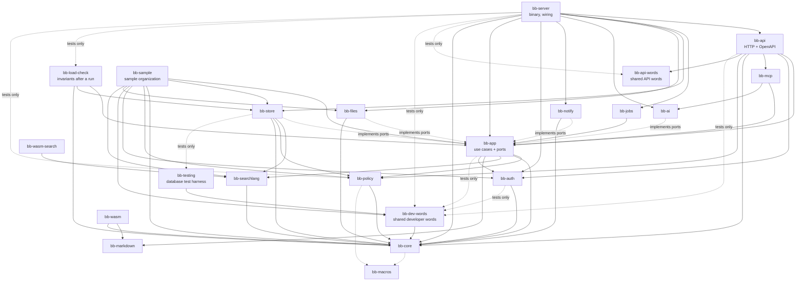

# Building blocks

## Repository layout

```text
bugaboo/
├── Cargo.toml              Rust workspace
├── crates/                 server code (Rust)
│   ├── bb-core/            domain types, IDs, error codes, domain events, field types — no I/O
│   ├── bb-macros/          derive macros (entities, personal-data marks, settings)
│   ├── bb-policy/          authorization engine, permission catalogue, Authorized<T>
│   ├── bb-searchlang/      search language: parse, print, check, suggest — no I/O, also WebAssembly
│   ├── bb-markdown/        Markdown → safe HTML, issue-number chips — no I/O, also WebAssembly
│   ├── bb-app/             use cases per feature (ports = traits for storage, files, mail, AI)
│   ├── bb-store/           database adapter: schema, migrations, repositories, search compiler
│   ├── bb-files/           file adapter: content-addressed storage, type checks, previews (a virus scan is V1, ATT-05)
│   ├── bb-auth/            passwords, passkeys, two-step codes, sessions, access keys, OIDC, OAuth 2.1
│   ├── bb-ai/              AI provider adapters, context builder, tool registry
│   ├── bb-mcp/             MCP server (uses the tool registry)
│   ├── bb-notify/          delivery adapters: e-mail over SMTP (lettre) today, webhooks later
│   ├── bb-jobs/            the loop that runs the due background jobs (the work of each kind is in bb-app)
│   ├── bb-api/             HTTP: routes, OpenAPI, security headers, rate limits, static app
│   ├── bb-api-words/       the words of the API description that code, tests and checks share (no dependencies)
│   ├── bb-dev-words/       the words the developer tools, the tests and xtask share: databases, test variables, the sample layout
│   ├── bb-wasm/            WebAssembly bindings for markdown, the wording of changes and notifications and the rule of the same name (bb-core); a module of its own
│   ├── bb-wasm-search/     WebAssembly bindings for searchlang; a module of its own, fetched when a search bar first opens (ADR-0005, amendment M5)
│   ├── bb-testing/         test harness: runs one test body on SQLite and PostgreSQL (dev dependency only)
│   ├── bb-sample/          sample-organization generator, developer tool (not shipped before OPS-12)
│   ├── bb-load-check/      the invariants after a run of many people at once, written once; developer tool and test support (never shipped)
│   └── bb-server/          the `bugaboo` binary: CLI, setup wizard, service install, wiring
├── xtask/                  the single check/build runner (cargo xtask …)
├── tools/                  check catalogue, pinned tool versions, dev ports
├── design/                 the theme (ADR-0026)
│   ├── theme.kdl           the base — source of all fonts, sizes, component rules and the colors of Daylight
│   └── themes/             one file of colors per built-in theme, named by the theme's ID
├── messages/en.json        message catalog — source of all user-facing text
├── web/                    browser app (TypeScript)
│   ├── app/                the React app: routes and feature folders
│   └── packages/
│       ├── api-client/     types generated from OpenAPI (never edited by hand) and the thin client on top
│       ├── ui/             shared components on React Aria + the generated style sheet; depends on api-client for the generated choices and defaults of the settings (the look of a person), and loads `wasm` when a Markdown preview opens
│       ├── wasm/           loads the module of bb-wasm (Markdown preview; the wording of changes; the rule of the same name for the draft of a workflow) (`cargo xtask wasm` writes it and its glue into `generated/`, never committed)
│       ├── wasm-search/    loads the module of bb-wasm-search (the search bar: parse, print, check and suggest; places counted in the units of the string; the types are generated from the Rust types, `cargo xtask gen search-types`)
│       └── messages/       generated, typed message keys
├── docs/                   development docs (this)
└── userDocs/               user and admin docs
```

## Module map



### Dependency rules (checked by `cargo xtask check only ARCH-DEPS`)

1. `bb-core`, `bb-searchlang` and `bb-markdown` do no I/O and depend on no other Bugaboo crate except `bb-core` (markdown not even that; `bb-searchlang` does, for the rules of an Issue ID and of a short name, which are defined once in `bb-core` and which the server reads the same way; `bb-core` and `bb-policy` use `bb-macros` for derives at compile time only), so they compile to WebAssembly.
2. `bb-app` knows **ports** (traits) only. It never imports `bb-store`, `bb-files`, `bb-ai` or `bb-notify`. Tests run use cases against in-memory fakes.
3. Only `bb-policy` can create `Authorized<T>`. Its constructor is private to the crate.
4. Only `bb-api` and `bb-mcp` speak HTTP. Only `bb-server` wires adapters to ports, and from M2 WP-06 on also the developer program `bb-sample`; the developer program `bb-load-check` (M3 WP-10) depends on `bb-store` to read the database of a load run, and wires no use case (`cargo xtask check only ARCH-HTTP-EDGE`).
5. The browser app talks to the server only through `@bugaboo/api-client` (`cargo xtask check only ARCH-WEB-API`), and has no hand-written types for what the server sends (`LINT-API-TYPES`).
6. A crate may name itself as a dev-dependency to switch on its own `testing` feature for its integration tests (`bb-api` does, for `Options::for_tests`); that is no edge between two crates (`cargo xtask check only ARCH-DEPS`). The same feature is on for every crate in a build of the whole workspace (`cargo build --workspace`), because cargo unifies the features that any member asks for; the shipped program is built with `cargo build -p bb-server` (`cargo xtask build`), which leaves the test hooks out.
7. Only `bb-sample` may switch on the feature `dataset` of `bb-store` (the one write that only the large dataset needs, `Transaction::set_issue_counter`), in any kind of dependency; the program that ships and every test are built without it (`cargo xtask check only ARCH-DEPS`).

## The core modules

### bb-core

Newtype IDs (`IssueId`, `ProjectId`, …, all UUIDv7 inside, readable keys like `WEB-142` outside), field types and values, domain entities, **domain events**, and the **error code catalogue** (one Rust enum; becomes OpenAPI, the TypeScript union and message keys). Entities carry personal-data marks (ADR-0015). It also holds the **settings registry** (ADR-0018: every setting is declared once, in `settings/`), the **message keys** generated from `messages/en.json` as Rust constants and functions (UX-07), and the entity list behind the generated personal-data page `docs/privacy/personal-data.md`. Its `wording` module chooses the words of a change and of a notification once (message keys and the words of values; the region-dependent writing of days, moments and numbers for e-mail), so the server and the browser (through `bb-wasm`) say the same (ADR-0033, amendment of M4 WP-13). The HTTP layer (`bb-api`) and the binary (`bb-server`) use `bb-core` directly for error codes and message text.

### bb-policy

- **Permission catalogue** (one Rust enum with plain-language descriptions as message keys) and the **starting roles** (one definition, used once to make editable copies and for *Reset to the starting permissions*), as [ADR-0025](../adr/0025-roles-groups-and-assignments.md) decides.
- **Evaluation:** given an actor (and an access key's choice) and a place, computes the effective permission set, the **field mask** (hidden / can see / can change per field, per issue type later) and the *Who sees people* levels, from roles, groups and assignments on the project tree with *No access* ([§7, Authorization model](07-cross-cutting.md#authorization-model)). No I/O: the assignments come in through a port of `bb-app`. Cached per request.
- **`PersonRef`:** resolves every person shown for the viewer, the kind of people information and the place (ADR-0022). **Check access:** the decision with its reasons as data.
- **Visibility:** project tree, issues (`Evaluation::sees_issue`: *See issues*, or an issue the person reported), restricted issues, documents.
- **Search predicates:** turns the actor's visibility into query-builder expressions that `bb-store` adds to every query.
- **`Authorized<T>`:** the only way data leaves the domain. It carries the field mask, so projections drop hidden fields automatically. A view is masked by `#[derive(Masked)]`: every member says whether it holds a field of the catalogue, a view inside the view or nothing hidden, so a hidden field of a nested view never leaves (SEC-04, M2-F21).

### bb-searchlang

Lexer, parser, syntax tree, canonical printer, checker and suggestions. Knows nothing about databases or permissions: the caller passes the **readable fields** (the fields this person may read, not to be mixed up with the field catalogue of `bb-core`), so a hidden field fails exactly like an unknown one. Simple search (filter buttons) edits the same syntax tree. The final grammar, the limits and the canonical text are in [§7, Search language](07-cross-cutting.md#search-language-adr-0005). It depends on `bb-core` for the rules of an Issue ID and of a short name. The tree and the readable fields cross into the browser module as JSON, which the feature `browser` (only the module turns it on) reads with a reader that is written from the Rust types (`cargo xtask gen search-reader`): deriving `Deserialize` made the module bigger than its budget, and a reader written by hand would be a second definition of the tree. The test vectors (`vectors.rs`) are what the browser's unit tests run the module on.

### bb-wasm and bb-wasm-search

Two modules, one way: each has its own crate (the bindings only pass calls through to the pure crates, they hold no rule), its own package in `web/packages/` that loads it when its feature first opens, and its own budget in `tools/checks/perf-bundle.toml` (PERF-BUNDLE, by the name of the file without the hash). A list should not fetch the module of Markdown, nor an editor the search language. `cargo xtask wasm` builds both (the list `MODULES` in `xtask/src/wasm.rs`).

### bb-app — use cases by feature

Built so far (M0 to M4): `auth` (signing in), `people` (people and groups), `roles` (roles and who has which role), `access` (field permissions, *Who sees people*, *Check access*, the starting roles), `projects`, `settings`, `issues` (issues, types, IDs, the trash), `fields` (own fields and their choices), `relations` (relations, sub-issues, kinds of relation), `tags` (tags, labels, groups of labels), `comments` (comments, mentions), `follow`, `history` (the history read from the events), `editing` (edit locks, drafts, the check of versions, the structured conflict), `layouts` (the issue page and the new-issue form), `many_changes` (changing many issues, with the run that goes on in the background), `notifications` (the reader of the outbox that tells people, their e-mail, handles and the confirming of an address; M4), `jobs` (the queue as the use cases see it, and what each kind of job does), `first_start` (what a new server makes before anyone signs in), `workflows` (the judge's inputs, the editor, *Publish* with its preview and the check that no issue is stranded; M4), `offers` (where issue types and groups of labels are offered, and what a person may know of them; M4), `files` (uploads in parts, attachments with the trash and *Undo*, signed downloads, previews and the daily clean-up; M4), `preview`, `status`. Planned: `releases`, `search`, `boards`, `timeline`, `calendar`, `relation_map`, `time` (timers, time entries, working hours, rules), `documents`, `assistant`, `privacy`, `themes`, `admin`.

`search` (M5 WP-04) holds what a person may ask a search about: `readable_fields` builds the fields the checker of `bb-searchlang` gets, once per request, from the field definitions, the levels of the person's roles and *Who sees people*. A field counts only when it is readable in every project the search looks at (`SearchScope`; a project the person does not see is `resource.not-found`), so a hidden field is as unknown as one that does not exist; a field that holds people (`Field::person_kind`, `FieldType::people_kind`) also needs the level *Names*. A word belongs to one field for everyone (ADR-0005 amendment M5, decision 9): the words of the catalogue (`Field::search_word`) and of the fields every issue has (`IssueField`) are reserved, and between own fields the first in their order keeps a word, decided before the rights of the person. Choices are names as shown, each once by the one rule of the same name (`names::same_name`, also in the checker): the issue types the person may know that reach a place the search looks at and the statuses of the workflows in force there (`Ctx::workflows_reaching`, which `project_statuses` uses too); the built-in lists (priority, status group) are English words of the language (`search_word`), not catalogue text. `search`, `search_count` and `search_groups` run a text: the fields first, then the text read and checked (every mistake is answered before anything else), then the names turned into what they stand for for this person (`names.rs`: statuses, types, choices, people and groups, each by the one rule of the same name), then the sight of the person limited to the same places the fields were judged for, and last the store port `SearchStore`, which `bb-store` implements with the compiler (`bb-store/src/search`): one statement with the sight first, the filter, the order with the ID last and the keyset after the last issue of the page before. A cursor holds nothing but the ID of that issue: the store reads its place in the order itself, so no title, name or value is ever written into a cursor (the API seals it for the person and the search). A row that points to an issue (a parent, an issue in an own field) counts only when the person reads that issue; the values of an own field count only in the projects it reaches. A group is named by identity (an ID or a word), and the use case shows a person as the viewer may see them. Each group also carries `filter`, the text of the one filter that selects its issues, and `name`, the name it is shown by (`search/group_filter.rs`): the filter is written by the printer of the language, read and checked, and its name resolved by the same `search_names_in` as the names of a search; it is given only when the name stands for exactly the thing of the group (two people, two types or two labels of one name, or a status renamed to another one's name, give none), and a name the resolution refused is not given. The groups come in the order of a *list* (`StatusGroup::LIST_ORDER`: in progress, not started, done; `Priority::LIST_ORDER`: the most important first), which is not the order that sorting and comparing use (`ALL`: `status group >= "In progress"` and `sort by priority` still go from the least to the most). The one visibility predicate is `bb-store/src/sight.rs`. Counts and groups are made from the same condition. A search is stopped after 2 seconds (`statement_timeout` on PostgreSQL, a progress handler on SQLite) and answers `search.too-slow`; each person may run 60 a minute (`Limits::check_search`).

Every use case has the same shape:

```rust
pub async fn change_status(
    ctx: &Ctx,               // actor, request id, clock, ports
    cmd: ChangeStatus,       // validated input
) -> Result<Authorized<IssueView>, AppError>
```

1. Ask `bb-policy` whether the actor may do it.
2. Load, change and validate inside one transaction.
3. Append domain events (same transaction). A command use case writes only through the `ChangeStore` port (`record_change`), which `bb-store` implements; a use case whose input type ends in `Query` only reads. Enforced by: ARCH-EVENTS.
4. Return the result through `Authorized<T>`.

### bb-store

sqlx connection pools, migrations (defined once with the query builder, run on both databases), repositories implementing `bb-app` ports, the **search compiler** (`search/`: the checked tree + the sight of the person → one statement; values are bound, names arrive resolved to IDs and keys, text is compared by its bytes with `COLLATE "C"` on PostgreSQL so both databases order alike, and the 2-second limit is `statement_timeout` on PostgreSQL and a progress handler on SQLite), full-text search adapters, the event log and outbox, the job queue tables, the security log (hash chain), stored secrets (envelope encryption) and setting values. It is the only crate that touches a database; it takes the time and the IDs from its caller and gets no clock of its own. Enforced by: ARCH-SQL-EDGE (no other crate may depend on a database library, and no SQL text is built with `format!`), DATA-MARKS (every table belongs to an entity with personal-data marks), ARCH-SETTINGS (setting values are read and written only in `settings.rs`).

`bb-app` also holds the real clock and secure random source (`context::SystemClock`, `context::SystemIds`), because `bb-core` does no I/O; `bb-server` passes them to the use cases and the store.

### bb-testing

Test-support crate, used only as a **dev dependency** (`[dev-dependencies]`) and never shipped (ARCH-DEPS fails on any other kind of dependency on it). `each_database` runs one async test body against every database named in `BB_TEST_DATABASES` (`sqlite`, `postgres`; default `sqlite`), each with a brand-new empty database that is removed afterwards (also when the test panics), hands the body a typed pool (`Pool::Sqlite` or `Pool::Postgres`), and records what ran for ARCH-DB-PARITY. It depends on `bb-dev-words` only, which names the databases and the variables. How it is wired to `cargo xtask db` and `cargo xtask ci` is in [testing](11-testing.md#database-tests).

### bb-files

The file adapter (ADR-0032): it implements the port `FileStore` of `bb-app` and keeps the bytes in the `files/` folder of the data folder. An upload is put together part by part; a finished file is stored once under the SHA-256 of its content (`DiskFiles`); the real type is read from the content (`sniff`), never from the name. A preview is made by the program itself, started as a child process (`bugaboo preview`) with an empty environment, the bytes on standard input, no path and limits on memory, pixels, input size and time (`preview`); a file that cannot be previewed just has none. The server never serves the folder: a file leaves only through a signed link that `bb-app` judges again at every use. A virus scan (ATT-05) and a second storage (S3-compatible, ATT-06) are not built; the port has room for both.

- **May depend on:** `bb-app` (the port), `bb-core`. Nothing depends on it except `bb-server`, and `bb-sample` with its feature `testing`.
- **In the layout and the diagram:** ARCH-MAP-SYNC and ARCH-DEPS read the repository layout and the module map above, which list the crate and its edges.

### bb-notify

The delivery adapter for e-mail (NTF-02, ADR-0033): it implements the port `Mailer` of `bb-app` over SMTP with `lettre`. Every e-mail is plain text and nothing else (no HTML, no picture, no attachment), a subject is one line, and what the crate logs is a class of failure and never the answer of the mail server, which can repeat an address (DATA-LOGS). Webhooks are planned for the same crate and not built.

- **May depend on:** `bb-app` (the port), `bb-core`. Nothing depends on it except `bb-server`.
- **In the layout and the diagram:** ARCH-MAP-SYNC and ARCH-DEPS read the repository layout and the module map above, which list the crate and its edges.

### bb-jobs

The loop that runs the background jobs (ADR-0017): a worker that, every two seconds, takes the jobs that are due and does them as long as there are some. It owns nothing else. The queue, the lease and the retries are the store's behind the port `JobStore`; which use case does the work of which kind of job, what is a permanent failure that goes to the dead-letter list at once, and what a job that died does to the work people can see (a change to many issues ends as failed) are `bb-app`'s (`Ctx::run_due_jobs`, `jobs.rs`). The server starts the loop and stops it.

- **May depend on:** `bb-app`. Nothing depends on it except `bb-server`.
- **In the layout and the diagram:** ARCH-MAP-SYNC and ARCH-DEPS read the repository layout and the module map above, which list the crate and its edges.

### bb-api

axum router; extractors that turn a session cookie, access key or OAuth token into an **actor**; CSRF and origin checks; security headers and CSP; rate limits (`limits`); the one cookie module (`cookies`); `?fields=` projections; cursor pagination; ETags; problem+json errors (`errors`: `ApiError`, `ApiJson`); the one route table (`permissions::ROUTES`: what each route needs, whether its answer may be kept, is never stored or is a secret; it writes the marks `x-permission`, `x-never-stored` and `x-secret`, and it decides which changes are open without a CSRF token); OpenAPI generation from the handlers' `#[utoipa::path]` descriptions (`openapi`, served at `/api/v1/openapi.json`, printed by `bugaboo openapi`, written to `web/packages/api-client/openapi.json` by `cargo xtask gen api`); the embedded static app.

### bb-api-words

The words of the API description that more than one program needs, written once: the marks `bb-api` puts on a route (`x-permission`, `x-never-stored`, `x-secret`, `x-long-text`), the words of a change that overwrites nothing unseen (`version`, `lock_token`, the schema of the conflict), the words of a paged list (`fields`, `cursor`, `limit`, `include`, `items`, `next_cursor`, `truncated`), the four words for a route that needs no single permission of the catalogue (`public`, `signed-in`, `own-account`, `by-record`), and the actor and answer names of the permission matrix (SEC-MATRIX). It has no dependencies and does no work, so `bb-api` (writes the words), the server tests (read them) and `xtask` (its checks read the generated description) can import it. The table that says which route gets which mark is `bb-api`'s `permissions::ROUTES`.

### bb-dev-words

The words that the developer tools, the tests and `xtask` share, written once: the databases Bugaboo runs on (`DatabaseKind`: `sqlite`, `postgres`) and the variables that tell the test harness what to do (`BB_TEST_DATABASES`, `BB_TEST_POSTGRES_URL`, `BB_DB_PARITY_FILE`), the passwords and the address of the sign-in tests (`accounts`), and the schema of `tools/dev/sample.json` (`sample::Layout`), which says where the sample organization is made and what its files, groups, projects and roles are called. It does no work and no input or output, and depends on `bb-core` (for the message catalogue), `serde` and `serde_json` only, so `bb-testing`, `bb-sample`, `xtask` and the tests of `bb-app` and `bb-server` can import it without pulling in the store or the use cases.

### bb-ai and bb-mcp

One **tool registry** (search issues, get issue, create, change status, comment, log time, …). Each tool maps to a `bb-app` use case, so permissions and validation are identical. `bb-mcp` exposes the registry to outside AI apps; the assistant uses the same registry but returns **proposals** for writes instead of running them.

### bb-sample

The sample-organization generator (architecture §11): a library and a small program that `cargo xtask dataset sample` runs as a process, so `xtask` does not link the store or the use cases (it imports only `bb-api-words`, `bb-core`, `bb-dev-words` and `bb-policy`, for the names its checks hold the code against). It makes the organization through the same use cases the API calls, deterministic from a seed, on SQLite and PostgreSQL. It is a developer tool: not linked into `bugaboo` until *Try it out* (OPS-12), and never shipped before then.

- **May depend on:** `bb-app`, `bb-store`, `bb-core`, `bb-policy`, `bb-auth`, `bb-dev-words`, `bb-searchlang` (the dump of the sample data reads a whole project with the empty search, which only the sample program builds, so the app crate has no search without a person), and `bb-files` with its feature `testing` (M4 WP-10: the sample stores its files in the data folder and makes their previews in its own process; the program that would be the child of a preview is not this one), and `bb-testing` as a dev dependency only. Nothing depends on it except, from OPS-12 on, `bb-server`.
- **It wires an adapter:** like `bb-server`, it builds the store and hands it to the use cases, so dependency rule 4 names it as the second crate that may wire adapters to ports; ARCH-HTTP-EDGE's list of wiring crates (`bb-server`, `bb-sample`, `bb-load-check`) is in `xtask/src/checks/arch_http_edge.rs`.
- **In the layout and the diagram:** ARCH-MAP-SYNC and ARCH-DEPS read the repository layout and the module map above, which list the crate and its edges.

### bb-load-check

The invariants after a run of many people at once (architecture §11, TEST-CONCURRENT), written once. Two things end in it: the invariants test of the server (`test_concurrent_invariants_hold_after_a_run`, on both databases, in memory) and `cargo xtask load` (the Node driver writes its **book**, a JSON file of what each person kept, was refused and read, and `xtask` runs the small program `bb-load-check` on that book and the database of the run). Both call the same function, `check`, which reads the database through `bb-store` and judges it against the book in `judge.rs`, the only file in the repository that says what must hold. It is a separate crate so that `xtask` does not link the store (it runs the program as a process, as it runs `bb-sample`), and so that `bb-server` can use it in its tests without the program depending on test code.

- **May depend on:** `bb-app` (the name of the member of a comment event), `bb-store`, `bb-core`. `bb-server` uses it in `[dev-dependencies]` only; nothing else depends on it.
- **In the layout and the diagram:** ARCH-MAP-SYNC and ARCH-DEPS read the repository layout and the module map above, which list the crate and its edges.

## Browser app (web/app)

```text
web/app/src/
├── routes/              TanStack Router routes in code (guest, signed-in and administrator
│                        layouts decide who may open what); URL search params are typed state
├── features/            shell (sidebar, top bar, phone bar, quick search, frames), sign-in, sign-up,
│                        invitation, setup, account (sign-in and security, where you're signed in),
│                        admin (invitations, status), home;
│                        M2: settings (the generic settings form), my-settings (appearance, region,
│                        start page, shortcuts, access keys), projects, people (people, groups),
│                        roles (roles and who has which role), access (field permissions,
│                        who sees people, check access);
│                        later: issues, search, board, timeline, calendar, relation-map,
│                        documents, time, dashboards, notifications, assistant
├── shared/              api client, session, errors, formatting (Intl), page title and focus,
│                        the shortcut registry, the helpers for instant changes
├── render-app.tsx       draws the app into the page: the providers, the router, and which errors are reported
└── main.tsx
```

- **Server data** lives only in the TanStack Query cache, fetched through the generated client, keyed by generated query keys.
- **Forms** get their validation rules from the server's exported schema; the server still decides.
- **Components** come from `@bugaboo/ui`, built on React Aria Components; a component carries no style and no class name: it puts `data-part`, `data-variant` and `data-state` on its elements (`partOf`) and the rules of `design/theme.kdl` do the rest, compiled into one static style sheet (ADR-0026). The content security policy allows no inline styles, so React Aria's one injected style element is replaced by a `base` rule of the theme file (the element is declared in `index.html`).
- **Who is signed in** is read once with `GET /api/v1/auth/me`; a `401` anywhere (a session that ended, a wrong CSRF token) takes the person to the sign-in page with the reason in the address, and the guest layout does not send a signed-in person away while a reason is shown.
- **The frame** (`features/shell`) lays out three sizes from the `bp-*` tokens: a sidebar on a computer (1280 px and wider), a menu that slides in on a tablet, a bottom bar and one screen at a time on a phone. `places.ts` is the one list of the screens that exist (menus, the trail at the top, quick search and the topics of the settings frames read it), so nothing is shown that does not exist. Other features add to the shell through registries (`addSidebarSection` for the project tree, `addQuickSearchSource` for search results). Which item is open lives in the address (typed search parameters), so it can be shared and Back closes it.
- **Shortcuts** are defined once in `shared/shortcuts.ts` (ID, default keys, words, where they work, the visible button that does the same). One engine handles sequences such as `g h` and stays silent while a text field has the focus; a person's own keys come from one source: the server when somebody is signed in (stored as one validated value), this browser before sign-in.
- **Instant changes**: `useOptimisticMutation` shows a change in the query cache at once, goes back with a plain message when the server refuses, and reports *Saving…*, *Saved* or *Not saved yet*; skeletons appear only after 0.3 s; *Undo* is on offer for 10 seconds. *Undo* is sent on the version that the person's own change made, so it is refused, not written over, when someone else changed the value since.
- **Appearance** (the mode *Match my device*, *Always light* or *Always dark*, one light and one dark theme, spacing, text size, motion) is one `AppearanceSource`. The source is the person's settings on the server once the person is signed in (they follow the person to every browser and are gone from the browser after sign-out), and this device's choice before sign-in. The browser keeps one copy for the first frame, which sign-out removes. *Region* (time zone, date and number format, first day of the week) reads from the same answer, and `shared/format.ts` writes times and numbers by it.
- **One home for what several screens share (M2C):** the choices and defaults of the settings and the page sizes of the lists are written by `cargo xtask gen api` from the Rust code (`setting-keys.generated.ts`, `paging.generated.ts` in `@bugaboo/api-client`) and read by the app, never typed again. Every list of pages goes through `shared/paged.ts` (`usePaged`, `linesFrom`, typed `fields`); the keys of the query cache are in `shared/query-keys.ts` and nowhere else, and the browser tests take the size of a part of an upload and of a megabyte from the generated `files.generated.ts`. Enforced by: ARCH-WEB-KEYS; the pages of a project (path, name, tab, permission, title) are the table in `shared/project-pages.ts`; a person shown by name is picked by `namedPerson` and named by `shared/person.ts`; what the browser keeps is read and written only through `@bugaboo/ui` `storage.ts`, whose `storageKey` lists every key. A search box with choices is the `SearchPicker` of `@bugaboo/ui`; a page that waits for one answer is a `QueryGate` (`features/shell`). The components of `@bugaboo/ui` take one prop that names a look (`tone`, `look`, `from`, `kind`, `size`; the words are in `props.ts`), not a flag per look. The browser tests reach the API through the typed client (`e2e/support/api.ts`), open pages by `paths.ts`, and take their windows from `web/tooling/viewports.ts`.
- **Rules the checks keep:** feature folders are reached only through their `index.ts` and shared code and packages never import features or the app (`ARCH-WEB-FEATURES`); all text comes from the catalog (`TXT-LITERAL`); no color is written out (`STY-TOKENS`), no size or duration either (`LINT-CSS`), and no style, class name or CSS file of a component exists (`THEME-ONLY`); every address in `paths.ts` is opened by the accessibility suite in the four themes on a computer and a phone (`TEST-A11Y`).
- **Heavy features** (timeline, relation map, document editor, workflow editor, theme editor, WebAssembly) are split into separate chunks and loaded when first opened.
