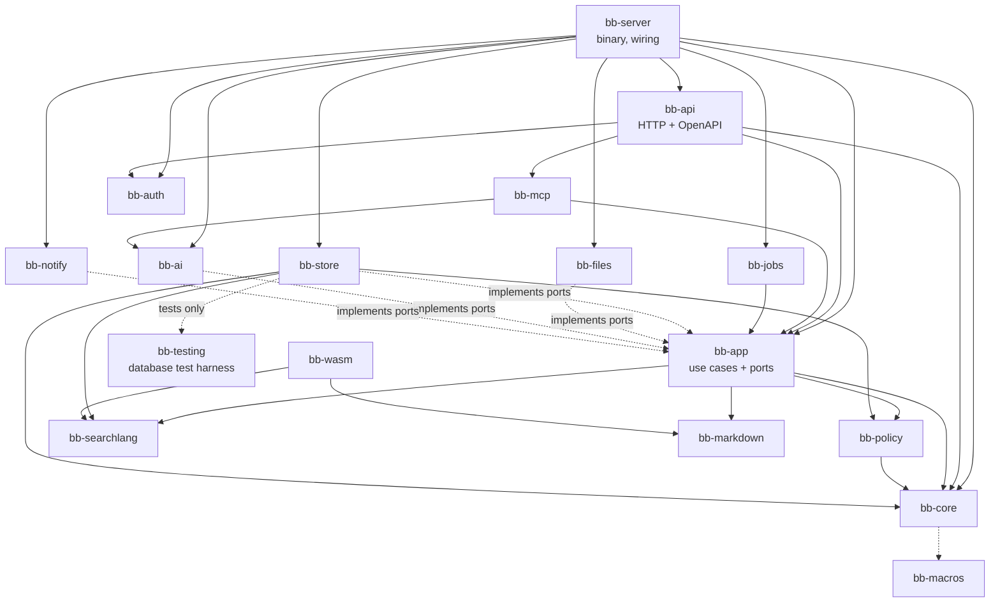

# Building blocks

## Repository layout

```text
bugaboo/
├── Cargo.toml              Rust workspace
├── crates/                 server code (Rust)
│   ├── bb-core/            domain types, IDs, error codes, domain events, field types — no I/O
│   ├── bb-macros/          derive macros (entities, personal-data marks, settings)
│   ├── bb-policy/          authorization engine, permission catalogue, Authorized<T>
│   ├── bb-searchlang/      search language: parse, print, check, suggest — no I/O, also WebAssembly
│   ├── bb-markdown/        Markdown → safe HTML, issue-number chips — no I/O, also WebAssembly
│   ├── bb-app/             use cases per feature (ports = traits for storage, files, mail, AI)
│   ├── bb-store/           database adapter: schema, migrations, repositories, search compiler
│   ├── bb-files/           file adapter: content-addressed storage, type checks, previews, scanning
│   ├── bb-auth/            passwords, passkeys, two-step codes, sessions, access keys, OIDC, OAuth 2.1
│   ├── bb-ai/              AI provider adapters, context builder, tool registry
│   ├── bb-mcp/             MCP server (uses the tool registry)
│   ├── bb-notify/          in-app, e-mail and webhook delivery
│   ├── bb-jobs/            background job runner and schedules
│   ├── bb-api/             HTTP: routes, OpenAPI, security headers, rate limits, static app
│   ├── bb-wasm/            WebAssembly bindings for searchlang, markdown, validation
│   ├── bb-testing/         test harness: runs one test body on SQLite and PostgreSQL (dev dependency only)
│   └── bb-server/          the `bugaboo` binary: CLI, setup wizard, service install, wiring
├── xtask/                  the single check/build runner (cargo xtask …)
├── tools/                  check catalogue, pinned tool versions, dev ports
├── design/tokens.json      design tokens — source of all colors, fonts, sizes
├── messages/en.json        message catalog — source of all user-facing text
├── web/                    browser app (TypeScript)
│   ├── app/                the React app: routes and feature folders
│   └── packages/
│       ├── api-client/     types generated from OpenAPI (never edited by hand) and the thin client on top
│       ├── ui/             shared components on React Aria + generated token CSS
│       ├── wasm/           generated bindings to bb-wasm
│       └── messages/       generated, typed message keys
├── docs/                   development docs (this)
└── userDocs/               user and admin docs
```

## Module map



### Dependency rules (checked by `cargo xtask check only ARCH-DEPS`)

1. `bb-core`, `bb-searchlang` and `bb-markdown` do no I/O and depend on no other Bugaboo crate except `bb-core` (searchlang and markdown not even that; `bb-core` uses `bb-macros` for derives at compile time only), so they compile to WebAssembly.
2. `bb-app` knows **ports** (traits) only. It never imports `bb-store`, `bb-files`, `bb-ai` or `bb-notify`. Tests run use cases against in-memory fakes.
3. Only `bb-policy` can create `Authorized<T>`. Its constructor is private to the crate.
4. Only `bb-api` and `bb-mcp` speak HTTP. Only `bb-server` wires adapters to ports (`cargo xtask check only ARCH-HTTP-EDGE`).
5. The browser app talks to the server only through `@bugaboo/api-client` (`cargo xtask check only ARCH-WEB-API`), and has no hand-written types for what the server sends (`LINT-API-TYPES`).

## The core modules

### bb-core

Newtype IDs (`IssueId`, `ProjectId`, …, all UUIDv7 inside, readable keys like `WEB-142` outside), field types and values, domain entities, **domain events**, and the **error code catalogue** (one Rust enum; becomes OpenAPI, the TypeScript union and message keys). Entities carry personal-data marks (ADR-0015). It also holds the **settings registry** (ADR-0018: every setting is declared once, in `settings/`), the **message keys** generated from `messages/en.json` as Rust constants and functions (UX-07), and the entity list behind the generated personal-data page `docs/privacy/personal-data.md`. The HTTP layer (`bb-api`) and the binary (`bb-server`) use `bb-core` directly for error codes and message text.

### bb-policy

- **Permission catalogue** (one Rust enum with plain-language descriptions as message keys).
- **Evaluation:** given an actor and a project, computes the effective permission set and the **field mask** (hidden / can see / can change per field, per issue type). Cached per request.
- **Visibility:** project tree, restricted issues, documents.
- **Search predicates:** turns the actor's visibility into query-builder expressions that `bb-store` adds to every query.
- **`Authorized<T>`:** the only way data leaves the domain. It carries the field mask, so projections drop hidden fields automatically.

### bb-searchlang

Lexer, parser, syntax tree, canonical printer, checker and suggestions. Knows nothing about databases or permissions: the caller passes a **field catalogue** (the fields this person may read), so a hidden field fails exactly like an unknown one. Simple search (filter buttons) edits the same syntax tree.

### bb-app — use cases by feature

`projects`, `issues`, `relations`, `fields`, `workflows`, `tags`, `releases`, `search`, `boards`, `timeline`, `calendar`, `relation_map`, `time` (timers, time entries, working hours, rules), `documents`, `attachments`, `notifications`, `assistant`, `privacy`, `settings`, `themes`, `people` (users, groups, roles), `admin`.

Every use case has the same shape:

```rust
pub async fn change_status(
    ctx: &Ctx,               // actor, request id, clock, ports
    cmd: ChangeStatus,       // validated input
) -> Result<Authorized<IssueView>, AppError>
```

1. Ask `bb-policy` whether the actor may do it.
2. Load, change and validate inside one transaction.
3. Append domain events (same transaction). A command use case writes only through the `ChangeStore` port (`record_change`), which `bb-store` implements; a use case whose input type ends in `Query` only reads. Enforced by: ARCH-EVENTS.
4. Return the result through `Authorized<T>`.

### bb-store

sqlx connection pools, migrations (defined once with the query builder, run on both databases), repositories implementing `bb-app` ports, the **search compiler** (syntax tree + permission predicates → SQL), full-text search adapters, the event log and outbox, the job queue tables, the security log (hash chain), stored secrets (envelope encryption) and setting values. It is the only crate that touches a database; it takes the time and the IDs from its caller and gets no clock of its own. Enforced by: ARCH-SQL-EDGE (no other crate may depend on a database library, and no SQL text is built with `format!`), DATA-MARKS (every table belongs to an entity with personal-data marks), ARCH-SETTINGS (setting values are read and written only in `settings.rs`).

`bb-app` also holds the real clock and secure random source (`context::SystemClock`, `context::SystemIds`), because `bb-core` does no I/O; `bb-server` passes them to the use cases and the store.

### bb-testing

Test-support crate, used only as a **dev dependency** (`[dev-dependencies]`) and never shipped (ARCH-DEPS fails on any other kind of dependency on it). `each_database` runs one async test body against every database named in `BB_TEST_DATABASES` (`sqlite`, `postgres`; default `sqlite`), each with a brand-new empty database that is removed afterwards (also when the test panics), hands the body a typed pool (`Pool::Sqlite` or `Pool::Postgres`), and records what ran for ARCH-DB-PARITY. It depends on no other Bugaboo crate. How it is wired to `cargo xtask db` and `cargo xtask ci` is in [testing](11-testing.md#database-tests).

### bb-api

axum router; extractors that turn a session cookie, access key or OAuth token into an **actor**; CSRF and origin checks; security headers and CSP; rate limits (`limits`); the one cookie module (`cookies`); `?fields=` projections; cursor pagination; ETags; problem+json errors (`errors`: `ApiError`, `ApiJson`); OpenAPI generation from the handlers' `#[utoipa::path]` descriptions (`openapi`, served at `/api/v1/openapi.json`, printed by `bugaboo openapi`, written to `web/packages/api-client/openapi.json` by `cargo xtask gen api`); the embedded static app.

### bb-ai and bb-mcp

One **tool registry** (search issues, get issue, create, change status, comment, log time, …). Each tool maps to a `bb-app` use case, so permissions and validation are identical. `bb-mcp` exposes the registry to outside AI apps; the assistant uses the same registry but returns **proposals** for writes instead of running them.

## Browser app (web/app)

```text
web/app/src/
├── routes/              TanStack Router file routes; URL search params are typed state
├── features/            issues, search, board, timeline, calendar, relation-map, documents,
│                        time, dashboards, notifications, assistant, settings, admin, setup
├── shared/              hooks, formatting (Intl), query keys
└── main.tsx
```

- **Server data** lives only in the TanStack Query cache, fetched through the generated client, keyed by generated query keys.
- **Forms** get their validation rules from the server's exported schema; the server still decides.
- **Components** come from `@bugaboo/ui`, built on React Aria Components; styles use token variables only.
- **Heavy features** (timeline, relation map, document editor, workflow editor, theme editor, WebAssembly) are split into separate chunks and loaded when first opened.
