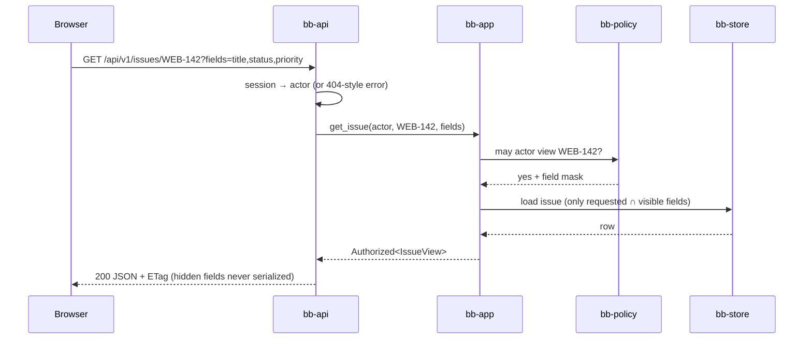
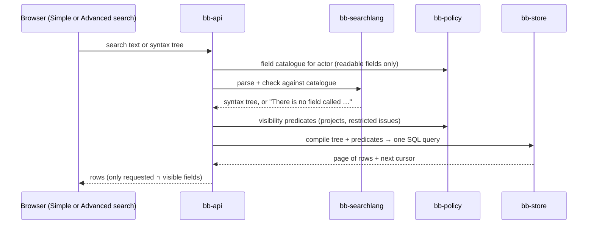
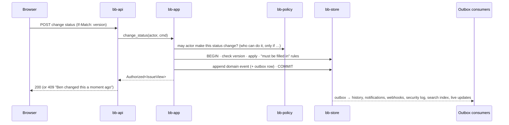
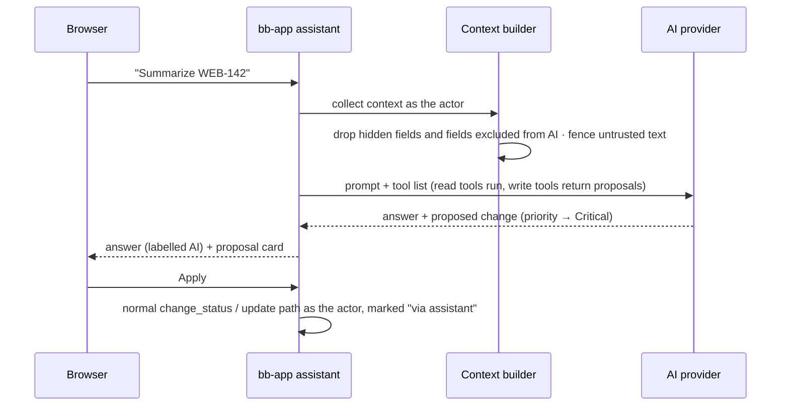

# Runtime

How the parts work together in the most important situations.

## Reading an issue



If the actor may not see the issue, the answer is the same "not found" as for an issue that doesn't exist (SEC-MATRIX).

## Searching



- Sorting, grouping and totals are only allowed on readable fields.
- Every query has a time limit, a page-size cap and a complexity limit.
- The browser runs the **same parser** (WebAssembly) for instant feedback; the server's answer is the one that counts.

## Changing something



- **Optimistic locking:** every entity has a version. A stale version gives the plain-language conflict message.
- **"Then automatically …"** actions run as part of the same use case, as the same actor.
- **Consumers** filter by the **receiver's** permissions before sending anything (e-mail, webhook, live update).

## The assistant proposes, the person decides



Outside AI apps (MCP) use the same tools through `bb-mcp`. Their token is the actor's identity narrowed by its scopes; write tools act directly only if the person granted write scope.

## Editing long text (edit locks, ADR-0019)

```mermaid
sequenceDiagram
  participant A as Ana's browser
  participant S as Server
  participant B as Ben's browser
  A->>S: first keystroke in Description → take lock
  S-->>A: lock token (60 s lease)
  loop every 15 s while editing
    A->>S: heartbeat (renews lease) + private draft
  end
  B->>S: open WEB-142
  S-->>B: "Ana is editing the description" (read-only for Ben)
  A->>S: save (text + lock token + base version)
  S-->>A: saved, new version → "Saved"
  S-->>S: lock released
  Note over A,S: If heartbeats stop (tab closed, network lost), the lease runs out and the lock frees itself.<br/>A save with an expired or taken-over token is refused; Ana's text stays as her draft with "Compare and save".
```

- **Short values** use only the version check (no lock).
- **Confirmed saves:** the browser shows changes at once as *Saving…*, then *Saved* when the server confirms, or a plain explanation (conflict, lock lost, offline) that keeps the person's text.
- **Watching open items:** every 30 s and on focus, the browser asks for the current versions of what's on screen; a newer version by someone else shows *"Ben changed this after you"*.

## Working hours

1. *Start work day* creates a work-day record for today (person, start time, time zone).
2. Breaks and the end are added the same way, or typed in later.
3. The **working-time rules** of the organization's preset are checked after every change. Broken rules become warnings stored with the day; nothing is blocked.
4. Changing a day in the past requires a reason. The event log keeps the old value; the person is notified if someone else changed it.
5. A daily job deletes work days older than the keep-and-delete rule allows.

## Removing a person (GDPR)

1. An admin chooses *Remove a person*. `bb-app::privacy` builds a **plan** from the personal-data marks: what will be deleted now, what will be anonymized, what must be kept by law and until when (DATA-MARKS; legal keep periods: review (compliance.md lists them)).
2. The admin confirms. A background job runs the plan in steps; each step is idempotent and logged.
3. The person's name becomes *Former user K7Q2* everywhere (a tombstone record replaces the user). Records under a legal hold are deleted by the normal deletion schedule.

## Live updates (built last)

The outbox feeds a small in-memory hub. Each open browser tab holds one Server-Sent Events connection and subscribes to what is on screen. Every event is checked against the subscriber's permissions, then sent as a small "this changed" note; the browser refetches only what it shows.
