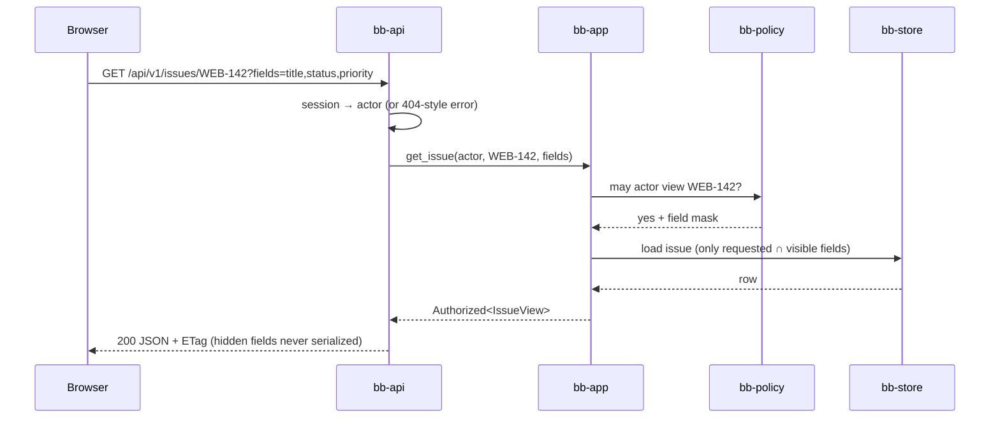
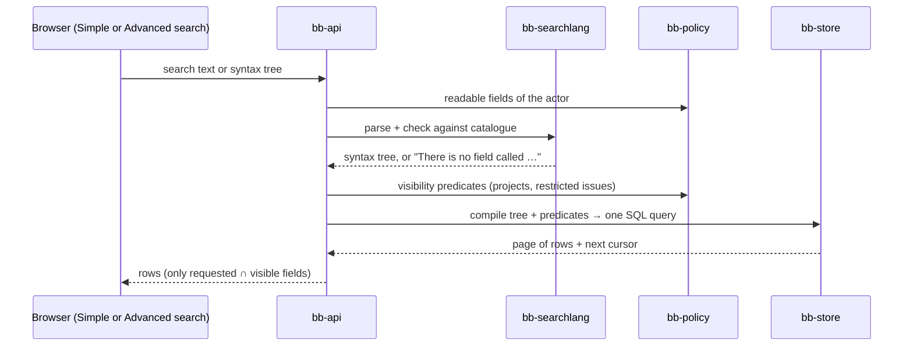
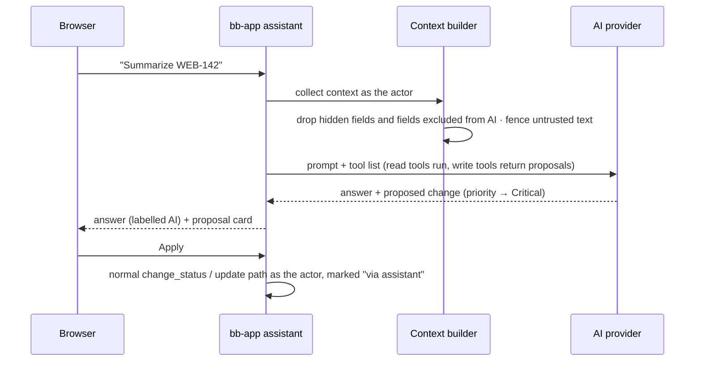

# Runtime

How the parts work together in the most important situations.

## Reading an issue



If the actor may not see the issue, the answer is the same "not found" as for an issue that doesn't exist (SEC-MATRIX).

## Searching



- Sorting, grouping and totals are only allowed on readable fields.
- Every query has a time limit, a page-size cap and a complexity limit.
- The browser runs the **same parser** (WebAssembly) for instant feedback; the server's answer is the one that counts.

## Changing something


- **Optimistic locking:** every entity has a version, and every change sends the version it read in its body (`version`, ARCH-VERSIONED). A stale version gives the plain-language conflict message and, with it, who changed the record, when, which fields and the values now (ADR-0019 amendment M3); the browser writes the sentence from them.
- **"Then automatically …"** actions run as part of the same use case, as the same actor.
- **Consumers** filter by the **receiver's** permissions before sending anything (e-mail, webhook, live update).

## The assistant proposes, the person decides



Outside AI apps (MCP) use the same tools through `bb-mcp`. Their token is the actor's identity narrowed by its scopes; write tools act directly only if the person granted write scope.

## Editing long text (edit locks, ADR-0019)

```mermaid
sequenceDiagram
  participant A as Ana's browser
  participant S as Server
  participant B as Ben's browser
  A->>S: first keystroke in Description → take lock (POST /edit-locks)
  S-->>A: lock token (60 s lease)
  loop every 15 s while editing
    A->>S: heartbeat (renews lease) + private draft; the answer carries the notes of others
  end
  B->>S: open WEB-142
  S-->>B: "Ana is editing the description" (read-only for Ben)
  A->>S: save (text + lock token + base version)
  S-->>A: saved, new version → "Saved"
  S-->>S: lock released
  Note over A,S: If heartbeats stop (tab closed, network lost), the lease runs out and the lock frees itself.<br/>A save with an expired or taken-over token is refused; Ana's text stays as her draft with "Compare and save".
```

- **Short values** use only the version check (no lock).
- **One mechanism for any record:** a lock and a draft are about one *part* of a record named by its kind and ID (`EntityRef`), so issues, comments and documents use the same routes (`/edit-locks`, `/drafts`). A kind of record says where it sits, which version it has and what a person needs to change it by implementing `EditableRecords`; the kinds `bb-app` keeps itself (project, issue, comment, layout, field, label, tag, …) are built in, and a program adds none of them: `EditableRecords` is for the kinds a later package brings. The lease and the heartbeat are the state of an open editor and write no domain event; *Edit anyway*, *Ask … to finish* and an administrator's release are facts others can learn from, so they are commands with an event, and the release is also in the security log. Expired lock rows are deleted when the next lock is taken; a draft is kept 30 days after its last change and deleted by the job `editing.purge-drafts` (and ignored when older). Enforced by: TEST-EDIT-LOCKS.
- **Notes at the next heartbeat:** *Ask … to finish* and *Edit anyway* leave a note for the person who was editing; the heartbeat hands it over once. The heartbeat keeps the text so far as the person's draft also when the lock is gone, and a refused save keeps its text as the draft: nothing typed is dropped. Enforced by: TEST-EDIT-LOCKS.
- **Saving long text** goes through `Ctx::save_text`: inside the change that writes the record it checks the lock token, runs the write (which checks the version) and lets go of the lock and the draft; a refusal is `edit.lock-lost`, `edit.taken-over` or the structured `edit.version-changed`. Enforced by: ARCH-VERSIONED, TEST-EDIT-LOCKS.
- **Confirmed saves:** the browser shows changes at once as *Saving…*, then *Saved* when the server confirms, or a plain explanation (conflict, lock lost, offline) that keeps the person's text.
- **Checking versions:** every 30 s and on focus, the browser asks (`POST /versions/check`, up to 50 records) for the current versions of what's on screen; a newer version by someone else shows *"Ben changed this after you"*.

## Working hours

The decisions are [ADR-0035](../adr/0035-time-on-issues-and-working-hours.md), decisions 5 to 8; this is how a work day moves through the server (`bb-app::working_hours`, the rules in `bb_core::working_time`).

1. *Start work day* creates a work-day record for the person's day of now (the person, the start, the time zone of the person), or reopens that day with a new period when it was ended already (ADR-0035, decision 5). If the person's last work day was never ended, the browser first asks when it ended, and that answer is a change of a past day (step 4) before the new day starts.
2. *Start break*, *End break* and *End work day* add to the same record; the timesheet's *Work day* rows take the same values typed later. Every change is a command with a version and an event (ARCH-VERSIONED, ARCH-EVENTS).
3. In the same change, the **working-time rules** of the organization (the numbers of its preset, from the settings registry) are checked for the day and the days next to it. Broken rules become warnings stored with the day; nothing is blocked.
4. A change that asks for a **reason** (ADR-0035, decision 7) carries it; the event keeps the old values and the reason, and when the person who changes it is not the person of the day, the notifications reader tells that person (ADR-0033).
5. The page *Working hours of others* reads another person's days only for a holder of *See working hours of others*, as *Totals only* allows (ADR-0035, decision 8); a change there needs *Change working hours of others* and goes through steps 2 to 4.
6. Nothing deletes a work day by itself. After the keep period an administrator deletes old work days from the settings page, with their breaks and the events of their changes (ADR-0035, decision 7).

## Removing a person (GDPR)

1. An admin chooses *Remove a person*. `bb-app::privacy` builds a **plan** from the personal-data marks: what will be deleted now, what will be anonymized, what must be kept by law and until when (DATA-MARKS; legal keep periods: review (compliance.md lists them)).
2. The admin confirms. A background job runs the plan in steps; each step is idempotent and logged.
3. The person's name becomes *Former user K7Q2* everywhere (a tombstone record replaces the user). Records under a legal hold are deleted by the normal deletion schedule.

## Live updates (built last)

The outbox feeds a small in-memory hub. Each open browser tab holds one Server-Sent Events connection and subscribes to what is on screen. Every event is checked against the subscriber's permissions, then sent as a small "this changed" note; the browser refetches only what it shows.
