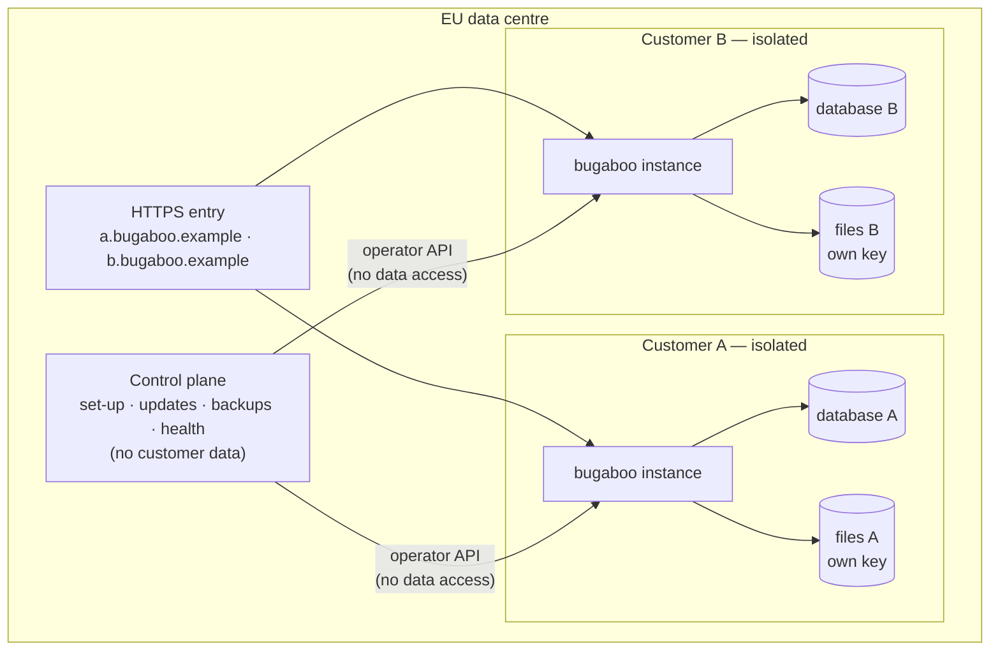
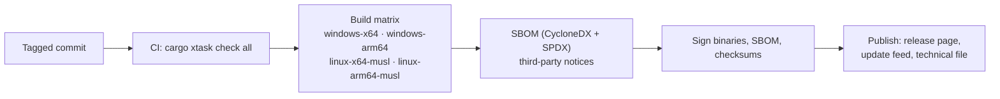

# Deployment

The same binary runs in both models (DIST-01).

## Sold: the customer runs it (self-hosted)


- **Install:** download, `bugaboo setup` (data folder, port, HTTPS), `bugaboo service install`, then the browser setup with the setup code.
- **Start-up settings** (address, port, data folder, certificates, database URL) live in `bugaboo.toml` or environment variables. Everything else is in the database and changed in the UI.
- **HTTPS (SEC-10):** built-in TLS (rustls with the `ring` provider) with a generated certificate, a provided certificate, or ACME (V1). Plain HTTP is allowed only on this computer (`127.0.0.1`, `::1`) or behind explicitly named proxies. Enforced by: the start-up settings check (tests `sec_10_…` in `crates/bb-server`) and SEC-HEADERS for HSTS.
- **Master key:** generated on first start, stored outside the database, readable only by the service account. It encrypts stored secrets and backups.
- **Upgrades:** replace the binary; on start, Bugaboo makes a backup, then runs migrations. If a migration fails, it restores the backup and stops with a plain explanation of how to go back to the previous version.
- **Also offered:** container image (non-root, read-only file system except the data volume), winget/MSI, .deb/.rpm.

### Start-up settings (OPS-10)

Read when the server starts, strongest first: command line, environment variable, `bugaboo.toml`, built-in default. Each setting has the same name everywhere; its variable is `BUGABOO_` plus the name in capitals. Wrong values stop the start with a plain sentence (messages `config.*`).

| Setting | Meaning | Default |
|---------|---------|---------|
| `address` | IP address to listen on | `127.0.0.1` |
| `port` | Port to listen on | none; the start stops without one (ADR-0023) |
| `data_dir` | The data folder | `bugaboo-data` |
| `database_url` | `sqlite:…` or `postgres://…`; empty means the built-in SQLite file in the data folder | empty |
| `tls_mode` | `self-signed`, `files` or `off` | `self-signed` |
| `tls_cert`, `tls_key` | Certificate chain and private key (PEM), with `tls_mode = "files"` | none |
| `tls_names` | Extra host names or addresses for the generated certificate | none |
| `trusted_proxies` | Addresses of proxies that add HTTPS; with `tls_mode = "off"` only they may connect | none |
| `log_level` | `error`, `warn`, `info` or `debug` | `info` |

`tls_mode = "off"` on an address that is not this computer is refused unless `trusted_proxies` is set. The settings file can be named with `--config` or `BUGABOO_CONFIG`; relative paths inside it are relative to the file.

### Data folder

```text
bugaboo.db   the built-in database (made by the store)
files/       attachments
keys/        the master key and other secrets
backups/     backups
tls/         the generated certificate and its key
```

Folders that Bugaboo creates are readable by their owner only: mode `0700` on Linux, and on Windows an access list that grants only the account running Bugaboo. Key and certificate files are written with mode `0600` on Linux. A self-signed certificate is valid for one year and renewed when less than 30 days are left at start-up, or when `tls_names` changes. Enforced by: tests `sec_16_…` and `sec_10_…`.

### One file per system (OPS-01, DIST-01)

`cargo xtask build` builds the browser app and then the release program with the browser app inside (`rust-embed`); `--target` builds for another system. Windows x64 is built on the development PC. Static Linux programs (`x86_64-unknown-linux-musl`, `aarch64-unknown-linux-musl`) are built by `cargo xtask ci` on Linux machines, which the CI workflow runs once the repository is on GitHub. Windows ARM64 waits for the MSVC ARM64 tools (follow-up M1-F01). The program has no edition or model switch: differences between self-hosted and hosted come from the settings above only.

## Served: we run it (hosted by Bugaboo)



- **One isolated instance per customer:** own process/container, own PostgreSQL database, own file bucket with its own encryption key, own web address. No database or file store is shared between customers (DIST-02).
- **Control plane** is a separate service: it creates instances, rolls out updates, runs and checks backups, and watches health. It has an **operator API** on each instance that can do maintenance but cannot read customer data.
- **Emergency access** (DIST-03): an operator requests access; the customer's administrator approves in their own Bugaboo; access is time-limited and every action appears in the customer's security log.
- **Data location:** EU only; the sub-processor list and data-location statement come from the control plane's configuration (DIST-05).
- **Switching:** a customer can export everything and import it into a self-hosted installation, and the other way round (DIST-06).

## Releases



- Every release has: binaries, checksums, signatures, SBOM, third-party notices, release notes, known issues, and its **support period** (COMP).
- Security fixes can ship as patch releases on supported versions.
- The served model receives the same signed release; the control plane verifies the signature before rollout.
