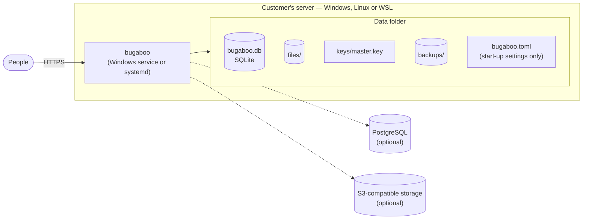
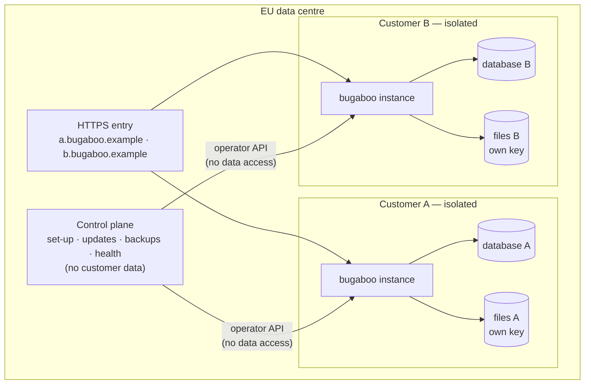
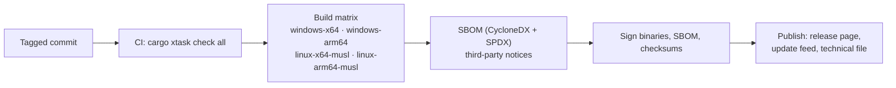

# Deployment

The same binary runs in both models (DIST-01).

## Sold: the customer runs it (self-hosted)



- **Install:** download, `bugaboo setup` (data folder, port, HTTPS), `bugaboo service install`, then the browser setup with the setup code. User pages: `userDocs/install/`.
- **Start-up settings** (address, port, data folder, certificates, database URL) live in `bugaboo.toml` or environment variables. Everything else is in the database and changed in the UI.
- **HTTPS (SEC-10):** built-in TLS (rustls with the `ring` provider) with a generated certificate, a provided certificate, or ACME (V1). Plain HTTP is allowed only on this computer (`127.0.0.1`, `::1`) or behind explicitly named proxies. Enforced by: the start-up settings check (tests `sec_10_…` in `crates/bb-server`) and SEC-HEADERS for HSTS.
- **Master key:** generated on first start, stored outside the database, readable only by the service account. It encrypts stored secrets and backups.
- **Upgrades:** replace the binary; on start, Bugaboo makes a backup, then runs migrations. If a migration fails, it restores the backup and stops with a plain explanation of how to go back to the previous version.
- **Also offered:** container image (non-root, read-only file system except the data volume), winget/MSI, .deb/.rpm.

### Start-up settings (OPS-10)

Read when the server starts, strongest first: command line, environment variable, `bugaboo.toml`, built-in default. Each setting has the same name everywhere; its variable is `BUGABOO_` plus the name in capitals. Wrong values stop the start with a plain sentence (messages `config.*`).

| Setting | Meaning | Default |
|---------|---------|---------|
| `address` | IP address to listen on | `127.0.0.1` |
| `port` | Port to listen on | none; the start stops without one (ADR-0023) |
| `data_dir` | The data folder | `bugaboo-data` next to the program |
| `database_url` | `sqlite:…` or `postgres://…`; empty means the built-in SQLite file in the data folder | empty |
| `tls_mode` | `self-signed`, `files` or `off` | `self-signed` |
| `tls_cert`, `tls_key` | Certificate chain and private key (PEM), with `tls_mode = "files"` | none |
| `tls_names` | Extra host names or addresses for the generated certificate | none |
| `trusted_proxies` | Addresses of proxies that add HTTPS; with `tls_mode = "off"` only they may connect | none |
| `log_level` | `error`, `warn`, `info` or `debug` | `info` |
| `max_connections` | Most connections open at once | `1024` |
| `header_timeout_seconds` | Time allowed for a client to send the headers of a request | `30` |
| `rate_limit_per_minute` | API requests one client network may make per minute | `600` |
| `sign_in_attempts_per_minute` | Sign-in attempts per minute, for one client network and for one account | `10` |

`tls_mode = "off"` on an address that is not this computer is refused unless `trusted_proxies` is set. The settings file can be named with `--config` or `BUGABOO_CONFIG`; without a name `bugaboo.toml` next to the program is read if it exists. Defaults are relative to the program's folder, not the current folder (a Windows service starts in `System32`); relative paths inside the file are relative to the file. With `tls_mode = "files"` on Linux, a key file that group or others can read is reported as a warning. Enforced by: review (the tests `ops_10_…` and `sec_10_…` in `crates/bb-server` cover it; no catalogue check yet).

### Commands (OPS-03)

| Command | What it does |
|---------|--------------|
| `bugaboo serve` | Runs the server. The setup code of a fresh installation is printed to the console, or written to `setup-code.txt` in the data folder when the output is not a terminal. |
| `bugaboo setup` | Asks for the data folder, address, port (suggestion 8443, checked to be free), HTTPS, public address and database, checks the answers with the same code that reads the settings at start, and writes `bugaboo.toml`. `--non-interactive` asks nothing; `--overwrite` replaces an existing file. |
| `bugaboo service install` / `uninstall` | Windows: a service named `Bugaboo` that runs as the virtual account `NT SERVICE\Bugaboo` (no password), started with the computer, stopping on the service manager's stop and shutdown messages. Linux (systemd, also WSL 2 with systemd): the user `bugaboo` (no password, no shell, no home folder), `/etc/systemd/system/bugaboo.service` that runs `serve --config <the settings file in place>`; the settings file keeps its place and becomes `root:bugaboo`, mode `640`; the unit may write only to the data folder. Installing takes over only what Bugaboo made (the data folder itself, its known files and its own sub-folders, never `chown -R` over the folder as a whole) and refuses a folder that is not empty and has no `keys/` folder, on Windows too. Both need administrator rights and keep the data when removed. The steps of the Linux install are a list that is built first and run second, so tests check it without root. |
| `bugaboo security-log verify` | Checks the security log chain, the checkpoint and the anchor file, and prints the head (place and hash). A log with entries and no anchor is reported as a warning. |
| `bugaboo rotate-key` | Makes a new master key and re-encrypts the stored secrets with it. |
| `bugaboo keys export <folder>` | Copies the key files to a folder that only its owner can open (Linux: others who can open it make the command refuse). Each copy is a new file, made private before the key goes in (mode `0600`, or on Windows an access list for the owner and the administrators); a copy that exists is never replaced, and a run that meets one removes what it made. |

`security-log verify`, `rotate-key` and `keys export` refuse to run, with the command to use instead, when the account that runs them is not the owner of the data folder (Linux, found from the owner of `/proc/self`) or cannot read and change the files in `keys/`: a run from the wrong account would leave files that the service cannot read. On Windows the account of a service has no password, so there is no tested way yet to start the command as it (follow-up M1-F57).

The service installers are covered by tests of the plan and the texts only: starting a real service needs administrator rights and a service manager that the test machines do not give (follow-up M1-F57).

### Data folder

```text
bugaboo.db   the built-in database (made by the store)
files/       attachments
keys/        the master key and other secrets
backups/     backups
tls/         the generated certificate and its key
setup-code.txt   the setup code of a server without a console (dead once an account exists; deleted at the next start)
```

Folders that Bugaboo creates are readable by their owner only: mode `0700` on Linux, and on Windows an access list that grants only the account running Bugaboo. Key and certificate files are written with mode `0600` on Linux. `keys/` and `tls/` are checked on **every start** and made private again if someone loosened them (Windows: the access list is reset to the running account, found by its SID, not its name). Certificate and key are written as new files and renamed into place (key first, certificate second), and a key that does not belong to the certificate is replaced. A self-signed certificate is valid for one year and renewed when less than 30 days are left at start-up, or when `tls_names` changes. Enforced by: tests `sec_16_…` and `sec_10_…`.

### One file per system (OPS-01, DIST-01)

`cargo xtask build` builds the browser app and then the release program with the browser app inside (`rust-embed`); `--target` builds for another system. Windows x64 is built on the development PC. Static Linux programs (`x86_64-unknown-linux-musl`, `aarch64-unknown-linux-musl`) are built by `cargo xtask ci` on Linux machines, which the CI workflow runs once the repository is on GitHub. Windows ARM64 waits for the MSVC ARM64 tools (follow-up M1-F01). The program has no edition or model switch: differences between self-hosted and hosted come from the settings above only.

## Served: we run it (hosted by Bugaboo)



- **One isolated instance per customer:** own process/container, own PostgreSQL database, own file bucket with its own encryption key, own web address. No database or file store is shared between customers (DIST-02).
- **Control plane** is a separate service: it creates instances, rolls out updates, runs and checks backups, and watches health. It has an **operator API** on each instance that can do maintenance but cannot read customer data.
- **Emergency access** (DIST-03): an operator requests access; the customer's administrator approves in their own Bugaboo; access is time-limited and every action appears in the customer's security log.
- **Data location:** EU only; the sub-processor list and data-location statement come from the control plane's configuration (DIST-05).
- **Switching:** a customer can export everything and import it into a self-hosted installation, and the other way round (DIST-06).

## Releases



- Every release has: binaries, checksums, signatures, SBOM, third-party notices, release notes, known issues, and its **support period** (COMP).
- Security fixes can ship as patch releases on supported versions.
- The served model receives the same signed release; the control plane verifies the signature before rollout.
