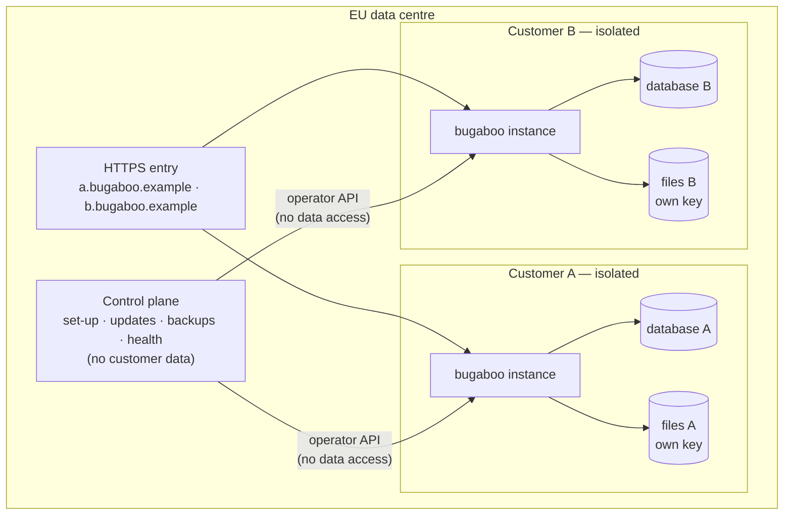
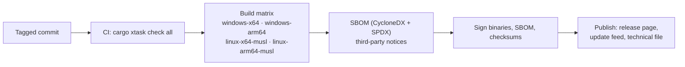

# Deployment

The same binary runs in both models (DIST-01).

## Sold: the customer runs it (self-hosted)

- **Install:** download, `bugaboo setup` (data folder, port, HTTPS), `bugaboo service install`, then the browser setup with the setup code.
- **Start-up settings** (address, port, data folder, certificates, database URL) live in `bugaboo.toml` or environment variables. Everything else is in the database and changed in the UI.
- **HTTPS:** built-in TLS with a generated certificate, a provided certificate, or ACME. Plain HTTP only on localhost or behind an explicitly trusted proxy.
- **Master key:** generated on first start, stored outside the database, readable only by the service account. It encrypts stored secrets and backups.
- **Upgrades:** replace the binary; on start, Bugaboo makes a backup, then runs migrations. If a migration fails, it restores the backup and stops with a plain explanation of how to go back to the previous version.
- **Also offered:** container image (non-root, read-only file system except the data volume), winget/MSI, .deb/.rpm.

## Served: we run it (hosted by Bugaboo)

- **One isolated instance per customer:** own process/container, own PostgreSQL database, own file bucket with its own encryption key, own web address. No database or file store is shared between customers (DIST-02).
- **Control plane** is a separate service: it creates instances, rolls out updates, runs and checks backups, and watches health. It has an **operator API** on each instance that can do maintenance but cannot read customer data.
- **Emergency access** (DIST-03): an operator requests access; the customer's administrator approves in their own Bugaboo; access is time-limited and every action appears in the customer's security log.
- **Data location:** EU only; the sub-processor list and data-location statement come from the control plane's configuration (DIST-05).
- **Switching:** a customer can export everything and import it into a self-hosted installation, and the other way round (DIST-06).

## Releases

- Every release has: binaries, checksums, signatures, SBOM, third-party notices, release notes, known issues, and its **support period** (COMP).
- Security fixes can ship as patch releases on supported versions.
- The served model receives the same signed release; the control plane verifies the signature before rollout.
