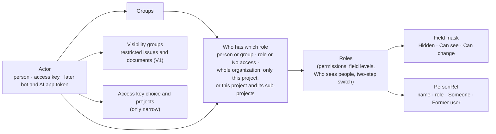

# Cross-cutting concepts

## Security

### Sign-in and sessions

- **Passwords:** Argon2id (OWASP parameters: 19 MiB memory, 2 iterations, 1 lane), checked against a bundled list of breached passwords (a plain sorted list searched on this computer, so no network call is made; it is not a k-anonymity range file, M1-F48). A wrong password and an unknown e-mail get the same answer and the same timing.
- **Passkeys:** WebAuthn (`webauthn-rs`), as a second step or on their own. **Two-step codes:** TOTP with backup codes (stored hashed).
- **Company sign-in:** OIDC with PKCE; group claims map to Bugaboo groups.
- **Sessions:** random 256-bit secrets, stored as a hash (SHA-256 with its own domain, so the hash of a session secret is never taken for one of an invitation); cookie `__Host-bb_session` (Secure, HttpOnly, SameSite=Lax) that lives as long as a session may (the setting `security.session-absolute-hours`, default 24 hours). A session is *pending* after the password when the person has a second step (it can do nothing but finish it, for at most five minutes) and *active* after. **A person who needs a second step and has none** (the organization asks it of everybody with `security.two-step-required`, or any role they hold anywhere, through their own rows or a group's, has the switch of ADR-0025, decision 7) can only set one up: the question is asked at every request, so it counts from the next request, also in a session that was open before; every use case that is not part of setting up a code app or a passkey answers `auth.second_step_required` (403), `GET /auth/me` answers that the setup is required with no permission, and the next request after the code app is confirmed or the passkey is added is an ordinary one. Enforced by: the tests `auth_03_*` in `crates/bb-server/src/tests/sign_in/second_step_by_role.rs` and `bb-store`. **A `401` for a session that has ended** (the cookie belongs to no session, or it ran out) also makes the browser forget both cookies and what it cached (`Clear-Site-Data: "cache"`, M2-F06); a session that is only waiting for its second step is not ended and is left alone. Enforced by: the tests `m2_f06_*` in `crates/bb-server/src/tests/sign_in/session_ended.rs`. **A new secret is made at sign-in, when the second step is done, and when the password is changed** (which also ends all other sessions), so a secret that was known earlier opens nothing. A session ends after the idle time (`security.session-idle-minutes`, default 30) or the absolute time; a session is marked as used at most once a minute; sessions nobody can use are removed inside every sign-in. Signing in from a browser that still has the cookie of an old session ends that old session, and a password alone shows nothing about the person (no name, address or administrator flag) until the second step is done. The two times are bounded settings (idle 5 minutes to 24 hours, absolute 1 hour to 30 days): a value outside is refused when it is stored and cut to the bounds when it is read. *Where you're signed in* lists the sessions (browser and system names, never the `User-Agent` text, and the shortened network) and ends any of them or all of them. The list holds at most 50 sessions and says when it was cut (`truncated`). Enforced by: the tests `sec_12_*` in `crates/bb-server/src/tests/sign_in/sessions.rs` (sign-out, list, end, end everywhere, idle and absolute timeouts, new secrets, password change, the old session of the browser), `perf_02_the_list_of_sessions_has_a_cap_and_says_when_it_cut`, `sec_12_a_password_alone_shows_nothing_about_the_person_until_the_second_step_is_done`, `auth_01_the_session_times_have_bounds_and_values_are_cut_to_them` in `bb-core`, and `sec_12_only_sessions_nobody_can_use_are_purged` in `bb-store`.
- **How signing in is built:** the mechanisms (passwords, tokens, CSRF token, TOTP, passkeys) are in `bb-auth` and do no I/O. The use cases are `async fn`s in `bb-app::auth`; each takes the context `Ctx` (store, clock, hasher, passkeys, CSRF key, limit on failed tries, client network and browser) and an input type, depends on storage only through the port `AuthStore`, and writes only through `ChangeStore::record_change`, so every change comes with its event and is undone together with it. A check inside a change (a code used twice, an invitation taken first) stops the change with `AuthStore::aborted`, which rolls back everything including the event. Adding a way to sign in (the code app, a passkey) asks for the password again, so a stolen session cannot add one. Waiting passkey challenges have a pool for each kind of ceremony (adding, second step, anonymous sign-in) and a cap for each network, so anonymous sign-in starts cannot keep the second step or an addition from starting. `AuthApi` lists the use cases once, with the store erased, so `bb-api` holds `Arc<dyn AuthApi>` and never names an adapter. `bb-store` implements the port (`AuthStorage`; tables from migration 2, every column with its personal-data mark), `bb-api` has the routes below `/api/v1/auth` (`src/api/auth*.rs`), and `bb-server/src/wiring.rs` builds it all at start. Enforced by: ARCH-DEPS, ARCH-EVENTS, ARCH-HTTP-EDGE, DATA-MARKS, and the flow tests in `crates/bb-server/src/tests/sign_in/`, which run every flow on both databases.
- **Setting up the first administrator (AUTH-09):** at every start the server makes a new setup code when no administrator exists and prints it to the console only (never to the log file); only its hash is stored, and a new start replaces it. The code works once: it is used up in the same change that makes the administrator, setup is closed for good afterwards, and wrong codes count against the limit on failed tries. Enforced by: the tests `auth_09_*` in `crates/bb-server/src/tests/sign_in/setup_and_password.rs`.
- **The public address:** the start-up setting `public_url` is the origin people type in the browser. Passkeys are tied to its host name; a server that listens on this computer only uses `localhost` and its port when the setting is missing, any other address needs the setting, a server behind trusted proxies needs it too (people reach it through the address of the proxy), and an address without a host name (an IP address) turns passkeys off. Enforced by: the tests `auth_02_*` in `crates/bb-server/src/config.rs` and `auth_02_without_a_host_name_in_the_public_address_passkeys_are_off`.
- **CSRF:** three layers. (1) SameSite cookies. (2) An **origin check**, already in the API: every request below `/api` that is not GET, HEAD or OPTIONS must carry an `Origin` equal to the server's own origin or, when the browser sent no `Origin`, `Sec-Fetch-Site: same-origin`. The own origin is the scheme plus the authority the browser asked for: the authority of the request address when there is one (HTTP/2 has no `Host` header), else `Host`; the scheme is `https` when the connection is TLS or when a trusted proxy says so (`X-Forwarded-Proto`, same trust rule as the client address: only from a listed proxy, only the last entry), else `http`; with neither the request is refused (fail closed) with the error `request.wrong_origin` (403, problem+json). Enforced by: the tests `sec_06_*` in `crates/bb-api` (cross-site, `null`, missing headers, same-origin, scheme, authority without `Host`) and the TLS + HTTP/2 test `sec_06_over_tls_and_http2_the_origin_check_uses_the_authority_and_the_scheme`. (3) A **session-bound token**: the value is derived on the server from the session (an HMAC of the session ID with a CSRF key), delivered in the page-readable cookie `__Host-bb_csrf` at sign-in and renewed with every new session ID; the server compares the `x-csrf-token` header with the value derived for the request's session in constant time, and refuses unsafe methods without a valid token with problem+json. The generated client reads the cookie and sends the header on every change. Layer 3 is the middleware `csrf_check` in `crates/bb-api/src/api/auth.rs` and covers every change below `/api` (a route added later is protected without anyone remembering): a change without a session cookie is answered with `auth.not_signed_in` (401), one with a session cookie and without the right token with `request.wrong_token` (403). Only the routes of people who have no session yet are left out: the routes that are `public` and change something in the route table `permissions::ROUTES` (setup, sign-in, sign-up, passkey sign-in, the invitation link; `permissions::csrf_exempt` reads them from the table, so there is no second list); they carry no secret a forged request could use and the origin check protects them. A request that comes with an access key (`Authorization: Bearer bb_...`) and no session cookie is left out of layers 2 and 3 as well: it has no cookie for a forged request to ride on, and a page of another website cannot send that header (there is no CORS; `sec_06_a_page_of_another_website_cannot_send_a_key`); with a session cookie a request is judged as a browser's, key or not. Enforced by: SEC-COOKIES (the cookie table) and the tests `sec_12_a_change_needs_the_token_of_its_own_session`, `sec_12_every_route_that_changes_something_checks_the_token_except_signing_in_and_up` (goes through every route of the API description) and `sec_12_every_session_has_its_own_secret_and_its_own_csrf_token`, and the TLS + HTTP/2 test `sec_12_over_tls_and_http2_a_person_sets_up_signs_out_and_signs_in_again`.
- **Cookies:** only strictly necessary ones (the session and the CSRF token), so no consent banner is needed (COMP-13, PRIV-01). One module, `crates/bb-api/src/cookies.rs`, holds the table and is the only code that sets a cookie. Every name starts with `__Host-`, so browsers insist on `Secure`, `Path=/` and no `Domain`; the module adds `HttpOnly` where script has no business reading the cookie. `cargo xtask gen api` writes the list "Cookies we use" to `userDocs/cookies.md` from the same table. Enforced by: SEC-COOKIES (reads the table; finds `Set-Cookie`, cookie libraries and `document.cookie` writes anywhere else).
- **Access keys** (scripts, apps; AUTH-07): `bb_` + a public prefix of 8 symbols + `_` + a 256-bit secret in 52 symbols of the alphabet of codes (`bb-auth`, `access_key.rs`); only the hash of the secret is stored (SHA-256 in its own domain, found by the hash, so an unknown key and a wrong secret are the same lookup); the key is shown once, in an answer marked as a secret (never stored, never compressed). Making a key asks for the password again (a stolen session cannot make a key that outlives it); every key runs out (90 days unless the person picks another date, never later than the organization's longest time: the settings `auth.access-key-default-days` and `auth.access-key-longest-days`, at most 365); the last use is kept to the minute. A script sends `Authorization: Bearer bb_…`; the use case takes the key where it takes a session (`Ctx::actor`), and the actor is the **owner with the key's narrowing**: at every request the owner's evaluation is narrowed by the key's choice and projects (`Ctx::evaluation_of`, which `Ctx::require` uses), so a key never holds more than its owner and follows the owner losing a role at once. An expired, a deleted, an unknown and a malformed key get the same answer (`auth.not_signed_in`); guessing is limited per network like failed passwords: the key is looked up first and only a lookup that fails reserves a try of the network (`reserve_network`), so a key that works never touches the counter and is never turned away by it, while a guess from a network over its limit is answered with 429. A key follows its owner's two-step requirement: while the owner is asked for a second step it is refused with `auth.second_step_required` (M2-F46). A key is judged before the body or the address of the request is read on the routes of the person's own sign-in data (`require_session`), so a key gets the same answer whatever it sent; the public prefix of a key as presented has to be the stored one, a clash of two public prefixes is retried once with a new secret, and a key that was used this minute writes nothing. A key that keeps *See status* reads `GET /api/v1/admin/status` (`see_server_status`, through the actor path; `/auth/me` stays session only). **No key holds a permission of `NOT_FOR_KEYS`** (*Invite people*, *Manage people*, *Manage groups*, *Manage roles*, *Decide who has which role*, *Decide what roles see*, *Change organization settings*): narrowing removes them whatever the choice, so inviting people, changing roles and changing the settings of the organization stay in the app (every use case that judges a permission goes through the actor, so the settings of WP-07 are covered as soon as they evaluate through it) (`bb-policy`, `catalogue.rs`, decision). **Sign out everywhere deletes the person's keys** (each one logged); a password change leaves them. **No key reaches the owner's own sign-in data** (password, second step, passkeys, sessions, keys): those use cases start at `Ctx::active`/`Ctx::session`, which turn a key away with `auth.access_key_not_allowed` and write it into the security log, so a route cannot forget it. A request that comes with a key and no session cookie needs no `Origin` and no CSRF token (there is no cookie for a forged request to ride on, and a page of another website cannot send the header: no CORS), is counted against the key as well as the network (`access_key_requests_per_minute`, default 300, per key), and its changes are recorded with the channel *API*. Making a key, deleting a key and a key that is turned away are in the security log (`access_key.made`, `access_key.deleted`, `access_key.refused`: the person and the key by ID; a refused key names nobody and shows the shortened network only, never the secret or the prefix). The routes of a person's own keys are `/api/v1/access-keys` (list, make, delete), `/access-keys/rules` (the default and the longest time, the single permissions with their topics) and `/access-keys/projects` (the projects the person may know, by short name, a page at a time); they declare `own-account` and take a session only. The form of *My settings › Access keys* (`web/app/src/features/my-settings/access-keys`) is made from them, and a person whose session must set up a second step is taken to the screen *Set up your second step* (`features/sign-in`). Enforced by: the tests `auth_07_*`, `sec_14_*` and `sec_15_*` in `crates/bb-server/src/tests/sign_in/access_keys.rs` and `access_keys_http.rs`, the Playwright tests `auth_07_*` and `auth_03_*` (`web/app/e2e/access-keys.spec.ts`, `second-step-required.spec.ts`, and the accessibility suite), the property test `auth_07_a_key_can_do_only_what_its_owner_can_and_its_scopes_allow` in `bb-app`, and SEC-SECRETS (the rule `bugaboo-access-key` of `.gitleaks.toml`).
- **MCP:** OAuth 2.1 authorization server inside Bugaboo (authorization code + PKCE, dynamic client registration with an admin allow list), short-lived access tokens, refresh token rotation, consent screen per app.

### Browser protections

- **Content Security Policy:** `default-src 'self'`; scripts and styles only from our own origin, no inline code, no `eval`; `frame-ancestors 'none'`; `require-trusted-types-for 'script'`; images from our origin and `data:` only (outside images only if an admin allows the host).
- **Other headers:** HSTS, `X-Content-Type-Options: nosniff`, COOP/CORP, a tight Permissions-Policy, `Referrer-Policy: same-origin`.
- **One header layer** wraps the whole router, so pages, files, API answers, errors and 404s carry the same set. Enforced by: SEC-HEADERS (the check holds the one header table in `headers.rs` against the requirement: every required header is set, the policy lets no injected or foreign code run) and the integration tests, which read the table and assert the full set on a page, an asset, an API error and a 404.
- **HSTS** is sent only when browsers reach us over HTTPS (here, or at a trusted proxy), and **never with `includeSubDomains`** (Bugaboo does not own the other names of its host). Lifetime: **one day** with a certificate Bugaboo made itself, so a person who trusts that certificate on `localhost` does not pin every other local tool to HTTPS; **one year** with a provided certificate or behind a trusted proxy. Enforced by: SEC-HEADERS (no `includeSubDomains`) and the tests `sec_11_hsts_…`.
- **Compression** (decision M2-Q2): Brotli or gzip, as the browser asks, for the text files of the app (from 256 bytes) and for JSON answers (`application/json`, `application/problem+json`) bigger than 1 KiB (`JSON_COMPRESS_ABOVE_BYTES` in `bb-api` `router.rs`, the one definition). **Never for an answer that hands out a secret**, whatever its size: a compressed answer that mixes a secret with text an attacker chooses can leak the secret (BREACH). The secret answers are the ones the cache rules mark (*Performance*, *Cache rules in one place*: a field marked `x-secret`, or any answer that sets a cookie), and the compression skips every answer that carries that mark or a `Set-Cookie` header, so a route added later is covered by declaring its answer in the route table. Any other type that is not text (images, fonts, archives, other kinds of JSON) is left as it is. Enforced by: the tests `sec_11_json_answers_are_compressed_above_1_kib_only`, `sec_11_json_answers_above_1_kib_are_compressed_and_smaller_ones_are_not`, `sec_11_an_answer_that_hands_out_a_secret_is_never_compressed_however_big`, `sec_11_files_keep_their_rules`, `perf_03_no_route_that_hands_out_a_secret_is_compressed` (every route of the API description, with a big answer: the routes with a secret field are not compressed, all others are) and `perf_03_a_big_answer_that_sets_a_cookie_is_never_compressed_whatever_the_route`; review decides when a new content type needs the same care.
- **Slow and many clients:** a client has 30 seconds (setting `header_timeout_seconds`) to send the headers of a request, which also ends idle keep-alive connections; HTTP/2 connections are pinged at the same interval. At most 1024 connections (setting `max_connections`) and 256 TLS handshakes run at once. Every API request has 30 seconds to finish, which also stops a request body that arrives too slowly (M1-F06). Enforced by: the tests `sec_10_…slowly…` and `sec_10_no_more_connections…`.
- **Client address:** the address of the connection is used, with IPv4-mapped IPv6 (`::ffff:a.b.c.d`) always treated as IPv4. `X-Forwarded-For` is believed only from a listed trusted proxy, and supports **exactly one trusted hop**: the last entry of the last header line is what the proxy itself saw; earlier entries are what the client claimed and are ignored. Enforced by: the tests `sec_10_forwarded_for_…` and `sec_10_mapped_…`.
- **User content** is rendered by one Markdown renderer with an allow list (ADR-0011). Attachments are downloaded, never rendered inline unless they are images or PDFs converted to safe previews.

### Secrets and keys

- A **master key** (outside the database) encrypts a key per secret (envelope encryption, XChaCha20-Poly1305). Secrets: mail password, AI keys, OIDC client secrets, webhook signing keys.
- **Where the keys live:** `keys/master.key` (the master keys) and `keys/log.key` (the log key of the security log) in the data folder, which the server makes owner-only. `master.key` has one line per key, `<id> <64 hex digits>`, oldest first; the newest key wraps new secrets. `log.key` is one key that never changes, so a rotation does not touch the security log. The files are made on the first start only, replaced atomically (and the folder flushed) on a change, and on Unix refused when anybody but its owner can read them. Keys are read through and held in `Zeroizing` buffers and never show in `Debug` output. Enforced by: the key and secret tests of `bb-store` (SEC-16).
- **A missing key file is never replaced silently.** The keys are made only when the database holds neither secrets nor a security log; otherwise `Database::open_keys` refuses with the catalogue message `server.keys-missing` ("Restore them from your backup"), because new keys could never read what the old ones protected. Enforced by: the test `sec_16_missing_keys_stop_the_start_when_the_database_needs_them`.
- **Stored form:** each secret has its own random 256-bit key; the value is encrypted with it (24-byte random nonce), and that key is wrapped by the master key (own nonce). The ID of the master key is stored with the secret, and the secret's name (and the key ID) are authenticated data, so a row copied to another name or changed in any byte does not decrypt. Enforced by: the key and secret tests of `bb-store`.
- **Key rotation** is a CLI command and an admin action (`Database::rotate_master_key`): add a key to the file, wrap every secret's key again with it in one transaction (values are not touched), and only then drop old keys that nothing uses. A stop half way leaves a state that still decrypts. Old keys decrypt, new keys encrypt. A running server follows a rotation made by the command line: the key ring looks at the modification time and size of `master.key` whenever it is asked for a key and reads the file again when it changed, so it never encrypts with a retired key; a write that was in flight while a key was retired is done again. Each secret is re-wrapped only if its row is still the one that was read (compare on the old wrapped key), so on PostgreSQL a secret replaced during the rotation is not overwritten with an old copy. Rotation is a rare administrator action; run it while no secret is being changed. Enforced by: the rotation tests of `bb-store`.
- Backups are encrypted with a backup key derived from the master key, or with a separate key the admin keeps.

### Limits and abuse

- Rate limits per IP and per account on sign-in, search, API and MCP; slow-down after failures, never a permanent lock that an attacker could trigger. **Only failed tries are limited, and a try is counted before it is checked** (M1-F27). A wrong password, a wrong code of the second step, a wrong password asked again before a sensitive change and a wrong setup code each reserve a slot of their account (the lower-case address, or the person after the password step) and of the client network when the try starts, and the slot counts as a failure from that moment, so many requests at the same time are not many guesses: no more than the allowance get through to be checked. A success gives the slot back (the account is cleared, the network gets its one try back), so signing in again and again never uses anything up. After the allowance (`sign_in_failures_per_minute`, default 10) a key waits for the rest of its window, also with the right password. Every window that ends with at least one failure makes the next one twice as long, up to 15 minutes, so pacing the tries just under the allowance does not help; a success (for the account) or a quiet time of 15 minutes ends the growth, and a key is never locked for good. The keys of a network are shared by many people and keep a window of a minute: they limit a flood and never grow. The wrong codes of the second step are counted under the key of the person, which only a finished second step clears; typing the password again before a sensitive change and confirming the code app have keys of their own, so a password that is right somewhere else does not reset the guesses at a code. A try that fails because the server failed (the database, the passkey library) gives its slot back, because it says nothing about the account; a request that was dropped stays counted. The sign-in cap and the failure keys use one size of network (IPv4 `/24`, IPv6 `/48`, the shortened address of the security log). Wrong codes of one half-finished sign-in are also counted without a window: after 10 the half-finished sign-in is ended and `second_step.given_up` is written to the security log, so whoever has the password starts again from the password. Wrong setup codes are counted per network, so nobody far away can lock the person at the console out. The counters are keyed hashes in memory; the failure that uses up an allowance is written to the security log once (`sign_in.limited`), so a flood does not fill the log. Enforced by: the tests `sec_14_parallel_wrong_tries_at_one_account_get_no_more_than_the_allowance`, `sec_14_parallel_wrong_codes_at_one_half_finished_sign_in_get_no_more_than_the_allowance`, `sec_14_parallel_wrong_passwords_before_a_sensitive_change_get_no_more_than_the_allowance`, `sec_14_a_success_gives_the_try_back_also_when_tries_run_at_the_same_time`, `sec_14_only_failed_tries_count_and_a_success_clears_them`, `sec_14_ten_wrong_codes_end_the_half_finished_sign_in_and_are_written_down`, `auth_09_wrong_setup_codes_are_counted_per_network_not_for_everybody` and `sec_14_failures_of_one_network_are_limited_whatever_the_account` in `crates/bb-server/src/tests/`, `sec_14_only_a_finished_second_step_clears_the_wrong_codes_of_a_person`, `sec_14_a_failure_of_the_server_does_not_use_up_the_tries_of_a_person`, `sec_14_a_failure_of_the_server_does_not_use_up_the_tries_at_sign_in_and_before_a_change`, `sec_14_a_failure_of_the_server_does_not_use_up_the_tries_at_setup`, and the tests `sec_14_*` in `crates/bb-api/src/failures.rs` (the growing wait also when paced, a network that does not grow, a full table) and `sec_14_the_sign_in_cap_counts_per_network_in_the_size_the_failure_keys_use` in `crates/bb-api/src/limits.rs`.
- **Rate limits (SEC-14)** are counted per minute, in memory, per client network (an IPv4 address, an IPv6 `/64`; the canonical client address from above, never the raw header): all `/api` requests (setting `rate_limit_per_minute`, default 600) and sign-in attempts (setting `sign_in_attempts_per_minute`, default 60, a generous cap against floods) per client network (every try) and, as described above, failed tries (setting `sign_in_failures_per_minute`, default 10) per account, person and network, where the key is kept only as a keyed hash. Going over a limit answers 429 with `Retry-After` and the message `error.rate-limit.exceeded`; nothing is locked for longer than the minute. The limiter is Bugaboo's own fixed window instead of `tower_governor`: it needs no other dependency, reads the canonical client address that the logging layer works out, and gives sign-in the per-account hook that a one-key-per-layer limiter does not. When a table is full, expired counters go first (swept at most once per second, so a flood cannot make every request scan the table) and counters still running are never dropped; new clients then share one overflow counter in the general window, and are refused in the sign-in windows (fail closed). This is a trade-off accepted on purpose: while a table is full (100,000 clients within one minute), newcomers share one general bucket and new sign-in keys wait for the rest of the window; a per-network aggregate is M1-F35. Enforced by: review, backed by the tests `sec_14_*` in `crates/bb-api` (unit tests of the windows, integration tests for the 429 and for the client address).
- **Access keys have a limit of their own** (SEC-14): a request that comes with a key counts against the key (the hash of what was presented, in memory, a window of a minute; `access_key_requests_per_minute`, default 300) besides the client network, so one script that runs wild uses up its own key and nobody else's; things that start like a key and are none share one counter, so they cannot use up the limit of a key that exists. Enforced by: the test `sec_14_a_key_has_its_own_limit`.
- Request size limits; upload limits per project; search complexity limits. API request bodies are limited to 1 MiB unless a route sets its own limit; a bigger body answers `request.too_large`. Enforced by: review, backed by the test `sec_14_a_body_up_to_the_limit_is_read_and_a_bigger_one_is_refused_as_problem_json`.

## Authorization model

The decisions are [ADR-0004](../adr/0004-authorization.md) (one policy engine, `Authorized<T>`), [ADR-0022](../adr/0022-who-sees-people.md) (*Who sees people*) and [ADR-0025](../adr/0025-roles-groups-and-assignments.md) (roles, groups and assignments on the project tree). This section is what `bb-policy` builds.



### The permission catalogue

One enum, `Permission` in `bb-policy`. The key is also the value of `x-permission` in the API description; the sentence is the message `permission.<key>`; the topic is the message `permission-topic.<topic>`. *Counts* says where a permission counts (ADR-0025, decision 1); *Kind* is what an access key's choice keeps (decision 8). Routes that need no catalogue permission declare `public`, `signed-in` or `own-account`. A permission that no route asks for yet, because a use case judges it and its screen and routes come later, is named in `tools/checks/permission-exemptions.toml` with a reason that names the follow-up; the entry must go when a route asks for the permission. Enforced by: ARCH-PERMS (every operation of the API description has `x-permission` with a key of the catalogue or one of the three words; every permission is asked by a route or named in the file; every permission and topic has its message).

| Key | Topic | Counts | Kind | Sentence on the role page |
|-----|-------|--------|------|---------------------------|
| `see-projects` | Projects | project | See | See the project and what is in it |
| `make-projects` | Projects | organization | Change | Make projects at the top level |
| `make-sub-projects` | Projects | project | Change | Make sub-projects inside the project |
| `move-projects` | Projects | project | Change | Move sub-projects into or out of the project |
| `change-project-settings` | Projects | project | Manage | Change the project's name, short name and settings |
| `decide-roles` | People | project | Manage | Decide who has which role, including *No access* |
| `decide-what-roles-see` | People | project | Manage | Decide which fields and which people information each role sees |
| `check-access` | People | project | See | Check what other people can do, and why |
| `manage-people` | People | organization | Manage | See everybody's e-mail address and correct their names |
| `manage-invitations` | People | organization | Manage | Invite people and take invitations back |
| `manage-groups` | People | organization | Manage | Make, rename and delete groups and change who is in them |
| `manage-roles` | People | organization | Manage | Make, change and delete roles |
| `change-organization-settings` | Settings | organization | Manage | Change organization settings |
| `see-status` | Settings | organization | See | See how the server is doing |

- A *project* permission given for the whole organization counts in every project; given on a project, in the project (and its sub-projects when the row says so).
- The rows for the whole organization, and a role's own field and people levels, are changed only with *Decide who has which role* or *Decide what roles see* from a row for the whole organization.
- Moving a project takes *Move projects* at the old and at the new parent; a project at the top level counts as inside the organization, so moving to or from the top takes the permission for the whole organization. Making a top-level project takes *Make projects*; a sub-project takes *Make sub-projects* at its parent. Renaming a project takes *Change project settings*; changing its short name takes that and also the right to make projects where the project sits (*Make projects* at the top level, *Make sub-projects* at the parent), because a short name that is taken is told only to people who may make projects there (decision: keep). A move shows its *preview* first (who gains or loses access or changes role, which fields and kinds of people information change for whom: the difference of two evaluations, `bb_policy::preview_move`) and is refused when somebody could take away a *No access* that applies to them after it and could not before (ADR-0025, decision 6; M2-F23). Changing a project's short name takes *Change project settings* and the right to make projects where the project sits, because only those people may be told that a short name is taken.
- Later milestones add their permissions to the enum (issues M3, time M6, documents M11), each with its topic, sentence, kind and starting values. Enforced by: ARCH-PERMS (a permission without a route or a message fails).

### Assignments

An assignment is one row of *Who has which role*:

| Part | Values |
|------|--------|
| Who | a person, or a group |
| What | a role, or *No access* |
| Where it counts | *Whole organization* (rows in *Organization settings*), *Only this project*, *This project and its sub-projects* (rows on a project); *No access* always covers *This project and its sub-projects* |

A person or group can have several roles on one project, never a role and *No access* there. In the API the place is named `applies_to` with the values `organization`, `project` and `project-and-sub-projects` (glossary: *Where it counts*).

### Evaluation

For an actor and a place (the organization, or a project and its parents), from one port call that loads the actor's groups and the rows of the place and its parents:

1. **Default deny:** nobody signed in reaches only `public` routes; a signed-in person without an applicable row can do nothing and sees no project (SEC-01).
2. **Applicable rows:** the actor's own rows and their groups' rows for the whole organization; rows on a parent project with *This project and its sub-projects*; rows on the project itself.
3. **Rank:** the depth of the row's project (the whole organization lowest, a top-level project 1, its sub-projects 2, …), and at equal depth the person's own row above a group's row.
4. ***No access*:** the highest-ranked *No access* row removes every role row of equal or lower rank. Roles from higher up, roles of the person's groups on the same project and other groups' roles on the same project are removed; a role given lower down, or to the person directly where a group has *No access*, stays. *Decide who has which role* from a removed row is kept when the row is **strictly above** the *No access* (a parent project or the whole organization), so nobody is locked out by a project below them; from a row at the depth of a *No access* that removes it, it is not (ADR-0025, decision 6).
5. **Permissions:** the union of the remaining roles' permissions that count at this place (organization permissions only at the organization and only from rows for the whole organization).
6. **Narrowing:** for an access key, keep only the permissions of the key's kinds (or the picked permissions), and nothing outside the key's projects and their sub-projects; a key with projects gets nothing for the whole organization.
7. **Field mask:** for each field of the catalogue and each remaining role, the level set for that role on the nearest of the project and its parents, else the role's own level; the mask is the highest of these (*Hidden < Can see < Can change*), at most *Can see* for a *See only* key.
8. ***Who sees people*:** for each kind, the level set for each remaining role the same way; the viewer's level is the most open (*Names > Role only > Hidden*).
9. **Visibility** (restricted issues SEC-05, V1): an issue is visible if the actor sees its project *and* (it isn't restricted *or* the actor is in one of its visibility groups).

The evaluation is cached for the request and never longer (review: the cache lives in the request context; tests `sec_03_a_role_taken_away_counts_from_the_next_request`, `auth_07_a_key_follows_its_owner_losing_a_role_at_once`).

### Starting roles

Made once at the first start from one Rust definition in `bb-policy` (ADR-0025, decision 4) and then changed like any role. In the order below, which is also the order for role labels. These are M2's permissions; issue, document and time permissions join with their milestones.

| Permission | Administrator | Project lead | Team member | Contributor | Viewer | Guest |
|------------|:-------------:|:------------:|:-----------:|:-----------:|:------:|:-----:|
| See the project and what is in it | ✓ | ✓ | ✓ | ✓ | ✓ | ✓ |
| Make projects at the top level | ✓ | – | – | – | – | – |
| Make sub-projects inside the project | ✓ | ✓ | – | – | – | – |
| Move sub-projects into or out of the project | ✓ | ✓ | – | – | – | – |
| Change the project's name, short name and settings | ✓ | ✓ | – | – | – | – |
| Decide who has which role | ✓ | ✓ | – | – | – | – |
| Decide what roles see | ✓ | ✓ | – | – | – | – |
| Check access | ✓ | ✓ | – | – | – | – |
| Manage people | ✓ | – | – | – | – | – |
| Invite people | ✓ | – | – | – | – | – |
| Manage groups | ✓ | – | – | – | – | – |
| Manage roles | ✓ | – | – | – | – | – |
| Change organization settings | ✓ | – | – | – | – | – |
| See how the server is doing | ✓ | – | – | – | – | – |
| Two-step sign-in for everyone with this role | off | off | off | off | off | off |

A Project lead holds these where the role is given, normally on their projects and sub-projects. The intent for later permissions, as accepted in M2-Q5: Team members change issues; Contributors make issues and change their own; Viewers only look; Guests see only what they reported.

**Starting field levels** (C = *Can change*, S = *Can see*, H = *Hidden*):

| Field | Administrator | Project lead | Team member | Contributor | Viewer | Guest |
|-------|:-:|:-:|:-:|:-:|:-:|:-:|
| Title | C | C | C | C | S | C |
| Description | C | C | C | C | S | C |
| Status | C | C | C | S | S | S |
| Priority | C | C | C | S | S | S |
| Assigned to | C | C | C | S | S | S |
| Reported by | C | C | S | S | S | S |
| Due date | C | C | C | S | S | H |
| Labels | C | C | C | S | S | S |
| Tags | C | C | C | C | S | S |
| Planned for release | C | C | C | S | S | S |
| Found in release | C | C | C | C | S | C |
| Estimated time | C | C | C | S | S | H |
| Time left | C | C | C | S | S | H |
| Time spent | C | C | C | S | S | H |
| Activity | C | C | C | S | S | H |
| Cost center | C | C | S | S | S | H |

A Contributor sees *Cost center* at the start, so the M2 exit demo can hide it. *Can change* on a field means "where the person can change the item at all"; the permissions to change issues come in M3.

**Starting *Who sees people*** (N = *Names*, R = *Role only*, H = *Hidden*):

| Kind of people information | Administrator | Project lead | Team member | Contributor | Viewer | Guest |
|----------------------------|:-:|:-:|:-:|:-:|:-:|:-:|
| Assigned to | N | N | N | N | N | R |
| Reported by | N | N | N | N | N | H |
| Last changed by | N | N | N | N | N | R |
| Comment and history authors | N | N | N | N | N | R |
| "… is editing" | N | N | N | N | N | H |
| Followers | N | N | N | R | R | H |
| Time entries | N | N | N | H | H | H |
| Mentions | N | N | N | N | N | R |
| Pictures of people | N | N | N | N | N | H |
| Project members | N | N | N | R | R | H |

### The field catalogue

Declared once in `bb-core` (`fields`): key, name (message `issue-field.<key>`), the thing it belongs to, and the kind of people information when it holds a person. Own fields join in M3 (CF-06); rules per issue type come with issue types (M3).

| Key | Name | Belongs to | Holds a person |
|-----|------|-----------|----------------|
| `title` | Title | issue | – |
| `description` | Description | issue | – |
| `status` | Status | issue | – |
| `priority` | Priority | issue | – |
| `assigned-to` | Assigned to | issue | yes, kind *Assigned to* |
| `reported-by` | Reported by | issue | yes, kind *Reported by* |
| `due-date` | Due date | issue | – |
| `labels` | Labels | issue | – |
| `tags` | Tags | issue | – |
| `planned-for-release` | Planned for release | issue | – |
| `found-in-release` | Found in release | issue | – |
| `estimated-time` | Estimated time | issue | – |
| `time-left` | Time left | issue | – |
| `time-spent` | Time spent | issue (total of its time entries) | – |
| `activity` | Activity | time entry (default on the issue) | – |
| `cost-center` | Cost center | time entry (default on the issue and project) | – |

A person in a field is shown only when the field is visible (mask) and then as its kind says (`PersonRef`).

### Kinds of people information

Declared once in `bb-core` (`people_kinds`), each with its name (message `people-kind.<key>`): `assigned-to`, `reported-by`, `last-changed-by`, `authors` (comment and history authors), `editing` ("… is editing"), `followers`, `time-entries`, `mentions`, `pictures` (pictures of people: shown only where the kind of the place also gives *Names*), and `project-members` (member lists of a project, M2-Q3). The starting levels are in the table above; a new role starts with *Hidden* everywhere (default deny).

**People who manage see names (M2-Q3):** in *Organization settings*, *Who has which role* and *Check access*, a viewer who holds *Manage people*, *Manage groups*, *Manage roles* or *Decide who has which role* at that place sees names; anybody else sees the people in these screens by the kind *Project members*. E-mail addresses are never part of a `PersonRef`: only the person and holders of *Manage people* see them (ARCH-PERSON-REF finds others).

### How `PersonRef` resolves

Every person in an answer is a `PersonRef`, resolved by `bb-policy` for the viewer, the kind and the place (ADR-0022). Enforced by: ARCH-PERSON-REF.

1. The viewer themselves: their name.
2. A removed person (PRIV-04, M9): with *Names*, the label *Former user* plus a random code (`Former user K7Q2`): four characters of Crockford Base32 from the secure random source, drawn again on a clash and longer when four run short, unique among removed people, made when the person is removed and stored with the tombstone, never made from the person's ID or a counter (PRIV-13); with *Role only* or *Hidden*, *Someone*.
3. Anybody else by the viewer's level: *Names* → the name (and the ID, for links); *Role only* → the label of their first role at that place in the order of roles (*"a Team member"*), or *Someone* when they have none there; *Hidden* → *Someone*.

```text
PersonRef = { shown: "name",    id: UserId, name: String }
          | { shown: "role",    role: String }          // the screen says "a {role}"
          | { shown: "someone" }
          | { shown: "former",  label: String }         // "K7Q2"; the screen says "Former user {label}"
```

A role label and *Someone* carry no ID, so a browser cannot tell two hidden people apart or follow one through the answers. A viewer who cannot see names for a kind cannot search, sort, group or filter by it (SEC-06, from M5 on).

### The answer of *Check access*

A query use case (`bb-app`, WP-05) answers for a person and a place; the screen (WP-12) turns each reason into a sentence with message keys `check-access.reason.<kind>`. The checker holds *Check access* at that place; names follow the rule above.

```text
CheckAccess = { person: PersonRef, place: Organization | ProjectRef,
                permissions: [{ permission, allowed: bool, reasons: [Reason] }],  // every permission that counts there
                fields:      [{ field, level, reasons: [Reason] }],
                people:      [{ kind, level, reasons: [Reason] }] }

Reason = { kind: "role",          role: RoleRef, through: Person | GroupRef, on: Place, applies_to, inherited: bool }
       | { kind: "no-access",     through: Person | GroupRef, on: Place }        // the row that removed the roles
       | { kind: "kept-above",    role: RoleRef, through: Person | GroupRef, on: Place }  // decide-roles kept over No access
       | { kind: "not-given",     roles: [RoleRef] }                              // the roles they have here; empty: none
       | { kind: "organization-only", role: RoleRef, on: Place }                  // counts only for the whole organization
       | { kind: "level",         role: RoleRef, level, set_on: Place | "role" }  // a field or people level and where it was set
Place  = "organization" | ProjectRef | "hidden"                                    // "hidden": a project the checker cannot see
```

Example: *"Yes. Ana is in the group Backend, which has the role Team member in ACME. Website is inside ACME, so the role applies here too."* comes from `role` with `through: Backend`, `on: ACME`, `inherited: true`. The decision always equals the engine's, and the reasons are enough to reach it (property test `sec_03_check_access_explains_every_result_with_the_chain_of_reasons`).

### No counts that leak (PRIV-13)

- No answer holds a number that counts things which include something the viewer cannot see: lists page with `next_cursor` and never answer a total; *Used by* counts only what the viewer can see; the project tree shows no counts of sub-projects or members; a member list that is *Hidden* for the viewer is left out with its number. Enforced by: ARCH-NO-COUNTERS (a `total`, `count` or similar property, or a whole number whose description says it counts, needs an entry in `tools/checks/counter-exemptions.toml` that says why the number holds only what the viewer can see; an entry that matches no property fails), and the tests `priv_13_no_project_answer_holds_a_count` and `priv_13_used_by_counts_only_what_the_viewer_may_see`.
- No identifier counts up: people, groups, roles, projects, assignments and access keys have random IDs; *Former user* labels and access-key prefixes are random. Enforced by: ARCH-NO-COUNTERS (product code with a counting column or sequence, or a number made by adding one to a count, fails; only the folders named in the same file, the counting issue IDs of M3 and labels nobody sees, may).

### Enforcement points

- Every use case asks `bb-policy` first. Every result passes through `Authorized<T>`, which applies the field mask during serialization. The API answers a view only through `answer_authorized` or a page made by `Page::of_authorized`; the steps of signing in and the caller's own sign-in data, which hold nothing of anybody else, are the exceptions, each named with its reason in `tools/checks/api-out-exemptions.toml`. Enforced by: ARCH-AUTHZ-ONLY, ARCH-API-OUT (a handler that answers through `answer(…)` or `axum::Json` without an entry fails; an entry that nothing needs fails).
- Every search gets the visibility predicate compiled into its SQL; the field catalogue given to the parser contains only readable fields (M5).
- History, notifications, webhooks, exports, assistant context and live updates apply the **receiver's** mask and `PersonRef` (each in its milestone, with its SEC-MATRIX column).
- **Tests:** a generated matrix (actors × routes, roles × fields × levels, roles × kinds × levels; the entry points of M2 are the API answers) runs on every build. The route rows run the example request of every route of the API description (`crates/bb-server/src/tests/matrix/examples.rs`, one row per route, added in the change that adds the route) for nobody signed in, a person without a role, each starting role for the whole organization, a project lead on the parent project, a project lead on a sibling project only, *No access* on the project (and a lead above a *No access*) and, with the access keys of WP-09, a key that may only see and a key for another project; each answer is *allowed* or *refused*, and a refusal of what the person may not know about is `resource.not_found`, as for a project that does not exist. A route may answer a person without the permission with what they may see only when the table says so (the list of projects). The matrix writes what it covered to `tools/checks/sec-matrix-record.txt` and fails when the file differs; the check holds the file and the table against the API description. The rows of fields and of kinds of people information are tests of the engine (`bb-policy`, `tests/engine/matrix.rs`). Enforced by: SEC-MATRIX.

## Data model

```mermaid
erDiagram
  PROJECT ||--o{ PROJECT : "contains"
  PROJECT ||--o{ ISSUE : has
  ISSUE ||--o{ ISSUE : "sub-issue of"
  ISSUE ||--o{ RELATION : from
  ISSUE ||--o{ RELATION : to
  RELATION }o--|| RELATION_KIND : "is a"
  ISSUE ||--o{ FIELD_VALUE : has
  FIELD ||--o{ FIELD_VALUE : defines
  ISSUE ||--o{ COMMENT : has
  ISSUE ||--o{ TIME_ENTRY : "booked on"
  PERSON ||--o{ TIME_ENTRY : books
  PERSON ||--o{ WORK_DAY : records
  WORK_DAY ||--o{ BREAK : has
  PROJECT ||--o{ FOLDER : has
  FOLDER ||--o{ DOCUMENT : has
  DOCUMENT ||--o{ DOCUMENT_VERSION : has
  BLOB ||--o{ ATTACHMENT : "stored as"
  BLOB ||--o{ DOCUMENT_VERSION : "file content"
  EVENT }o--|| PERSON : "caused by"
```

- **IDs:** UUIDv7 everywhere internally; readable issue IDs per project, counting (`WEB-142`) or random (`WEB-K7Q2X`), with redirects from old IDs (ADR-0021); short names for projects.
- **Own fields** (ADR-0006): one `field_value` table with typed columns (text, number, date, reference) and indexes per type; used by issues, time entries, work days, documents, releases and projects.
- **Relations:** one table for every kind, including timeline dependencies; sub-issues use a parent column, shown as *part of* on the map.
- **Files:** content-addressed blobs (SHA-256), referenced by attachments and document versions; deleted when nothing references them and no keep rule applies.
- **Time:** all timestamps in UTC; each work day stores the person's time zone so "day" means their day.
- **Versions:** every changeable entity has a `version` number for optimistic locking.
- **Edit locks:** `edit_lock` rows (what, who, session, token, expires at) for long text and admin editors; private drafts in `edit_draft`; both deleted when no longer needed (ADR-0019).
- **Deleted items** move to the trash (soft delete with a deletion date), then are removed by the keep-and-delete job.

## Events, history and the outbox (ADR-0007)

Every change appends a **domain event** in the same transaction: who (actor), how (UI, API, MCP, assistant), what (entity, field changes before → after), why (reason, when required). The **outbox** delivers events to consumers that run after commit:

| Consumer | Uses events to … |
|----------|------------------|
| History | show the change log (filtered by the reader's field mask) |
| Notifications | notify followers and mentioned people (filtered per recipient) |
| Webhooks | send signed payloads (filtered by the bot account's permissions) |
| Security log | append hash-chained entries for security-relevant events |
| Full-text index | update search text (inside the same database) |
| Live updates | tell open screens that something changed (built last) |

Consumers are idempotent and resume from their last position after a restart.

**In `bb-store`:** `Database::record_change` is the only way to write domain data: it runs the change, appends the event and the outbox entry, and commits all three or none. Outbox positions are handed out from a counter row that the change transaction locks until it commits, so positions become visible in order and a consumer that has seen position 7 cannot miss a 6 that commits later (the price: changes commit one after the other). Each consumer stores the last position it finished (`outbox_done`). Enforced by: the event tests of `bb-store`; ARCH-EVENTS (a command use case in `bb-app` must write through the `ChangeStore` port, whose method `record_change` `bb-store` implements); ARCH-SQL-EDGE (no other crate may write to the database).

**Background jobs** (ADR-0017) are rows in the `job` table. A worker leases due jobs with one `UPDATE … RETURNING` statement (`FOR UPDATE SKIP LOCKED` on PostgreSQL); a lease that runs out puts the job back, every start counts as an attempt, failures wait 30 seconds doubled each time (at most an hour), and after the last attempt the job goes to the dead-letter list, which an administrator can requeue. Enforced by: the job tests of `bb-store`.

**The security log** (SEC-15) is append-only. Each entry stores the HMAC-SHA256 (under the log key, `keys/log.key`) of the previous entry's hash and all its own fields in a length-prefixed encoding. Because the key is not in the database, somebody who can only change the database (SQL injection, a stolen copy) cannot change an entry and hash the rest of the chain again; somebody who also holds the host's key files can, and that is outside what the log protects against. After every append, one line `seq hash signature` goes to an append-only anchor file outside the database (`logs/security-head.log`, owner-only). `verify_security_log` reads one consistent snapshot (no write lock) and reports the first entry that does not verify (a gap, a broken link, changed content, a missing or forged checkpoint, an anchor line with a wrong signature) and whether the database reaches the newest anchored entry with the same hash (cut off or replaced ends are `Truncated`); a log whose anchor file is missing verifies but says it is not anchored. After the keep period, whole blocks of 1000 entries are deleted from the start; before deleting, the job verifies those blocks from the previous checkpoint and that the first kept entry points to the last deleted hash, in the same transaction, and refuses otherwise. A checkpoint is left: place, hash and time of the deletion, signed with the log key, so the remaining entries still verify. The newest entry is never deleted. Network addresses are stored shortened (IPv4 `/24`, IPv6 `/48`). Enforced by: the hash-chain property tests (`sec_15_any_changed_row_breaks_the_chain`, `sec_15_a_rewritten_tail_without_the_key_does_not_verify`) and the security-log tests of `bb-store`.

**Storage types:** every whole number is a `BIGINT`, every moment is microseconds since 1970 in a `BIGINT`, IDs are 16-byte blobs and JSON is text, so both databases hand back the same Rust types. SQLite runs in WAL mode with foreign keys on, a busy timeout and `synchronous=FULL` (a committed change survives a power cut; the cost is one more disk flush per commit than `NORMAL`), and every write transaction starts with `BEGIN IMMEDIATE` (one writer at a time). Migrations record a checksum of their steps and take the write lock (SQLite) or an advisory lock (PostgreSQL), reading the record again inside the transaction, so two processes starting together cannot apply one migration twice; a changed, renamed or unknown applied migration stops the start. PostgreSQL pools are sized to the number of processors. Every table is the home of an entity with personal-data marks. Enforced by: DATA-MARKS (tables), DATA-MIGRATIONS and ARCH-DB-PARITY (the `migrations` test and every repository test run on both databases).

## Privacy engineering (ADR-0015)

- Every stored field is **marked** in the entity definition: personal data or not, category (contact, employee time, content, technical), and the legal basis note. Unmarked fields fail the build.
- The marks generate: *Download my data*, the *Remove a person* plan, keep-and-delete jobs, the record of processing, and the data-flow map.
- **Logs** hold IDs, never names or e-mail addresses; IP addresses are kept 7 days by default.
- **Former users:** a removed person becomes a tombstone (`Former user K7Q2`); references stay valid, personal data is gone.
- **Legal holds:** working hours stay until their keep period ends, even after a person is removed.

## Search language (ADR-0005)

Grammar sketch (final grammar is part of milestone work):

```text
search     = [ expr ] [ "sort by" sort ("," sort)* ]
expr       = term ( ("and" | "or") term )*
term       = "not" term | "(" expr ")" | condition
condition  = field op value | field "contains" text | helper
op         = "is" | "is not" | "<" | ">" | "<=" | ">=" | "in" | "within"
helper     = "connected to" key [ "within" n "steps" ] | "under" key | "blocks" key | …
value      = word | quoted | number | date | "me" | "today" | "in last" n unit
```

- The printer writes a **canonical** form; `parse(print(tree)) == tree` is a property test.
- Simple search edits the same tree; anything without a picker becomes an editable text button.

## Settings and configuration (ADR-0018)

- **Start-up settings** (address, port, data folder, database URL, certificates): `bugaboo.toml` or environment variables, written by the setup wizard.
- **Everything else** comes from one **settings registry**: each setting is defined once (key, type, default, levels — organization / project / person — who may change it, help text key). The registry drives storage, the API and the settings dialogs, so a new setting appears in the UI without hand-written forms.
- **In code:** settings are declared in `crates/bb-core/src/settings/catalog.rs` and nowhere else, and are read through their typed handle (`settings::APPEARANCE_MODE`). A setting key written as text elsewhere, in Rust or in the browser app, is a way around the registry and is found (not in generated files, in migrations, or as the argument of a message lookup: messages and settings are separate namespaces, and `appearance.larger-text` is both); the browser app names a setting through the generated constants of `@bugaboo/api-client` (`settingKeys`), and a migration may name the keys of its time. Enforced by: ARCH-SETTINGS.
- **What the registry knows:** key, name and explanation (message keys), type, bounds or list limits, a **format** for text (a fixed list of choices with the words for each, a time zone, the address of a page of the app, the keys of shortcuts), the levels, who may change it (`changed_by`) and whether it can be locked. One check of a value (`SettingDefinition::accepts`) is used by the store and the use cases. Settings that exist only for tests (feature `test-settings` of `bb-core`) cover the project level while no real setting is set on a project.
- **Layers (CFG-06):** the value that counts is the default, then the organization's, then the nearest project up the tree that sets it, then the person's own; a value the organization **locked** wins over every lower layer and lower layers are refused with `setting.locked` (decided inside the change, so a lock made at the same moment is seen). *Reset to default* takes the value of one layer away and leaves the others. Every answer says where the value comes from (*default*, *organization*, *from ACME*, *your own*) and whether it is locked. One function, `Layers::resolve`, decides; the store, the use cases and the tests use it.
- **Who may change what** (ADR-0025, decision 14): the organization's layer needs *Change organization settings*; a project's layer *Change project settings* in that project (a setting only administrators change also needs the organization's permission); a person's own layer is theirs alone and only for a setting each person changes. Every change writes its event, and a setting of the topics `security` and `auth` also a security-log entry. Enforced by: the tests `cfg_06_only_administrators_change_organization_values_and_each_person_only_their_own` and `cfg_06_a_change_of_a_setting_that_touches_security_is_in_the_security_log`, ARCH-EVENTS and ARCH-PERMS.
- **A person's own values** are stored for that person (their own table, `person_setting`, so the person is a column with a personal-data mark), are never kept by the browser or a cache (`x-never-stored`), and are gone with the person. The routes are one set for every setting: `/settings`, `/projects/{id}/settings` and `/me/settings`, and the browser draws any topic from them with one generic form.

## User interface

- **Server data:** only in the TanStack Query cache. **URL:** the search, the presentation and the open issue live in typed URL parameters, so every screen is shareable.
- **Lean requests:** each screen asks for the fields its layout shows (`?fields=`); lists use cursor pagination and are virtualized.
- **Text:** every user-facing string is a key in `messages/en.json` (ICU message format), typed via generated keys. The hooks reject literal text in components.
- **Text in Rust:** the server uses the constants and functions generated into `bb_core::message` (`SERVER_NOT_FOUND`, `server_port_busy(port)`), whose placeholders are typed arguments; a key that does not exist does not compile. Keys that nothing uses are found. Enforced by: TXT-CATALOG.
- **Styles:** CSS Modules using token variables only; generated token CSS per theme; no inline styles (CSP).
- **Accessibility:** React Aria Components for focus, keyboard and screen-reader behavior; axe checks in CI.

## Errors

- One `ErrorCode` enum in `bb-core` (for example `issue.not_found`, `issue.version_conflict`, `search.unknown_field`).
- The API answers with `application/problem+json`: `type`, `title`, `status`, `code`, `message_key`, `params` and the `request_id` (the same as the `x-request-id` header). Handlers take their input through `ApiJson`, `ApiQuery` and `ApiPath`, whose rejections are problem+json, and return an `ApiError` made from an `ErrorCode`; a failure below `/api` that still has no problem body (any layer) is turned into one by its status: the status, the title and the message key come from the table, and a cause inside the server goes to the log (`ApiError::internal`), never into the answer. Every route in the OpenAPI document lists the standard answers 429, 500 and 503. Enforced by: ARCH-ERRORS (finds error answers built from a text written in the code, handlers that use `axum::Json`, `Query`, `Path` or `Form` as extractors instead of the wrappers, and compares the generated API description with the table).
- The `Display` texts of error types such as `TlsError` are English in code and reach only the log or the terminal; a person reads catalogue messages. Enforced by: ARCH-ERRORS (an error answer cannot be made from a text).
- The TypeScript client gets the codes as a union type; the UI shows the message from the catalog.
- An error message in the catalog has no placeholder, so an error cannot carry a name or number the person may not see; anything hidden answers with `resource.not_found`, exactly as if it did not exist. Enforced by: ARCH-ERRORS.

## Observability

- Structured JSON logs (`tracing`, one object per line on standard error) with random request IDs. One line per request holds the request ID, method, route pattern, status, duration and the client network cut short (IPv4 `/24`, IPv6 `/48`); never the path as typed, the query, headers, bodies, names, e-mail addresses or free text. Enforced by: DATA-LOGS.
- Health endpoints: `/health/live` answers while the process runs; `/health/ready` also checks the data folder (and the database once the store exists) and answers 503 when something is missing; both are sent with `Cache-Control: no-store`; optional Prometheus metrics, off by default and protected.
- The admin *Status* page shows version, database, disk, jobs, backups and certificate expiry.

## Performance

- Per-request caches for permission evaluation; Brotli and gzip compression (see *Compression* under *Browser protections*).
- **Lean lists (PERF-02):** every list takes `fields`, `cursor` and `limit`, written once in `bb-api` (`lean.rs`, `paging.rs`, `seal.rs`). `fields` names what the screen shows; the answer schema lists every field that can be asked for, and the route names a small default, never everything (one table of fields per route, each marked as default or not). A field that does not exist and one the person may not read are refused alike with `request.unknown_field` (SEC-06). A page holds at most the page size of `bb-core` (`paging`, the one definition for the use cases and for the API description) and every page answers `next_cursor`: the cursor of the next page, `null` on the last. Enforced by: ARCH-LEAN (the parameters, the maximum of `limit` and `next_cursor` in the API description), backed by the tests `perf_02_a_list_answers_only_the_fields_asked_for`, `perf_02_a_list_refuses_an_unknown_field_like_a_hidden_one` and `perf_02_every_page_answers_next_cursor_and_the_last_one_answers_null`.
- **Cursors:** a cursor is opaque text: the position of the last item (sort key and ID) with a tag made by `HMAC-SHA256` under a random key that is made when the server starts and kept in memory only, and bound to the list it was made for. A cursor that was changed, cut, made up, taken from another list or made before a restart answers `request.bad_cursor`, whatever is inside it. A cursor holds only a position: every filter and every permission comes from the request, every time. **A cursor is readable (the seal is a checksum, not a lock), so it never carries a value the person may not see:** its position is made of the last item of the page, which the person has just been shown, never of something a page looked at and left out (a project they may not know about, a person they may not see). A page that stops after looking at many hidden items continues past them with a number of whole stretches that were looked at (the project list of the access-key form: `NAME`, `NAME+500` or `+500`), which says no more than that the page ended early and there is more. Enforced by: the test `auth_07_the_cursor_of_the_projects_for_a_key_holds_no_name_of_a_project_hidden_from_the_person`, and review for every other list (each list says in its use case what its position is made of; the lists of invitations and of a person's own keys use the last item they return); the tests `perf_02_paging_walks_every_item_once_and_refuses_a_changed_cursor` and `perf_02_a_cursor_that_is_cut_empty_made_up_or_for_another_list_is_refused`, and review (that no route puts a filter or a permission into a cursor).
- **Who asks comes before what is asked:** a list judges the person (401, 403) before its query (400), so a person who cannot list learns nothing about its fields or cursors. Enforced by: the test `perf_02_a_list_judges_who_asks_before_it_judges_the_query`.
- **References, not embedded objects:** a list item names a related thing by its ID, or by a reference schema whose name ends in `Ref` (`PersonRef`); it embeds the thing only when the route declares the query parameter `include` with the closed set of names that may be embedded, and declares `include` only when it embeds. Enforced by: ARCH-LEAN (an embedded object without `include`, and `include` without an embedded object), and review (whether a property is "another resource" is a judgment).
- **ETags and `304` (PERF-03):** a read that holds no personal data gets a weak `ETag`, a tag made with the seal of this server run from the final answer body after masking, so two people with different rights never share a tag for different text; `If-None-Match` with the current tag answers `304` without a body. Every `GET` documents the `ETag` header and the `304` answer, except the routes marked `x-never-stored`. Enforced by: ARCH-LEAN, backed by the test `perf_03_every_get_answers_an_etag_and_304_on_a_match`, which runs over every `GET` route of the API description.
- **Cache rules in one place:** `bb-api` (`etag.rs`) sets them for every answer below `/api`, from the route table `permissions::ROUTES` (the same table puts `x-permission`, `x-never-stored` and `x-secret` into the API description; no handler writes a mark by hand) and from the answer itself. A read is `Cache-Control: private, no-cache` (kept, asked again every time). An answer with personal data (a `GET` route marked `x-never-stored`: who is signed in, the sessions, the invitations, the second step, the state of the server, the projects a person sees and one project, which differ with what the person may see) is `no-store` with no `ETag`. An answer that hands out a secret (a route the route table declares `Secret`, marked `x-secret`, or any answer that sets a cookie) is `no-store`, has no `ETag` and is marked as a secret answer, which the compression never touches (*Compression* under *Browser protections*). Every other answer, errors included, is `no-store`; an answer too big to tag is passed on whole as `no-store`. An answer that clears the session cookie also sends `Clear-Site-Data: "cache"`. A new route has a row in the table with the kind of its answer (`Kept`, `NeverStored`, `Secret` or `Change`), so nobody forgets to decide. Enforced by: the tests `perf_03_every_read_decides_whether_it_may_be_kept_and_a_change_never_is`, `perf_03_a_route_whose_answer_has_a_field_named_like_a_secret_is_declared_a_secret`, `perf_03_answers_with_a_secret_are_not_stored_or_compressed`, `perf_03_no_route_that_hands_out_a_secret_is_compressed`, `perf_03_answers_with_personal_data_are_never_stored_for_anybody` and `sec_12_signing_out_clears_what_the_browser_cached`.
- **Files of the app:** named by their content hash and sent `public, max-age=31536000, immutable`; the start page and other files are `no-cache`. The manifest the build leaves for the checks is neither in the binary nor served. Enforced by: the tests `perf_03_files_with_a_content_hash_are_kept_forever_and_api_answers_are_asked_again` and `perf_04_what_the_build_leaves_for_the_checks_is_not_served`.
- **Compression quality:** one number, in `tools/dev/compression.json`, read by the server and by the budget check, so the check measures what a browser receives. Enforced by: the tests `perf_04_the_server_compresses_with_the_quality_the_budget_is_measured_with` and `the_budget_is_measured_with_the_quality_the_server_compresses_with` (xtask).
- **First page budget (PERF-04):** the JavaScript the first route loads (the entry and what it imports at once, read from the Vite manifest) stays within the budget in `tools/checks/perf-bundle.toml`, the only place the number is written. The WebAssembly part joins with `bb-wasm` (follow-up M2-F03). Enforced by: PERF-BUNDLE.
- **SQLite:** WAL mode, one writer task with a queue, many readers. **PostgreSQL:** a pool sized to CPU count.
- A dataset generator (`cargo xtask dataset --issues 1000000`) feeds benchmarks in CI; budgets from PERF-01…06 fail the build when exceeded.

## AI (ADR-0013)

- **Providers:** one trait; adapters for Anthropic, OpenAI-compatible endpoints (which cover local models) and a test fake.
- **Context builder:** reads as the actor, drops hidden and AI-excluded fields, wraps people's text in clearly fenced "untrusted content" blocks.
- **Tool registry:** shared with MCP. In the assistant, write tools return proposals; nothing changes without *Apply*.
- **Output:** rendered by the Markdown renderer with remote images and auto-links disabled; marked *Written with the assistant* when saved.
- **Hard rules (AI Act):** no tools that rank, evaluate or assign people; no access to working hours; no mood analysis. These tools don't exist, so they can't be called.
- **Limits:** per-person and organization budgets; each call logged with metadata (who, tool, size, cost), not content, unless an admin enables content logging for troubleshooting.

## Compliance artifacts

| Artifact | Made by | When |
|----------|---------|------|
| SBOM (CycloneDX + SPDX) | `cargo cyclonedx` + `@cyclonedx/cyclonedx-npm`, merged by xtask | every release |
| Third-party notices | `cargo about` + npm license data, rendered by xtask | every release; shown in *About › Licenses* |
| Third-party register check | xtask compares lockfiles with `docs/third-party/` | every CI run |
| License policy | `cargo deny` (`deny.toml`) and the same list for npm | every CI run |
| Vulnerability scan + VEX | `cargo audit`, OSV for npm; VEX statements in `security/vex/` | every CI run and daily |
| Technical documentation file | xtask assembles architecture docs, ADRs, SBOM, test reports, support period | every release |
