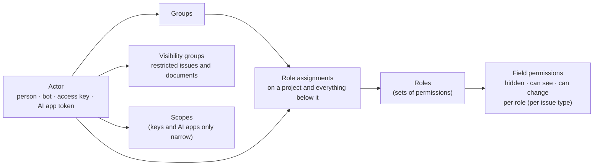

# Cross-cutting concepts

## Security

### Sign-in and sessions

- **Passwords:** Argon2id (OWASP parameters: 19 MiB memory, 2 iterations, 1 lane), checked against a bundled list of breached passwords. A wrong password and an unknown e-mail get the same answer and the same timing.
- **Passkeys:** WebAuthn (`webauthn-rs`), as a second step or on their own. **Two-step codes:** TOTP with backup codes (stored hashed).
- **Company sign-in:** OIDC with PKCE; group claims map to Bugaboo groups.
- **Sessions:** random 256-bit IDs, stored hashed; cookie `__Host-bb_session` (Secure, HttpOnly, SameSite=Lax). New session ID after sign-in and after any permission change; idle and absolute timeouts; *Where you're signed in* lists and ends sessions.
- **CSRF:** SameSite cookies plus an `Origin` check plus a per-session token header on every change request.
- **Access keys** (scripts, apps): `bb_` + prefix + secret; only a hash is stored; shown once; scoped, can expire, can only narrow the owner's permissions.
- **MCP:** OAuth 2.1 authorization server inside Bugaboo (authorization code + PKCE, dynamic client registration with an admin allow list), short-lived access tokens, refresh token rotation, consent screen per app.

### Browser protections

- **Content Security Policy:** `default-src 'self'`; scripts and styles only from our own origin, no inline code, no `eval`; `frame-ancestors 'none'`; `require-trusted-types-for 'script'`; images from our origin and `data:` only (outside images only if an admin allows the host).
- **Other headers:** HSTS, `X-Content-Type-Options: nosniff`, COOP/CORP, a tight Permissions-Policy, `Referrer-Policy: same-origin`.
- **One header layer** wraps the whole router, so pages, files, API answers, errors and 404s carry the same set. Enforced by: SEC-HEADERS (the check compares the header table with the values the integration tests expect, exactly; the tests assert the full set on a page, an asset, an API error and a 404).
- **HSTS** is sent only when browsers reach us over HTTPS (here, or at a trusted proxy), and **never with `includeSubDomains`** (Bugaboo does not own the other names of its host). Lifetime: **one day** with a certificate Bugaboo made itself, so a person who trusts that certificate on `localhost` does not pin every other local tool to HTTPS; **one year** with a provided certificate or behind a trusted proxy. Enforced by: SEC-HEADERS (no `includeSubDomains`) and the tests `sec_11_hsts_…`.
- **Compression:** Brotli or gzip for text, but **never for JSON** (API answers, problem+json): a compressed answer that mixes a secret with text an attacker chooses can leak the secret (BREACH). Enforced by: review (a person decides when another content type needs the same care), backed by the test `sec_11_json_answers_are_not_compressed`.
- **Slow and many clients:** a client has 30 seconds (setting `header_timeout_seconds`) to send the headers of a request, which also ends idle keep-alive connections; HTTP/2 connections are pinged at the same interval. At most 1024 connections (setting `max_connections`) and 256 TLS handshakes run at once. Request-body timeouts come with the first endpoint that reads a body (M1-F06). Enforced by: the tests `sec_10_…slowly…` and `sec_10_no_more_connections…`.
- **Client address:** the address of the connection is used, with IPv4-mapped IPv6 (`::ffff:a.b.c.d`) always treated as IPv4. `X-Forwarded-For` is believed only from a listed trusted proxy, and supports **exactly one trusted hop**: the last entry of the last header line is what the proxy itself saw; earlier entries are what the client claimed and are ignored. Enforced by: the tests `sec_10_forwarded_for_…` and `sec_10_mapped_…`.
- **User content** is rendered by one Markdown renderer with an allow list (ADR-0011). Attachments are downloaded, never rendered inline unless they are images or PDFs converted to safe previews.

### Secrets and keys

- A **master key** (outside the database) encrypts a key per secret (envelope encryption, XChaCha20-Poly1305). Secrets: mail password, AI keys, OIDC client secrets, webhook signing keys.
- **Key rotation** is a CLI command and an admin action; old keys decrypt, new keys encrypt.
- Backups are encrypted with a backup key derived from the master key, or with a separate key the admin keeps.

### Limits and abuse

- Rate limits per IP and per account on sign-in, search, API and MCP; slow-down after failures, never a permanent lock that an attacker could trigger.
- Request size limits; upload limits per project; search complexity limits.

## Authorization model



**Evaluation**, for an actor and a project:

1. Collect role assignments on the project and all its parents; an explicit *deny* on a lower project wins over a grant from above.
2. Union the permissions of those roles; intersect with the scopes of the access key or AI-app token, if any.
3. Build the **field mask**: for each field, the highest level any role gives (hidden < can see < can change), per issue type.
4. **Visibility:** an issue is visible if the actor may view issues in its project *and* (it isn't restricted *or* the actor is in one of its visibility groups).

**People:** every person shown anywhere is a `PersonRef`, resolved for the viewer into a name, a role label (*"a Team member"*) or *Someone*, according to *Who sees people* (ADR-0022). Hidden people information can't be searched or filtered either.

**Enforcement points:**

- Every use case asks `bb-policy` first. Every result passes through `Authorized<T>`, which applies the field mask during serialization.
- Every search gets the visibility predicate compiled into its SQL; the field catalogue given to the parser contains only readable fields.
- History, notifications, webhooks, exports, assistant context and live updates apply the **receiver's** mask.
- **Tests:** a generated matrix (roles × permissions × fields × entry points) runs on every build.

## Data model

```mermaid
erDiagram
  PROJECT ||--o{ PROJECT : "contains"
  PROJECT ||--o{ ISSUE : has
  ISSUE ||--o{ ISSUE : "sub-issue of"
  ISSUE ||--o{ RELATION : from
  ISSUE ||--o{ RELATION : to
  RELATION }o--|| RELATION_KIND : "is a"
  ISSUE ||--o{ FIELD_VALUE : has
  FIELD ||--o{ FIELD_VALUE : defines
  ISSUE ||--o{ COMMENT : has
  ISSUE ||--o{ TIME_ENTRY : "booked on"
  PERSON ||--o{ TIME_ENTRY : books
  PERSON ||--o{ WORK_DAY : records
  WORK_DAY ||--o{ BREAK : has
  PROJECT ||--o{ FOLDER : has
  FOLDER ||--o{ DOCUMENT : has
  DOCUMENT ||--o{ DOCUMENT_VERSION : has
  BLOB ||--o{ ATTACHMENT : "stored as"
  BLOB ||--o{ DOCUMENT_VERSION : "file content"
  EVENT }o--|| PERSON : "caused by"
```

- **IDs:** UUIDv7 everywhere internally; readable issue IDs per project, counting (`WEB-142`) or random (`WEB-K7Q2X`), with redirects from old IDs (ADR-0021); short names for projects.
- **Own fields** (ADR-0006): one `field_value` table with typed columns (text, number, date, reference) and indexes per type; used by issues, time entries, work days, documents, releases and projects.
- **Relations:** one table for every kind, including timeline dependencies; sub-issues use a parent column, shown as *part of* on the map.
- **Files:** content-addressed blobs (SHA-256), referenced by attachments and document versions; deleted when nothing references them and no keep rule applies.
- **Time:** all timestamps in UTC; each work day stores the person's time zone so "day" means their day.
- **Versions:** every changeable entity has a `version` number for optimistic locking.
- **Edit locks:** `edit_lock` rows (what, who, session, token, expires at) for long text and admin editors; private drafts in `edit_draft`; both deleted when no longer needed (ADR-0019).
- **Deleted items** move to the trash (soft delete with a deletion date), then are removed by the keep-and-delete job.

## Events, history and the outbox (ADR-0007)

Every change appends a **domain event** in the same transaction: who (actor), how (UI, API, MCP, assistant), what (entity, field changes before → after), why (reason, when required). The **outbox** delivers events to consumers that run after commit:

| Consumer | Uses events to … |
|----------|------------------|
| History | show the change log (filtered by the reader's field mask) |
| Notifications | notify followers and mentioned people (filtered per recipient) |
| Webhooks | send signed payloads (filtered by the bot account's permissions) |
| Security log | append hash-chained entries for security-relevant events |
| Full-text index | update search text (inside the same database) |
| Live updates | tell open screens that something changed (built last) |

Consumers are idempotent and resume from their last position after a restart.

## Privacy engineering (ADR-0015)

- Every stored field is **marked** in the entity definition: personal data or not, category (contact, employee time, content, technical), and the legal basis note. Unmarked fields fail the build.
- The marks generate: *Download my data*, the *Remove a person* plan, keep-and-delete jobs, the record of processing, and the data-flow map.
- **Logs** hold IDs, never names or e-mail addresses; IP addresses are kept 7 days by default.
- **Former users:** a removed person becomes a tombstone (`Former user K7Q2`); references stay valid, personal data is gone.
- **Legal holds:** working hours stay until their keep period ends, even after a person is removed.

## Search language (ADR-0005)

Grammar sketch (final grammar is part of milestone work):

```text
search     = [ expr ] [ "sort by" sort ("," sort)* ]
expr       = term ( ("and" | "or") term )*
term       = "not" term | "(" expr ")" | condition
condition  = field op value | field "contains" text | helper
op         = "is" | "is not" | "<" | ">" | "<=" | ">=" | "in" | "within"
helper     = "connected to" key [ "within" n "steps" ] | "under" key | "blocks" key | …
value      = word | quoted | number | date | "me" | "today" | "in last" n unit
```

- The printer writes a **canonical** form; `parse(print(tree)) == tree` is a property test.
- Simple search edits the same tree; anything without a picker becomes an editable text button.

## Settings and configuration (ADR-0018)

- **Start-up settings** (address, port, data folder, database URL, certificates): `bugaboo.toml` or environment variables, written by the setup wizard.
- **Everything else** comes from one **settings registry**: each setting is defined once (key, type, default, levels — organization / project / person — who may change it, help text key). The registry drives storage, the API and the settings dialogs, so a new setting appears in the UI without hand-written forms.
- **In code:** settings are declared in `crates/bb-core/src/settings/catalog.rs` and nowhere else, and are read through their typed handle (`settings::APPEARANCE_THEME`). A setting key written as text elsewhere is a way around the registry and is found. Enforced by: ARCH-SETTINGS.

## User interface

- **Server data:** only in the TanStack Query cache. **URL:** the search, the presentation and the open issue live in typed URL parameters, so every screen is shareable.
- **Lean requests:** each screen asks for the fields its layout shows (`?fields=`); lists use cursor pagination and are virtualized.
- **Text:** every user-facing string is a key in `messages/en.json` (ICU message format), typed via generated keys. The hooks reject literal text in components.
- **Text in Rust:** the server uses the constants and functions generated into `bb_core::message` (`SERVER_NOT_FOUND`, `server_port_busy(port)`), whose placeholders are typed arguments; a key that does not exist does not compile. Keys that nothing uses are found. Enforced by: TXT-CATALOG.
- **Styles:** CSS Modules using token variables only; generated token CSS per theme; no inline styles (CSP).
- **Accessibility:** React Aria Components for focus, keyboard and screen-reader behavior; axe checks in CI.

## Errors

- One `ErrorCode` enum in `bb-core` (for example `issue.not_found`, `issue.version_conflict`, `search.unknown_field`).
- The API answers with `application/problem+json`: code, plain-language message key and parameters, request ID.
- The TypeScript client gets the codes as a union type; the UI shows the message from the catalog.
- An error message in the catalog has no placeholder, so an error cannot carry a name or number the person may not see; anything hidden answers with `resource.not_found`, exactly as if it did not exist. Enforced by: ARCH-ERRORS.

## Observability

- Structured JSON logs (`tracing`, one object per line on standard error) with random request IDs. One line per request holds the request ID, method, route pattern, status, duration and the client network cut short (IPv4 `/24`, IPv6 `/48`); never the path as typed, the query, headers, bodies, names, e-mail addresses or free text. Enforced by: DATA-LOGS.
- Health endpoints: `/health/live` answers while the process runs; `/health/ready` also checks the data folder (and the database once the store exists) and answers 503 when something is missing; both are sent with `Cache-Control: no-store`; optional Prometheus metrics, off by default and protected.
- The admin *Status* page shows version, database, disk, jobs, backups and certificate expiry.

## Performance

- Per-request caches for permission evaluation; ETags for lists and issues; Brotli/zstd compression.
- **SQLite:** WAL mode, one writer task with a queue, many readers. **PostgreSQL:** a pool sized to CPU count.
- A dataset generator (`cargo xtask dataset --issues 1000000`) feeds benchmarks in CI; budgets from PERF-01…06 fail the build when exceeded.

## AI (ADR-0013)

- **Providers:** one trait; adapters for Anthropic, OpenAI-compatible endpoints (which cover local models) and a test fake.
- **Context builder:** reads as the actor, drops hidden and AI-excluded fields, wraps people's text in clearly fenced "untrusted content" blocks.
- **Tool registry:** shared with MCP. In the assistant, write tools return proposals; nothing changes without *Apply*.
- **Output:** rendered by the Markdown renderer with remote images and auto-links disabled; marked *Written with the assistant* when saved.
- **Hard rules (AI Act):** no tools that rank, evaluate or assign people; no access to working hours; no mood analysis. These tools don't exist, so they can't be called.
- **Limits:** per-person and organization budgets; each call logged with metadata (who, tool, size, cost), not content, unless an admin enables content logging for troubleshooting.

## Compliance artifacts

| Artifact | Made by | When |
|----------|---------|------|
| SBOM (CycloneDX + SPDX) | `cargo cyclonedx` + `@cyclonedx/cyclonedx-npm`, merged by xtask | every release |
| Third-party notices | `cargo about` + npm license data, rendered by xtask | every release; shown in *About › Licenses* |
| Third-party register check | xtask compares lockfiles with `docs/third-party/` | every CI run |
| License policy | `cargo deny` (`deny.toml`) and the same list for npm | every CI run |
| Vulnerability scan + VEX | `cargo audit`, OSV for npm; VEX statements in `security/vex/` | every CI run and daily |
| Technical documentation file | xtask assembles architecture docs, ADRs, SBOM, test reports, support period | every release |
