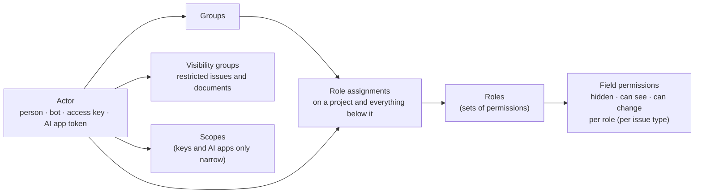

# Cross-cutting concepts

## Security

### Sign-in and sessions

- **Passwords:** Argon2id (OWASP parameters: 19 MiB memory, 2 iterations, 1 lane), checked against a bundled list of breached passwords (a plain sorted list searched on this computer, so no network call is made; it is not a k-anonymity range file, M1-F48). A wrong password and an unknown e-mail get the same answer and the same timing.
- **Passkeys:** WebAuthn (`webauthn-rs`), as a second step or on their own. **Two-step codes:** TOTP with backup codes (stored hashed).
- **Company sign-in:** OIDC with PKCE; group claims map to Bugaboo groups.
- **Sessions:** random 256-bit secrets, stored as a hash (SHA-256 with its own domain, so the hash of a session secret is never taken for one of an invitation); cookie `__Host-bb_session` (Secure, HttpOnly, SameSite=Lax) that lives as long as a session may (the setting `security.session-absolute-hours`, default 24 hours). A session is *pending* after the password when the person has a second step (it can do nothing but finish it, for at most five minutes) and *active* after. **A new secret is made at sign-in, when the second step is done, and when the password is changed** (which also ends all other sessions), so a secret that was known earlier opens nothing. A session ends after the idle time (`security.session-idle-minutes`, default 30) or the absolute time; a session is marked as used at most once a minute; sessions nobody can use are removed inside every sign-in. Signing in from a browser that still has the cookie of an old session ends that old session, and a password alone shows nothing about the person (no name, address or administrator flag) until the second step is done. The two times are bounded settings (idle 5 minutes to 24 hours, absolute 1 hour to 30 days): a value outside is refused when it is stored and cut to the bounds when it is read. *Where you're signed in* lists the sessions (browser and system names, never the `User-Agent` text, and the shortened network) and ends any of them or all of them. The list holds at most 50 sessions and says when it was cut (`truncated`). Enforced by: the tests `sec_12_*` in `crates/bb-server/src/tests/sign_in/sessions.rs` (sign-out, list, end, end everywhere, idle and absolute timeouts, new secrets, password change, the old session of the browser), `perf_02_the_list_of_sessions_has_a_cap_and_says_when_it_cut`, `sec_12_a_password_alone_shows_nothing_about_the_person_until_the_second_step_is_done`, `auth_01_the_session_times_have_bounds_and_values_are_cut_to_them` in `bb-core`, and `sec_12_only_sessions_nobody_can_use_are_purged` in `bb-store`.
- **How signing in is built:** the mechanisms (passwords, tokens, CSRF token, TOTP, passkeys) are in `bb-auth` and do no I/O. The use cases are `async fn`s in `bb-app::auth`; each takes the context `Ctx` (store, clock, hasher, passkeys, CSRF key, limit on failed tries, client network and browser) and an input type, depends on storage only through the port `AuthStore`, and writes only through `ChangeStore::record_change`, so every change comes with its event and is undone together with it. A check inside a change (a code used twice, an invitation taken first) stops the change with `AuthStore::aborted`, which rolls back everything including the event. Adding a way to sign in (the code app, a passkey) asks for the password again, so a stolen session cannot add one. Waiting passkey challenges have a pool for each kind of ceremony (adding, second step, anonymous sign-in) and a cap for each network, so anonymous sign-in starts cannot keep the second step or an addition from starting. `AuthApi` lists the use cases once, with the store erased, so `bb-api` holds `Arc<dyn AuthApi>` and never names an adapter. `bb-store` implements the port (`AuthStorage`; tables from migration 2, every column with its personal-data mark), `bb-api` has the routes below `/api/v1/auth` (`src/api/auth*.rs`), and `bb-server/src/wiring.rs` builds it all at start. Enforced by: ARCH-DEPS, ARCH-EVENTS, ARCH-HTTP-EDGE, DATA-MARKS, and the flow tests in `crates/bb-server/src/tests/sign_in/`, which run every flow on both databases.
- **Setting up the first administrator (AUTH-09):** at every start the server makes a new setup code when no administrator exists and prints it to the console only (never to the log file); only its hash is stored, and a new start replaces it. The code works once: it is used up in the same change that makes the administrator, setup is closed for good afterwards, and wrong codes count against the limit on failed tries. Enforced by: the tests `auth_09_*` in `crates/bb-server/src/tests/sign_in/setup_and_password.rs`.
- **The public address:** the start-up setting `public_url` is the origin people type in the browser. Passkeys are tied to its host name; a server that listens on this computer only uses `localhost` and its port when the setting is missing, any other address needs the setting, a server behind trusted proxies needs it too (people reach it through the address of the proxy), and an address without a host name (an IP address) turns passkeys off. Enforced by: the tests `auth_02_*` in `crates/bb-server/src/config.rs` and `auth_02_without_a_host_name_in_the_public_address_passkeys_are_off`.
- **CSRF:** three layers. (1) SameSite cookies. (2) An **origin check**, already in the API: every request below `/api` that is not GET, HEAD or OPTIONS must carry an `Origin` equal to the server's own origin or, when the browser sent no `Origin`, `Sec-Fetch-Site: same-origin`. The own origin is the scheme plus the authority the browser asked for: the authority of the request address when there is one (HTTP/2 has no `Host` header), else `Host`; the scheme is `https` when the connection is TLS or when a trusted proxy says so (`X-Forwarded-Proto`, same trust rule as the client address: only from a listed proxy, only the last entry), else `http`; with neither the request is refused (fail closed) with the error `request.wrong_origin` (403, problem+json). Enforced by: the tests `sec_06_*` in `crates/bb-api` (cross-site, `null`, missing headers, same-origin, scheme, authority without `Host`) and the TLS + HTTP/2 test `sec_06_over_tls_and_http2_the_origin_check_uses_the_authority_and_the_scheme`. (3) A **session-bound token**: the value is derived on the server from the session (an HMAC of the session ID with a CSRF key), delivered in the page-readable cookie `__Host-bb_csrf` at sign-in and renewed with every new session ID; the server compares the `x-csrf-token` header with the value derived for the request's session in constant time, and refuses unsafe methods without a valid token with problem+json. The generated client reads the cookie and sends the header on every change. Layer 3 is the middleware `csrf_check` in `crates/bb-api/src/api/auth.rs` and covers every change below `/api` (a route added later is protected without anyone remembering): a change without a session cookie is answered with `auth.not_signed_in` (401), one with a session cookie and without the right token with `request.wrong_token` (403). Only the seven routes of people who have no session yet (`CSRF_EXEMPT`: setup, sign-in, sign-up, passkey sign-in, the invitation link) are left out; they carry no secret a forged request could use and the origin check protects them. Enforced by: SEC-COOKIES (the cookie table) and the tests `sec_12_a_change_needs_the_token_of_its_own_session`, `sec_12_every_route_that_changes_something_checks_the_token_except_signing_in_and_up` (goes through every route of the API description) and `sec_12_every_session_has_its_own_secret_and_its_own_csrf_token`, and the TLS + HTTP/2 test `sec_12_over_tls_and_http2_a_person_sets_up_signs_out_and_signs_in_again`.
- **Cookies:** only strictly necessary ones (the session and the CSRF token), so no consent banner is needed (COMP-13, PRIV-01). One module, `crates/bb-api/src/cookies.rs`, holds the table and is the only code that sets a cookie. Every name starts with `__Host-`, so browsers insist on `Secure`, `Path=/` and no `Domain`; the module adds `HttpOnly` where script has no business reading the cookie. `cargo xtask gen api` writes the list "Cookies we use" to `userDocs/cookies.md` from the same table. Enforced by: SEC-COOKIES (reads the table; finds `Set-Cookie`, cookie libraries and `document.cookie` writes anywhere else).
- **Access keys** (scripts, apps): `bb_` + prefix + secret; only a hash is stored; shown once; scoped, can expire, can only narrow the owner's permissions.
- **MCP:** OAuth 2.1 authorization server inside Bugaboo (authorization code + PKCE, dynamic client registration with an admin allow list), short-lived access tokens, refresh token rotation, consent screen per app.

### Browser protections

- **Content Security Policy:** `default-src 'self'`; scripts and styles only from our own origin, no inline code, no `eval`; `frame-ancestors 'none'`; `require-trusted-types-for 'script'`; images from our origin and `data:` only (outside images only if an admin allows the host).
- **Other headers:** HSTS, `X-Content-Type-Options: nosniff`, COOP/CORP, a tight Permissions-Policy, `Referrer-Policy: same-origin`.
- **One header layer** wraps the whole router, so pages, files, API answers, errors and 404s carry the same set. Enforced by: SEC-HEADERS (the check compares the header table with the values the integration tests expect, exactly; the tests assert the full set on a page, an asset, an API error and a 404).
- **HSTS** is sent only when browsers reach us over HTTPS (here, or at a trusted proxy), and **never with `includeSubDomains`** (Bugaboo does not own the other names of its host). Lifetime: **one day** with a certificate Bugaboo made itself, so a person who trusts that certificate on `localhost` does not pin every other local tool to HTTPS; **one year** with a provided certificate or behind a trusted proxy. Enforced by: SEC-HEADERS (no `includeSubDomains`) and the tests `sec_11_hsts_…`.
- **Compression:** Brotli or gzip for text, but **never for JSON** (API answers, problem+json): a compressed answer that mixes a secret with text an attacker chooses can leak the secret (BREACH). Enforced by: review (a person decides when another content type needs the same care), backed by the test `sec_11_json_answers_are_not_compressed`.
- **Slow and many clients:** a client has 30 seconds (setting `header_timeout_seconds`) to send the headers of a request, which also ends idle keep-alive connections; HTTP/2 connections are pinged at the same interval. At most 1024 connections (setting `max_connections`) and 256 TLS handshakes run at once. Every API request has 30 seconds to finish, which also stops a request body that arrives too slowly (M1-F06). Enforced by: the tests `sec_10_…slowly…` and `sec_10_no_more_connections…`.
- **Client address:** the address of the connection is used, with IPv4-mapped IPv6 (`::ffff:a.b.c.d`) always treated as IPv4. `X-Forwarded-For` is believed only from a listed trusted proxy, and supports **exactly one trusted hop**: the last entry of the last header line is what the proxy itself saw; earlier entries are what the client claimed and are ignored. Enforced by: the tests `sec_10_forwarded_for_…` and `sec_10_mapped_…`.
- **User content** is rendered by one Markdown renderer with an allow list (ADR-0011). Attachments are downloaded, never rendered inline unless they are images or PDFs converted to safe previews.

### Secrets and keys

- A **master key** (outside the database) encrypts a key per secret (envelope encryption, XChaCha20-Poly1305). Secrets: mail password, AI keys, OIDC client secrets, webhook signing keys.
- **Where the keys live:** `keys/master.key` (the master keys) and `keys/log.key` (the log key of the security log) in the data folder, which the server makes owner-only. `master.key` has one line per key, `<id> <64 hex digits>`, oldest first; the newest key wraps new secrets. `log.key` is one key that never changes, so a rotation does not touch the security log. The files are made on the first start only, replaced atomically (and the folder flushed) on a change, and on Unix refused when anybody but its owner can read them. Keys are read through and held in `Zeroizing` buffers and never show in `Debug` output. Enforced by: the key and secret tests of `bb-store` (SEC-16).
- **A missing key file is never replaced silently.** The keys are made only when the database holds neither secrets nor a security log; otherwise `Database::open_keys` refuses with the catalogue message `server.keys-missing` ("Restore them from your backup"), because new keys could never read what the old ones protected. Enforced by: the test `sec_16_missing_keys_stop_the_start_when_the_database_needs_them`.
- **Stored form:** each secret has its own random 256-bit key; the value is encrypted with it (24-byte random nonce), and that key is wrapped by the master key (own nonce). The ID of the master key is stored with the secret, and the secret's name (and the key ID) are authenticated data, so a row copied to another name or changed in any byte does not decrypt. Enforced by: the key and secret tests of `bb-store`.
- **Key rotation** is a CLI command and an admin action (`Database::rotate_master_key`): add a key to the file, wrap every secret's key again with it in one transaction (values are not touched), and only then drop old keys that nothing uses. A stop half way leaves a state that still decrypts. Old keys decrypt, new keys encrypt. A running server follows a rotation made by the command line: the key ring looks at the modification time and size of `master.key` whenever it is asked for a key and reads the file again when it changed, so it never encrypts with a retired key; a write that was in flight while a key was retired is done again. Each secret is re-wrapped only if its row is still the one that was read (compare on the old wrapped key), so on PostgreSQL a secret replaced during the rotation is not overwritten with an old copy. Rotation is a rare administrator action; run it while no secret is being changed. Enforced by: the rotation tests of `bb-store`.
- Backups are encrypted with a backup key derived from the master key, or with a separate key the admin keeps.

### Limits and abuse

- Rate limits per IP and per account on sign-in, search, API and MCP; slow-down after failures, never a permanent lock that an attacker could trigger. **Only failed tries are limited, and a try is counted before it is checked** (M1-F27). A wrong password, a wrong code of the second step, a wrong password asked again before a sensitive change and a wrong setup code each reserve a slot of their account (the lower-case address, or the person after the password step) and of the client network when the try starts, and the slot counts as a failure from that moment, so many requests at the same time are not many guesses: no more than the allowance get through to be checked. A success gives the slot back (the account is cleared, the network gets its one try back), so signing in again and again never uses anything up. After the allowance (`sign_in_failures_per_minute`, default 10) a key waits for the rest of its window, also with the right password; a key that used up a whole window gets a window twice as long the next time, up to 15 minutes, and never a lock for good. Wrong codes of one half-finished sign-in are also counted without a window: after 10 the half-finished sign-in is ended and `second_step.given_up` is written to the security log, so whoever has the password starts again from the password. Wrong setup codes are counted per network, so nobody far away can lock the person at the console out. The counters are keyed hashes in memory; the failure that uses up an allowance is written to the security log once (`sign_in.limited`), so a flood does not fill the log. Enforced by: the tests `sec_14_parallel_wrong_tries_at_one_account_get_no_more_than_the_allowance`, `sec_14_parallel_wrong_codes_at_one_half_finished_sign_in_get_no_more_than_the_allowance`, `sec_14_parallel_wrong_passwords_before_a_sensitive_change_get_no_more_than_the_allowance`, `sec_14_a_success_gives_the_try_back_also_when_tries_run_at_the_same_time`, `sec_14_only_failed_tries_count_and_a_success_clears_them`, `sec_14_ten_wrong_codes_end_the_half_finished_sign_in_and_are_written_down`, `auth_09_wrong_setup_codes_are_counted_per_network_not_for_everybody` and `sec_14_failures_of_one_network_are_limited_whatever_the_account` in `crates/bb-server/src/tests/`, and the tests `sec_14_*` in `crates/bb-api/src/failures.rs` (the growing wait, the cap, a full table).
- **Rate limits (SEC-14)** are counted per minute, in memory, per client network (an IPv4 address, an IPv6 `/64`; the canonical client address from above, never the raw header): all `/api` requests (setting `rate_limit_per_minute`, default 600) and sign-in attempts (setting `sign_in_attempts_per_minute`, default 60, a generous cap against floods) per client network (every try) and, as described above, failed tries (setting `sign_in_failures_per_minute`, default 10) per account, person and network, where the key is kept only as a keyed hash. Going over a limit answers 429 with `Retry-After` and the message `error.rate-limit.exceeded`; nothing is locked for longer than the minute. The limiter is Bugaboo's own fixed window instead of `tower_governor`: it needs no other dependency, reads the canonical client address that the logging layer works out, and gives sign-in the per-account hook that a one-key-per-layer limiter does not. When a table is full, expired counters go first (swept at most once per second, so a flood cannot make every request scan the table) and counters still running are never dropped; new clients then share one overflow counter in the general window, and are refused in the sign-in windows (fail closed). This is a trade-off accepted on purpose: while a table is full (100,000 clients within one minute), newcomers share one general bucket and new sign-in keys wait for the rest of the window; a per-network aggregate is M1-F35. Enforced by: review, backed by the tests `sec_14_*` in `crates/bb-api` (unit tests of the windows, integration tests for the 429 and for the client address).
- Request size limits; upload limits per project; search complexity limits. API request bodies are limited to 1 MiB unless a route sets its own limit; a bigger body answers `request.too_large`. Enforced by: review, backed by the test `sec_14_a_body_up_to_the_limit_is_read_and_a_bigger_one_is_refused_as_problem_json`.

## Authorization model



**Evaluation**, for an actor and a project:

1. Collect role assignments on the project and all its parents; an explicit *deny* on a lower project wins over a grant from above.
2. Union the permissions of those roles; intersect with the scopes of the access key or AI-app token, if any.
3. Build the **field mask**: for each field, the highest level any role gives (hidden < can see < can change), per issue type.
4. **Visibility:** an issue is visible if the actor may view issues in its project *and* (it isn't restricted *or* the actor is in one of its visibility groups).

**People:** every person shown anywhere is a `PersonRef`, resolved for the viewer into a name, a role label (*"a Team member"*) or *Someone*, according to *Who sees people* (ADR-0022). Hidden people information can't be searched or filtered either.

**Enforcement points:**

- Every use case asks `bb-policy` first. Every result passes through `Authorized<T>`, which applies the field mask during serialization.
- Every search gets the visibility predicate compiled into its SQL; the field catalogue given to the parser contains only readable fields.
- History, notifications, webhooks, exports, assistant context and live updates apply the **receiver's** mask.
- **Tests:** a generated matrix (roles × permissions × fields × entry points) runs on every build.

## Data model

```mermaid
erDiagram
  PROJECT ||--o{ PROJECT : "contains"
  PROJECT ||--o{ ISSUE : has
  ISSUE ||--o{ ISSUE : "sub-issue of"
  ISSUE ||--o{ RELATION : from
  ISSUE ||--o{ RELATION : to
  RELATION }o--|| RELATION_KIND : "is a"
  ISSUE ||--o{ FIELD_VALUE : has
  FIELD ||--o{ FIELD_VALUE : defines
  ISSUE ||--o{ COMMENT : has
  ISSUE ||--o{ TIME_ENTRY : "booked on"
  PERSON ||--o{ TIME_ENTRY : books
  PERSON ||--o{ WORK_DAY : records
  WORK_DAY ||--o{ BREAK : has
  PROJECT ||--o{ FOLDER : has
  FOLDER ||--o{ DOCUMENT : has
  DOCUMENT ||--o{ DOCUMENT_VERSION : has
  BLOB ||--o{ ATTACHMENT : "stored as"
  BLOB ||--o{ DOCUMENT_VERSION : "file content"
  EVENT }o--|| PERSON : "caused by"
```

- **IDs:** UUIDv7 everywhere internally; readable issue IDs per project, counting (`WEB-142`) or random (`WEB-K7Q2X`), with redirects from old IDs (ADR-0021); short names for projects.
- **Own fields** (ADR-0006): one `field_value` table with typed columns (text, number, date, reference) and indexes per type; used by issues, time entries, work days, documents, releases and projects.
- **Relations:** one table for every kind, including timeline dependencies; sub-issues use a parent column, shown as *part of* on the map.
- **Files:** content-addressed blobs (SHA-256), referenced by attachments and document versions; deleted when nothing references them and no keep rule applies.
- **Time:** all timestamps in UTC; each work day stores the person's time zone so "day" means their day.
- **Versions:** every changeable entity has a `version` number for optimistic locking.
- **Edit locks:** `edit_lock` rows (what, who, session, token, expires at) for long text and admin editors; private drafts in `edit_draft`; both deleted when no longer needed (ADR-0019).
- **Deleted items** move to the trash (soft delete with a deletion date), then are removed by the keep-and-delete job.

## Events, history and the outbox (ADR-0007)

Every change appends a **domain event** in the same transaction: who (actor), how (UI, API, MCP, assistant), what (entity, field changes before → after), why (reason, when required). The **outbox** delivers events to consumers that run after commit:

| Consumer | Uses events to … |
|----------|------------------|
| History | show the change log (filtered by the reader's field mask) |
| Notifications | notify followers and mentioned people (filtered per recipient) |
| Webhooks | send signed payloads (filtered by the bot account's permissions) |
| Security log | append hash-chained entries for security-relevant events |
| Full-text index | update search text (inside the same database) |
| Live updates | tell open screens that something changed (built last) |

Consumers are idempotent and resume from their last position after a restart.

**In `bb-store`:** `Database::record_change` is the only way to write domain data: it runs the change, appends the event and the outbox entry, and commits all three or none. Outbox positions are handed out from a counter row that the change transaction locks until it commits, so positions become visible in order and a consumer that has seen position 7 cannot miss a 6 that commits later (the price: changes commit one after the other). Each consumer stores the last position it finished (`outbox_done`). Enforced by: the event tests of `bb-store`; ARCH-EVENTS (a command use case in `bb-app` must write through the `ChangeStore` port, whose method `record_change` `bb-store` implements); ARCH-SQL-EDGE (no other crate may write to the database).

**Background jobs** (ADR-0017) are rows in the `job` table. A worker leases due jobs with one `UPDATE … RETURNING` statement (`FOR UPDATE SKIP LOCKED` on PostgreSQL); a lease that runs out puts the job back, every start counts as an attempt, failures wait 30 seconds doubled each time (at most an hour), and after the last attempt the job goes to the dead-letter list, which an administrator can requeue. Enforced by: the job tests of `bb-store`.

**The security log** (SEC-15) is append-only. Each entry stores the HMAC-SHA256 (under the log key, `keys/log.key`) of the previous entry's hash and all its own fields in a length-prefixed encoding. Because the key is not in the database, somebody who can only change the database (SQL injection, a stolen copy) cannot change an entry and hash the rest of the chain again; somebody who also holds the host's key files can, and that is outside what the log protects against. After every append, one line `seq hash signature` goes to an append-only anchor file outside the database (`logs/security-head.log`, owner-only). `verify_security_log` reads one consistent snapshot (no write lock) and reports the first entry that does not verify (a gap, a broken link, changed content, a missing or forged checkpoint, an anchor line with a wrong signature) and whether the database reaches the newest anchored entry with the same hash (cut off or replaced ends are `Truncated`); a log whose anchor file is missing verifies but says it is not anchored. After the keep period, whole blocks of 1000 entries are deleted from the start; before deleting, the job verifies those blocks from the previous checkpoint and that the first kept entry points to the last deleted hash, in the same transaction, and refuses otherwise. A checkpoint is left: place, hash and time of the deletion, signed with the log key, so the remaining entries still verify. The newest entry is never deleted. Network addresses are stored shortened (IPv4 `/24`, IPv6 `/48`). Enforced by: the hash-chain property tests (`sec_15_any_changed_row_breaks_the_chain`, `sec_15_a_rewritten_tail_without_the_key_does_not_verify`) and the security-log tests of `bb-store`.

**Storage types:** every whole number is a `BIGINT`, every moment is microseconds since 1970 in a `BIGINT`, IDs are 16-byte blobs and JSON is text, so both databases hand back the same Rust types. SQLite runs in WAL mode with foreign keys on, a busy timeout and `synchronous=FULL` (a committed change survives a power cut; the cost is one more disk flush per commit than `NORMAL`), and every write transaction starts with `BEGIN IMMEDIATE` (one writer at a time). Migrations record a checksum of their steps and take the write lock (SQLite) or an advisory lock (PostgreSQL), reading the record again inside the transaction, so two processes starting together cannot apply one migration twice; a changed, renamed or unknown applied migration stops the start. PostgreSQL pools are sized to the number of processors. Every table is the home of an entity with personal-data marks. Enforced by: DATA-MARKS (tables), DATA-MIGRATIONS and ARCH-DB-PARITY (the `migrations` test and every repository test run on both databases).

## Privacy engineering (ADR-0015)

- Every stored field is **marked** in the entity definition: personal data or not, category (contact, employee time, content, technical), and the legal basis note. Unmarked fields fail the build.
- The marks generate: *Download my data*, the *Remove a person* plan, keep-and-delete jobs, the record of processing, and the data-flow map.
- **Logs** hold IDs, never names or e-mail addresses; IP addresses are kept 7 days by default.
- **Former users:** a removed person becomes a tombstone (`Former user K7Q2`); references stay valid, personal data is gone.
- **Legal holds:** working hours stay until their keep period ends, even after a person is removed.

## Search language (ADR-0005)

Grammar sketch (final grammar is part of milestone work):

```text
search     = [ expr ] [ "sort by" sort ("," sort)* ]
expr       = term ( ("and" | "or") term )*
term       = "not" term | "(" expr ")" | condition
condition  = field op value | field "contains" text | helper
op         = "is" | "is not" | "<" | ">" | "<=" | ">=" | "in" | "within"
helper     = "connected to" key [ "within" n "steps" ] | "under" key | "blocks" key | …
value      = word | quoted | number | date | "me" | "today" | "in last" n unit
```

- The printer writes a **canonical** form; `parse(print(tree)) == tree` is a property test.
- Simple search edits the same tree; anything without a picker becomes an editable text button.

## Settings and configuration (ADR-0018)

- **Start-up settings** (address, port, data folder, database URL, certificates): `bugaboo.toml` or environment variables, written by the setup wizard.
- **Everything else** comes from one **settings registry**: each setting is defined once (key, type, default, levels — organization / project / person — who may change it, help text key). The registry drives storage, the API and the settings dialogs, so a new setting appears in the UI without hand-written forms.
- **In code:** settings are declared in `crates/bb-core/src/settings/catalog.rs` and nowhere else, and are read through their typed handle (`settings::APPEARANCE_THEME`). A setting key written as text elsewhere is a way around the registry and is found. Enforced by: ARCH-SETTINGS.

## User interface

- **Server data:** only in the TanStack Query cache. **URL:** the search, the presentation and the open issue live in typed URL parameters, so every screen is shareable.
- **Lean requests:** each screen asks for the fields its layout shows (`?fields=`); lists use cursor pagination and are virtualized.
- **Text:** every user-facing string is a key in `messages/en.json` (ICU message format), typed via generated keys. The hooks reject literal text in components.
- **Text in Rust:** the server uses the constants and functions generated into `bb_core::message` (`SERVER_NOT_FOUND`, `server_port_busy(port)`), whose placeholders are typed arguments; a key that does not exist does not compile. Keys that nothing uses are found. Enforced by: TXT-CATALOG.
- **Styles:** CSS Modules using token variables only; generated token CSS per theme; no inline styles (CSP).
- **Accessibility:** React Aria Components for focus, keyboard and screen-reader behavior; axe checks in CI.

## Errors

- One `ErrorCode` enum in `bb-core` (for example `issue.not_found`, `issue.version_conflict`, `search.unknown_field`).
- The API answers with `application/problem+json`: `type`, `title`, `status`, `code`, `message_key`, `params` and the `request_id` (the same as the `x-request-id` header). Handlers take their input through `ApiJson`, `ApiQuery` and `ApiPath`, whose rejections are problem+json, and return an `ApiError` made from an `ErrorCode`; a failure below `/api` that still has no problem body (any layer) is turned into one by its status: the status, the title and the message key come from the table, and a cause inside the server goes to the log (`ApiError::internal`), never into the answer. Every route in the OpenAPI document lists the standard answers 429, 500 and 503. Enforced by: ARCH-ERRORS (finds error answers built from a text written in the code, handlers that use `axum::Json`, `Query`, `Path` or `Form` as extractors instead of the wrappers, and compares the generated API description with the table).
- The `Display` texts of error types such as `TlsError` are English in code and reach only the log or the terminal; a person reads catalogue messages. Enforced by: ARCH-ERRORS (an error answer cannot be made from a text).
- The TypeScript client gets the codes as a union type; the UI shows the message from the catalog.
- An error message in the catalog has no placeholder, so an error cannot carry a name or number the person may not see; anything hidden answers with `resource.not_found`, exactly as if it did not exist. Enforced by: ARCH-ERRORS.

## Observability

- Structured JSON logs (`tracing`, one object per line on standard error) with random request IDs. One line per request holds the request ID, method, route pattern, status, duration and the client network cut short (IPv4 `/24`, IPv6 `/48`); never the path as typed, the query, headers, bodies, names, e-mail addresses or free text. Enforced by: DATA-LOGS.
- Health endpoints: `/health/live` answers while the process runs; `/health/ready` also checks the data folder (and the database once the store exists) and answers 503 when something is missing; both are sent with `Cache-Control: no-store`; optional Prometheus metrics, off by default and protected.
- The admin *Status* page shows version, database, disk, jobs, backups and certificate expiry.

## Performance

- Per-request caches for permission evaluation; ETags for lists and issues; Brotli/zstd compression.
- **SQLite:** WAL mode, one writer task with a queue, many readers. **PostgreSQL:** a pool sized to CPU count.
- A dataset generator (`cargo xtask dataset --issues 1000000`) feeds benchmarks in CI; budgets from PERF-01…06 fail the build when exceeded.

## AI (ADR-0013)

- **Providers:** one trait; adapters for Anthropic, OpenAI-compatible endpoints (which cover local models) and a test fake.
- **Context builder:** reads as the actor, drops hidden and AI-excluded fields, wraps people's text in clearly fenced "untrusted content" blocks.
- **Tool registry:** shared with MCP. In the assistant, write tools return proposals; nothing changes without *Apply*.
- **Output:** rendered by the Markdown renderer with remote images and auto-links disabled; marked *Written with the assistant* when saved.
- **Hard rules (AI Act):** no tools that rank, evaluate or assign people; no access to working hours; no mood analysis. These tools don't exist, so they can't be called.
- **Limits:** per-person and organization budgets; each call logged with metadata (who, tool, size, cost), not content, unless an admin enables content logging for troubleshooting.

## Compliance artifacts

| Artifact | Made by | When |
|----------|---------|------|
| SBOM (CycloneDX + SPDX) | `cargo cyclonedx` + `@cyclonedx/cyclonedx-npm`, merged by xtask | every release |
| Third-party notices | `cargo about` + npm license data, rendered by xtask | every release; shown in *About › Licenses* |
| Third-party register check | xtask compares lockfiles with `docs/third-party/` | every CI run |
| License policy | `cargo deny` (`deny.toml`) and the same list for npm | every CI run |
| Vulnerability scan + VEX | `cargo audit`, OSV for npm; VEX statements in `security/vex/` | every CI run and daily |
| Technical documentation file | xtask assembles architecture docs, ADRs, SBOM, test reports, support period | every release |
