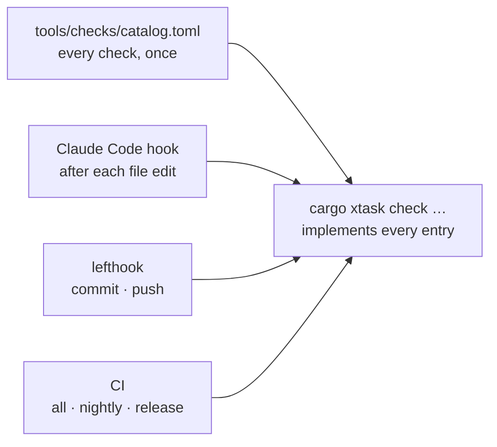

# Architecture checks

The architecture is only true if the code follows it. AI agents write most of the code, so every rule that a machine can check **is** checked, by many small checks rather than one big one (ADR-0020).

## How it works

- **One catalogue, one runner.** Each check has an ID (for example `ARCH-AUTHZ-ONLY`), a plain title, the rule it enforces, the tool, when it runs and which files trigger it. People, agents and CI all run the same code.
- **Small and fast.** A check runs only when its files change. Edit-time checks take under 3 seconds per file and commit-time checks under 10 seconds on a quiet PC, so nobody is tempted to skip them.
- **Explains itself.** A failing check prints one sentence: what's wrong, which rule, and where it's written down.

## Groups of checks

| Group | Guards |
|-------|--------|
| **FMT** | Formatting: rustfmt, oxfmt (TypeScript, JSON, CSS), taplo (TOML), rumdl (Markdown) |
| **LINT** | Linting: clippy, oxlint with type-aware tsgolint (TypeScript 7), stylelint, tsc type check, typos, lychee, actionlint |
| **TXT / STY** | Plain words and design: no literal UI text, message catalog complete, glossary "don't say" words, tokens only, theme contrast |
| **ARCH** | The structure in this document: allowed crate dependencies, pure crates, WebAssembly build, `Authorized<T>` only from the policy engine, only safe types leave the API, HTTP and SQL only at the edges, events for every change, versions and edit-lock tokens on change endpoints, lean list endpoints, permissions declared, settings via the registry, AI tools only from the registry, browser uses only the API client, module map matches the code, docs change with boundaries, no `unsafe`, both databases tested |
| **SEC** | Secrets, private details of the maintainer, dangerous patterns, the permission matrix, security headers, known vulnerabilities |
| **DATA** | Personal-data marks, no personal data in logs, one schema source |
| **DEP / DOC** | Third-party register, licenses, unused dependencies, SBOM, generated files up to date, decision records name their checks |
| **PERF / TEST** | Bundle and WebAssembly budgets, query counts, benchmarks, accessibility, search round trip, edit locks |
| **META** | The checks themselves (next section) |

The full list, generated from the catalogue, follows this chapter.

## Checks that guard the checks

Adding a rule should be easy, and forgetting part of it impossible. The **META** checks make sure that:

1. **Catalogue and implementation match** (`META-CATALOG`): no check without an entry, no entry without a check.
2. **Every check is tested** (`META-FIXTURES`): each has a "bad" example that must fail and a "good" example that must pass, in `tools/checks/fixtures/<ID>/`.
3. **Nothing is unchecked** (`META-COVERAGE`): every file type in the repository is covered by a formatter or linter. Adding the first `.sql`, `.yaml` or `.py` file fails until a check covers it. This is the hook that asks for new hooks. Generated files need no check of their own; the few other exceptions are listed with a reason in `tools/checks/coverage-exemptions.toml`.
4. **New modules are declared first** (`META-NEW-MODULE`): a new crate, package or top-level folder needs a module-map entry and dependency rules.
5. **Every rule is traceable** (`META-RULE-TRACE`): each "must" in the coding standards, decision records and these chapters names its check ID or says *review* with a reason.
6. **Callers agree** (`META-WIRING`): lefthook, the Claude Code hooks and CI call only xtask, with the same lists.
7. **Suppressions are visible** (`META-SUPPRESS`): every `allow`, `oxlint-disable`, ast-grep ignore or "not affected" vulnerability statement needs a reason and an issue ID, and the total can't grow unnoticed. The file types searched are listed in `xtask/src/checks/meta_suppress.rs`.
8. **Checks stay fast** (`META-SPEED`). The 3 and 10 seconds hold on a quiet PC. Several builds often run at once, and wall-clock time alone would then fail a fast check, so the check times a fixed *reference workload* (a few small processes plus some file and CPU work, like a typical check) right before, during and right after each measurement. The budget is a multiple of that reference: the quiet-PC budget times how much longer the reference took than on a quiet PC (the *load factor*, never below 1 and never above 20). Each timing is taken up to 3 times and the best attempt counts, which drops one-off spikes. A check that is slow by itself is slow in every attempt and still fails. The failure names the measured time, the allowed time, the reference time and the load factor, so a human can tell real slowness from load. The numbers (budgets, quiet reference, attempts, ceiling) are defined once, in `xtask/src/checks/meta_speed.rs`.

## Adding a rule

1. Write the rule where it belongs (coding standards, a decision record, or a chapter here), with `Enforced by: <ID>`.
2. Add the entry to `tools/checks/catalog.toml`.
3. Implement it in `xtask/src/checks/`.
4. Add the bad and good examples.

The META checks fail until all four steps are done.
