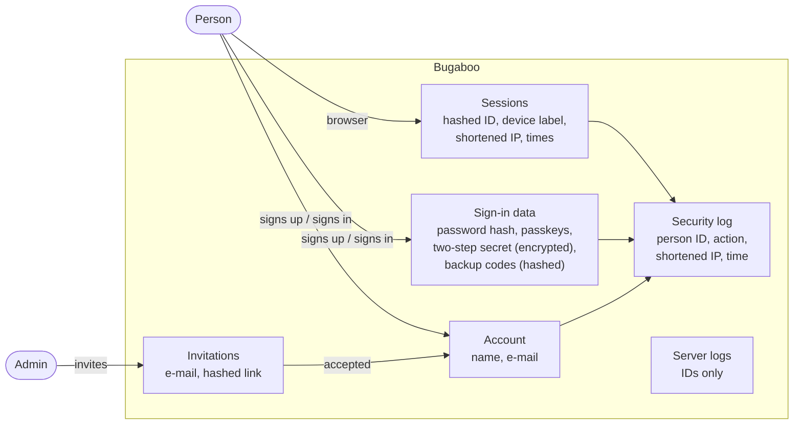

# Security: threat model and personal-data flows

Part of the security and data-flow documentation (COMP-07) for the CRA technical file and for customers' own risk assessments. It covers what is built so far and grows with every milestone: each milestone review checks that new entry points appear here.

The method is STRIDE per trust boundary (boundaries from [Context](02-context.md)). Every threat names the mitigation and what proves it: a check from the catalogue (`tools/checks/catalog.toml`), a test, or *review* when a person decides.

## Scope (status: M1)

| In scope now | Comes later (own section then) |
|--------------|-------------------------------|
| HTTPS and start-up config, security headers, sign-in (password, passkey, two-step codes), sessions, invitations, first-run setup code, rate limits, the security log, stored secrets, logs | Permissions engine (M2), search language (M3), attachments (M5), MCP and the assistant (M9), webhooks and mail (M4), the served model's control plane (M14) |

## Attack surface

Entry points in M1: the HTTPS listener (pages, assets, `/api/v1`, `/health/*`), the console and `bugaboo.toml`, and the data folder on disk.

## Threats and mitigations

### Boundary 1: browser ↔ server

| STRIDE | Threat | Mitigation | Proven by |
|--------|--------|-----------|-----------|
| Spoofing | Password guessing and credential stuffing | Argon2id, breached-password list, per-account and per-IP slow-down, no permanent lockout | sign-in tests (WP-07); rate-limit test (WP-06) |
| Spoofing | Finding out which e-mail addresses have accounts | Same answer and same timing for unknown accounts and wrong passwords | timing test (WP-07); ARCH-ERRORS |
| Spoofing | Stolen password alone is enough | Two-step codes and passkeys; admins can require them per role | sign-in end-to-end tests (WP-08) |
| Spoofing | Someone on the network claims a fresh installation | One-time setup code printed on the server console (AUTH-09) | first-run test (WP-07, WP-08) |
| Spoofing | Invitation links reused or guessed | 256-bit random, stored hashed, single use, 7-day expiry | invitation tests (WP-07) |
| Tampering | Cross-site request forgery | `__Host-` cookie with SameSite, `Origin` check, per-session token header | CSRF tests (WP-07) |
| Tampering | Session fixation | New session ID after sign-in and any permission change | session tests (WP-07) |
| Tampering | Script injection into pages | CSP without inline code or `eval`, Trusted Types, one Markdown renderer | SEC-HEADERS; SEC-PATTERNS |
| Tampering | Clickjacking | `frame-ancestors 'none'` | SEC-HEADERS |
| Information disclosure | Traffic read on the network | HTTPS by default; plain HTTP only on loopback or behind a configured trusted proxy; HSTS | TLS start-up tests (WP-04); SEC-HEADERS |
| Information disclosure | Error messages leak internals or hidden things | problem+json with a code and message key only; details go to the log | ARCH-ERRORS |
| Information disclosure | Path tricks reach files outside the app (`..`, Windows short names, odd percent-encoding) | Strict path decoding; 8.3 short names refused | static-file tests (WP-04, M0-F08) |
| Denial of service | Flooding sign-in or the API | Rate limits, request size limits, cheap rejection before Argon2id work | rate-limit test (WP-06) |
| Elevation of privilege | Stolen session cookie used elsewhere | HttpOnly, Secure, idle and absolute timeouts, *Where you're signed in* to end sessions | session tests (WP-07) |

### Boundary 4 (operator ↔ data) and the host

| STRIDE | Threat | Mitigation | Proven by |
|--------|--------|-----------|-----------|
| Information disclosure | Stored secrets read from a database copy or backup | Envelope encryption with XChaCha20-Poly1305; the master key lives outside the database | secrets tests (WP-05) |
| Information disclosure | Other local users read keys or certificates | `keys/` and `tls/` created owner-only (Windows ACL, Unix mode 0700/0600) | data-folder tests (WP-04) |
| Information disclosure | Personal data ends up in logs | Logs hold IDs only; IP addresses shortened | DATA-LOGS |
| Information disclosure | Secrets committed to the repository | Secret scanning on every commit | SEC-SECRETS |
| Repudiation | An admin denies an action, or someone edits the security log | Append-only, hash-chained security log with a verify command; status page shows the result | hash-chain property test (WP-05) |
| Tampering | A vulnerable or unlicensed dependency ships | Register, license allow list, advisory scan | DEP-REGISTER; DEP-LICENSES; SEC-ADVISORIES |
| Tampering | Database changes outside the defined schema | Schema and migrations defined once in Rust, refused on a newer schema | DATA-MIGRATIONS; ARCH-DB-PARITY |
| Elevation of privilege | Memory-safety bugs | No `unsafe` code unless an ADR allows it | ARCH-NO-UNSAFE |

### Accepted risks

| Risk | Why accepted | Revisit |
|------|-------------|---------|
| An administrator of the host machine can read the master key | Anyone with full control of the host can read process memory too; protection against them is out of scope for self-hosted installations | M14 (served model: keys per customer, operator without data access) |
| Self-signed certificates show a browser warning | Safer than plain HTTP; admins can provide a certificate, ACME comes in 1.0 | V1 (ACME) |

## Personal data in M1

The map below is written by hand for M1. From M1 WP-05 on, `cargo xtask gen privacy` generates the complete list from the personal-data marks (ADR-0015) into `docs/privacy/personal-data.md`; this diagram then only shows the flows.

| Data | Purpose | Legal basis (GDPR Art. 6) | Kept |
|------|---------|---------------------------|------|
| Name, e-mail | Account, sign-in, showing who did what | (b) contract / employment | While the account exists; then *Remove a person* (M2) |
| Password hash, passkeys, two-step secret, backup codes | Sign-in | (b) contract; (f) security | Until changed or the account is removed |
| Sessions with shortened IP and device label | Staying signed in, *Where you're signed in* | (b) contract; (f) security | Until signed out or expired |
| Invitation e-mail | Sending and checking the invitation | (b) contract | Until accepted or 7 days |
| Security log entries | Proving who did what (SEC-15) | (c) legal obligation; (f) security | Keep period set by the admin (default 1 year); hash chain stays valid when old entries are deleted in whole blocks |
| Shortened IP in logs | Abuse defence | (f) security | 7 days by default |

No personal data leaves the server in M1: no mail, no AI, no outside fonts, scripts or analytics (PRIV-01).
