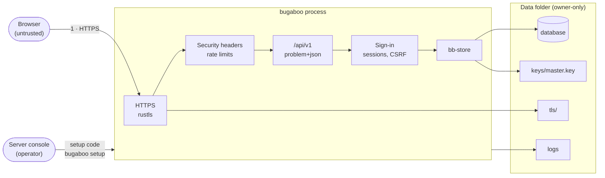
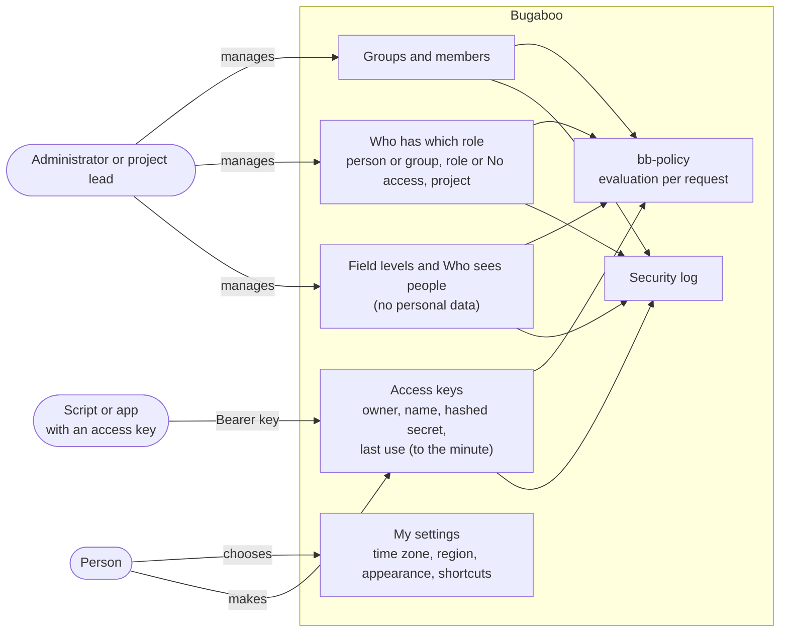

# Security: threat model and personal-data flows

Part of the security and data-flow documentation (COMP-07) for the CRA technical file and for customers' own risk assessments. It covers what is built so far and grows with every milestone: each milestone review checks that new entry points appear here.

The method is STRIDE per trust boundary (boundaries from [Context](02-context.md)). Every threat names the mitigation and what proves it: a check from the catalogue (`tools/checks/catalog.toml`), a test, or *review* when a person decides.

## Scope (status: M3 built, M4 planned)

| In scope now | Comes later (own section then) |
|--------------|-------------------------------|
| HTTPS and start-up config, security headers, sign-in (password, passkey, two-step codes), sessions, invitations, first-run setup code, rate limits, the security log, stored secrets, logs (M1); the permission engine (roles, groups, assignments, *No access*, field masks, *Who sees people*), projects and short names, access keys, two-step sign-in by role, settings in layers (M2); issues with their text, comments, tags and labels, own fields, layouts, edit locks and drafts, changing many issues and the background jobs that carry it (M3) | Attachments, mail and workflows (M4; threats below), search language (M5), MCP and the assistant (M8), *Remove a person* and exports (M9), webhooks (M12), the served model's control plane (M14) |

## Attack surface

Entry points in M1: the HTTPS listener (pages, assets, `/api/v1`, `/health/*`), the console and `bugaboo.toml`, and the data folder on disk. M2 adds no new listener: the new routes are below `/api/v1`, and scripts reach them with an access key (`Authorization: Bearer bb_…`) instead of a cookie. The sample-organization program (`bb-sample`) is a developer tool and is not shipped before OPS-12.

## Threats and mitigations

### Boundary 1: browser ↔ server

| STRIDE | Threat | Mitigation | Proven by |
|--------|--------|-----------|-----------|
| Spoofing | Password guessing and credential stuffing | Argon2id, breached-password list, slow-down per account, person and network (failed tries only, reserved before they are checked so parallel requests are not parallel guesses, cleared by a success), a window that doubles up to 15 minutes after every window that ended with a failure (pacing does not help), never a permanent lock; the keys of a network keep a window of a minute and do not grow, because many people share a network | `sec_14_only_failed_tries_count_and_a_success_clears_them`, `sec_14_parallel_wrong_tries_at_one_account_get_no_more_than_the_allowance`, `sec_14_pacing_the_tries_just_under_the_allowance_does_not_dodge_the_growing_wait`, `sec_14_the_window_of_a_network_stays_a_minute_however_often_it_fails`, `sec_14_only_a_finished_second_step_clears_the_wrong_codes_of_a_person`, `sec_14_failures_of_one_network_are_limited_whatever_the_account`, `sec_14_failed_sign_ins_are_turned_away_with_a_wait_and_the_answers_look_alike`, `sec_14_one_network_is_limited_in_its_tries_whatever_the_account`; `auth_01_*` (password rules) |
| Spoofing | Finding out which e-mail addresses have accounts | Same answer and same work for unknown accounts and wrong passwords; no error says which of the two was wrong | `auth_01_an_unknown_address_and_a_wrong_password_get_the_same_answer`, the timing test `auth_01_an_unknown_account_takes_as_long_as_a_wrong_password`; ARCH-ERRORS |
| Spoofing | Stolen password alone is enough | Two-step codes (TOTP with backup codes) and passkeys; administrators ask them of everybody (`security.two-step-required`) or of a role (the switch on the role, ADR-0025; see the M2 rows below) | `auth_03_*`, `auth_02_*` (`crates/bb-server/src/tests/sign_in/`) |
| Spoofing | Guessing or replaying a code of the second step after a password was stolen | A code works once (its step is written in the same change that opens the session), wrong codes count against the person and, after 10 in one half-finished sign-in, end it, backup codes are 80 bits and stored hashed | `auth_03_signing_in_with_a_code_opens_a_new_session_and_a_code_works_once`, `sec_14_wrong_second_step_codes_are_limited_per_person`, `sec_14_parallel_wrong_codes_at_one_half_finished_sign_in_get_no_more_than_the_allowance`, `sec_14_ten_wrong_codes_end_the_half_finished_sign_in_and_are_written_down`, `auth_03_a_code_step_is_accepted_once_even_when_requests_race` |
| Elevation of privilege | A thief with a stolen session adds a code app or a passkey of their own and keeps access | Adding a way to sign in asks for the password again (when it starts and when it is finished) | `sec_12_a_stolen_session_cannot_add_a_code_app_without_the_password`, `sec_12_a_stolen_session_cannot_add_a_passkey_without_the_password` |
| Spoofing | A passkey answer replayed, made by another passkey, or for another person | A challenge works once, for 5 minutes and for one person; the passkey is one the person registered; the answer is checked by `webauthn-rs`. A new passkey is asked to be discoverable (`residentKey: preferred`), so that it can also sign in on its own, without the password; a device that cannot store one still works as a second step | `auth_02_a_passkey_finishes_signing_in_after_the_password`, `auth_02_a_passkey_signs_in_on_its_own` |
| Spoofing | Someone on the network claims a fresh installation | One-time setup code printed on the server console only (a server that runs as a service has no console, so the code goes into `setup-code.txt` in the data folder, made in a folder of its own, under a name with random bytes, made new with a plain create (a name that is taken is never used, whoever made it) that only the account can enter (mode `0700`, or on Windows an access list for the account alone), made private itself (mode `0600`, or on Windows an access list for the service account with full control and the administrators of the computer with read, nothing inherited), filled, and only then moved into place, so nobody who can read the data folder can catch it half-made, and a failed write leaves nothing behind; when it cannot be saved the console says so and where else to look, never printing the code; the code is dead once the administrator exists, and the use case that makes the administrator deletes the file in the same run through a port that the server implements, with the clean-up at the next start as a safety net, M1-F58); stored hashed, replaced at every start, used up by the change that makes the administrator, wrong codes limited | `auth_09_*` (`setup_and_password.rs`, and `auth_09_the_setup_code_file_is_gone_once_the_administrator_exists` in `wiring.rs`) and the TLS test `sec_12_over_tls_and_http2_a_person_sets_up_signs_out_and_signs_in_again` |
| Spoofing | Invitation links reused or guessed | 256-bit random, stored hashed, single use, 7-day expiry; the answer never says why a link does not work | `auth_06_an_administrator_invites_and_the_link_works_once`, `auth_06_an_invitation_runs_out_after_seven_days`, `auth_06_two_people_with_the_same_link_create_one_account` |
| Tampering | Cross-site request forgery | `__Host-` cookie with SameSite, `Origin` check, per-session token header checked for every change in constant time | `sec_12_a_change_needs_the_token_of_its_own_session`, `sec_12_every_route_that_changes_something_checks_the_token_except_signing_in_and_up`, `sec_12_every_session_has_its_own_secret_and_its_own_csrf_token` |
| Tampering | Session fixation | A new secret at sign-in, when the second step is done and when the password is changed | `auth_03_signing_in_with_a_code_opens_a_new_session_and_a_code_works_once`, `sec_12_changing_the_password_ends_other_sessions_and_gives_a_new_secret`, `sec_12_every_session_has_its_own_secret_and_its_own_csrf_token` |
| Tampering | Script injection into pages | CSP without inline code or `eval`, Trusted Types, one Markdown renderer whose HTML is written from the parsed text, never cleaned afterwards | SEC-HEADERS; SEC-PATTERNS; SEC-RICHTEXT; the tests `sec_13_the_sanitizer_corpus_renders_every_attack_as_text` and `sec_13_server_and_browser_render_the_same_html` |
| Tampering | Clickjacking | `frame-ancestors 'none'` | SEC-HEADERS |
| Information disclosure | Traffic read on the network | HTTPS by default; plain HTTP only on loopback or behind a configured trusted proxy; HSTS | TLS start-up tests (WP-04); SEC-HEADERS |
| Information disclosure | A shared computer or a cache keeps answers with a person's data after they have left | Answers with personal data (who is signed in, sessions, invitations, second step, the state of the server) are `no-store` and have no tag; every other read is `private, no-cache` with an `ETag`; the answer that clears the session cookie also sends `Clear-Site-Data: "cache"` | `perf_03_answers_with_personal_data_are_never_stored_for_anybody`, `perf_03_only_a_read_is_never_stored_and_every_read_is_ordinary_or_never_stored`, `sec_12_signing_out_clears_what_the_browser_cached` |
| Information disclosure | A secret in an answer (a new session, an invitation link, the code app, backup codes) is stored, or leaks through compression of text an attacker chooses (BREACH) | A route declared `Secret` in the route table (marked `x-secret`), or an answer that sets a cookie, makes the answer `no-store`, tagless and uncompressed; a route whose answer has a field named like a secret and is not declared `Secret` fails a test | `perf_03_a_route_whose_answer_has_a_field_named_like_a_secret_is_declared_a_secret`, `perf_03_answers_with_a_secret_are_not_stored_or_compressed` |
| Information disclosure | BREACH: a compressed answer that holds a secret next to text an attacker chooses gives the secret away through its size | Secret answers are never compressed, whatever their size: the compression skips every answer marked as a secret (a route marked `x-secret`) and every answer that sets a cookie; JSON answers that hold no secret are compressed above 1 KiB (M2-Q2) | `perf_03_no_route_that_hands_out_a_secret_is_compressed` (every route of the API description), `sec_11_an_answer_that_hands_out_a_secret_is_never_compressed_however_big`, `perf_03_a_big_answer_that_sets_a_cookie_is_never_compressed_whatever_the_route`, `perf_03_answers_with_a_secret_are_not_stored_or_compressed` |
| Tampering | A client changes, makes up or reuses a cursor (of another list, or from before a restart) to read another position | A cursor is sealed with `HMAC-SHA256` under a key made at each start and bound to its list; it holds only a position, and every filter and permission comes from the request each time | `perf_02_a_cursor_that_is_cut_empty_made_up_or_for_another_list_is_refused`, `perf_02_paging_walks_every_item_once_and_refuses_a_changed_cursor`; review (no route puts a filter or a permission into a cursor) |
| Information disclosure | A cursor, which a client can read, names a project or a person the viewer cannot see (a page that stopped after looking at hidden ones) | A cursor is made of the last item the page showed, or of whole stretches that were looked at; never of something left out of the page | `auth_07_the_cursor_of_the_projects_for_a_key_holds_no_name_of_a_project_hidden_from_the_person` (WP-09); review for every other list |
| Information disclosure | Error messages leak internals or hidden things | problem+json with a code and message key only; details go to the log | ARCH-ERRORS |
| Information disclosure | Passwords, session secrets, codes or links end up in events, the security log or logs | Credentials are never part of the changes of an event; the log holds IDs, actions and shortened networks only | `sec_16_no_secret_is_written_to_an_event_or_to_the_security_log`, DATA-LOGS |
| Information disclosure | Path tricks reach files outside the app (`..`, Windows short names, odd percent-encoding) | Strict path decoding; 8.3 short names refused | static-file tests (WP-04, M0-F08) |
| Denial of service | Anonymous starts of passkey sign-in fill the waiting challenges so that the second step or adding a passkey cannot start | A pool for each kind of ceremony and a cap for each network | `sec_14_one_network_and_one_kind_of_ceremony_cannot_fill_the_waiting_challenges` (`bb-auth`) |
| Denial of service | Flooding sign-in or the API | Rate limits, request size limits, cheap rejection before Argon2id work (a password over 256 characters is refused at once, and hashing runs on as many threads as the computer has processors) | rate-limit test (WP-06), `sec_14_one_network_is_limited_in_its_tries_whatever_the_account` (every try of the sign-in family, 60 a minute) |
| Repudiation | A sign-in, a failed try, a limit or a change of credentials leaves no trace | Every sign-in event is written to the security log, whose chain verifies | `sec_15_the_security_log_of_signing_in_verifies_and_names_what_happened`, `adr_0007_*` (an event for every change) |
| Elevation of privilege | Stolen session cookie used elsewhere | HttpOnly, Secure, idle and absolute timeouts, *Where you're signed in* to end sessions | `sec_12_a_session_ends_after_it_was_idle_too_long_and_use_keeps_it_alive`, `sec_12_a_session_ends_after_the_absolute_time_however_busy_the_person_is`, `sec_12_people_list_their_sessions_and_end_any_of_them` |
| Elevation of privilege | A person makes invitations or changes who may sign up | Administrators only | `auth_06_only_administrators_manage_invitations`, `auth_06_signing_up_is_off_by_default_and_only_administrators_change_the_rule` |

### Permissions, projects and access keys (M2)

The model is [ADR-0025](../adr/0025-roles-groups-and-assignments.md) and [§7, *Authorization model*](07-cross-cutting.md#authorization-model). The trust boundary is the same (browser or script ↔ server); what is new is that the server now decides between people who are all signed in. The packages that build a row add its test when they merge; a name in the last column that does not exist yet is the test the package's plan asks for.

| STRIDE | Threat | Mitigation | Proven by |
|--------|--------|-----------|-----------|
| Elevation of privilege | A route or use case forgets to ask the policy engine, or answers a plain domain type | Every route declares its permission; only `bb-policy` builds `Authorized<T>`; the answer wrapper for a view takes nothing else, and the few answers that go around it (the steps of signing in and the caller's own sign-in data) are named one by one (M2-F61); a generated matrix runs every route for every kind of actor | ARCH-PERMS, ARCH-AUTHZ-ONLY, ARCH-API-OUT, SEC-MATRIX (WP-05, WP-10) |
| Elevation of privilege | A person edits a role they hold (or gives a role) to get more than they have | *Manage roles* counts only for the whole organization; nobody adds a permission to a role, or gives a role, unless they hold every permission of it at that place themselves | `sec_08_nobody_adds_a_permission_they_do_not_hold_to_a_role`, `sec_02_nobody_gives_a_role_with_more_than_they_hold_there` (WP-05), `sec_08_nobody_gives_a_replacement_with_more_than_they_hold` (WP-11, over HTTP), SEC-MATRIX |
| Denial of service | The last administrator is removed, or a project lead puts *No access* on the administrators, and nobody can manage roles any more | A change that leaves nobody with *Manage roles* and *Decide who has which role* for the whole organization is refused; *No access* never takes *Decide who has which role* from people who hold it from above | `sec_08_nobody_can_remove_the_last_way_to_manage_roles`, `sec_03_no_access_cannot_lock_out_the_people_who_decide_roles_above` (WP-05), `sec_08_nobody_removes_the_last_way_to_manage_roles_over_http` (WP-11) |
| Denial of service | A person loses their own way to manage roles by a change that does not look like it (a row of a group they are in, *No access* on themselves, leaving a group, changing the role) | The page asks the engine what the change takes from the person (`checkOwnAccessChange`: the person's own rows and roles with the change applied, evaluated again, nothing written) and asks first only then; a person who may not make the change is told it takes nothing | `sec_08_taking_a_row_of_a_group_you_are_in_is_told_to_take_your_way_to_manage_roles`, `sec_08_no_access_on_yourself_or_your_group_is_told_when_it_takes_the_way_to_decide`, `sec_08_a_person_who_may_not_apply_the_change_is_told_it_takes_nothing_and_nothing_more` (WP-11), SEC-MATRIX |
| Elevation of privilege | The M1 upgrade turns the wrong people into administrators, or leaves none | The migration keeps the M1 list; the first start gives exactly those people the Administrator role, with events and security-log entries | `sec_08_m1_administrators_become_administrators_and_nobody_else_does` (WP-05, both databases) |
| Elevation of privilege | A project is moved under a project where somebody has a role with sub-projects, which keeps *Decide who has which role* above a *No access* inside it, so they can take away a *No access* that applies to them (M2-F23) | `bb-policy` compares the tree as it is with the tree as it would be (`preview_move`) and lists everybody who could lift a *No access* after the move and could not before; the move is refused (`project.move_lifts_no_access`), before the preview is looked at, inside the change after the policy lock; the preview names those people | `prj_03_a_move_cannot_let_somebody_lift_a_no_access_they_are_subject_to` (engine and both databases) |
| Elevation of privilege | A role taken away keeps working because an evaluation was kept | Evaluations live for one request only | `sec_03_a_role_taken_away_counts_from_the_next_request` (WP-05); review (the cache lives in the request context) |
| Information disclosure | Reaching a hidden project by its address or its short name, old short names included | A hidden project answers `resource.not_found` exactly like a missing one; a visible sub-project of a hidden project is shown at the top and never names its parent; old short names stay with their project | `prj_01_a_hidden_project_answers_not_found_like_a_missing_one`, `prj_01_a_visible_sub_project_of_a_hidden_project_does_not_name_it`, `prj_01_an_old_short_name_redirects` (WP-08), SEC-MATRIX |
| Information disclosure | Probing short names to learn that a hidden project exists | Only people who can create projects at that place learn that a short name is taken, and the sentence is the same whether the project is hidden or not | `prj_01_a_taken_short_name_is_told_only_to_people_who_may_create_projects` (WP-08) |
| Information disclosure | Counts that include hidden things (sub-projects, members, *Used by*, people who still need a second step) | No total in any list answer; counts only of what the viewer can see; a hidden member list is left out with its number | ARCH-NO-COUNTERS; `priv_13_no_project_answer_holds_a_count` (WP-08), `priv_13_used_by_counts_only_what_the_viewer_may_see` (WP-11) |
| Information disclosure | Deleting a role says by *yes* or *no* (`role.in_use`) that somebody has it in a place the person cannot see | Accepted: a person who may delete roles learns only that the role is used somewhere, not where or by whom; the counts of *Used by* stay within what they see | `sec_08_a_role_in_use_is_deleted_only_with_a_replacement` (WP-11) |
| Information disclosure | A move preview that was made for one tree is used to move another, or a person confirms a move whose effect they never read | The move asks for the version of the preview (a digest of the project, both parents, who has which role and the levels the roles set) and works only while it is still the version of the stored state, judged inside the change after the policy lock | `prj_03_a_move_after_the_tree_changed_asks_again` |
| Information disclosure | A hidden field read through an answer, `fields=`, the move preview or *Check access* | `Authorized<T>` leaves hidden fields out; asking for one fails like an unknown field; previews and *Check access* use the same mask | `sec_06_a_hidden_field_is_missing_from_every_m2_answer_and_cannot_be_asked_for` (WP-12), SEC-MATRIX (field rows) |
| Information disclosure | A name or e-mail address reaches a viewer whose *Who sees people* is *Role only* or *Hidden* | Every person is a `PersonRef`, resolved for the viewer; a role label and *Someone* carry no ID; e-mail addresses only for the person and *Manage people* | ARCH-PERSON-REF; `priv_12_a_guest_sees_role_only_or_someone_as_set_and_no_name_reaches_their_browser` (WP-12), SEC-MATRIX (people rows) |
| Information disclosure | *Check access* or the move preview names a project the person cannot see | Reasons name only projects the checker sees (others are *a project you can't see*); moving takes the right in both parents | `sec_03_check_access_names_no_project_the_checker_cannot_see`, `sec_03_check_access_over_http_names_no_project_the_checker_cannot_see_and_agrees_with_the_engine` (WP-12), `prj_03_the_move_preview_names_who_gains_and_loses_access` (WP-08) |
| Information disclosure | *Former user* labels count up or can be traced back to the person | Random Crockford Base32 codes from the secure random source, unique, never made from the ID | `priv_13_former_user_labels_are_random_and_unique` (WP-05) |
| Spoofing | A stolen access key | Shown once, only a hash stored; every key runs out (at most a year); a limit per key; a key never reaches the owner's sign-in data, so it cannot take the account over; making, deleting and refusing keys is in the security log; a secret-scan rule finds keys in commits | `auth_07_a_key_is_shown_once_and_only_its_hash_is_stored`, `auth_07_a_key_cannot_change_the_owners_sign_in_data`, `auth_07_no_route_of_the_owners_sign_in_data_opens_for_a_key`, `sec_14_a_key_has_its_own_limit`, `sec_15_making_and_deleting_keys_is_in_the_security_log`, `auth_07_the_last_use_of_a_key_is_kept_to_the_minute`; SEC-SECRETS (the rule `bugaboo-access-key`, with its fixtures) |
| Elevation of privilege | A key that outlives its owner's permissions, or that holds more than the owner | A key has no permissions of its own: at every use it is the owner's evaluation narrowed by its choice and projects | `auth_07_a_key_can_do_only_what_its_owner_can_and_its_scopes_allow` (property test), `auth_07_a_key_does_what_its_choice_allows_and_never_more_than_its_owner`, `auth_07_a_key_for_projects_counts_in_them_and_their_sub_projects_only`, `auth_07_a_key_follows_its_owner_losing_a_role_at_once` (WP-09), SEC-MATRIX (key actors) |
| Spoofing | Guessing keys, or telling an expired key from a wrong one | 256-bit secrets; an expired, a deleted, an unknown and a malformed key get the same answer; guessing is limited per network by the failed tries: the key is looked up first, only a lookup that fails counts and is answered with a wait when the network is over its limit, and a key that works never touches the counter, so keys used at the same time or on a network where others guess are never turned away; the network limit and the per-key limit | `auth_07_an_expired_a_deleted_and_an_unknown_key_get_the_same_answer`, `auth_07_an_expired_a_deleted_and_an_unknown_key_get_the_same_answer_over_http`, `sec_14_guessing_keys_is_limited_per_network_and_a_working_key_costs_nothing`, `sec_14_keys_that_work_are_never_turned_away_when_they_are_used_at_the_same_time`, `sec_14_a_network_over_its_limit_is_made_to_wait_but_a_key_that_works_still_passes` (WP-09) |
| Spoofing | A person whose role asks for two-step sign-in keeps working with the password alone | The switch on the role (and the one of the organization) counts from the next request, also in a session that was open before: the session can only set up a second step, and the keys of that person are refused until they have | `auth_03_a_role_that_requires_two_step_sign_in_makes_its_people_set_it_up_first`, `auth_03_a_passkey_is_a_second_step_too`, `auth_03_a_role_held_through_a_group_or_on_a_project_counts_too`, `auth_03_the_organization_switch_asks_everybody_for_a_second_step`; for keys: `auth_03_a_key_made_before_the_switch_is_refused_until_its_owner_sets_up_a_second_step`, `auth_03_a_key_cannot_switch_off_the_requirement_of_its_owner` (WP-09) |
| Elevation of privilege | A stolen key invites a new administrator, takes roles away or changes the settings of the organization (the two-step requirement, signing up, session lengths) | A key never keeps *Invite people*, *Manage people*, *Manage groups*, *Manage roles*, *Decide who has which role*, *Decide what roles see* or *Change organization settings*, whatever its choice: narrowing removes them, the form does not offer them, the server refuses a key made with one | `auth_07_a_key_never_invites_people_or_changes_roles_whatever_its_choice`, `auth_07_single_permissions_of_a_key_never_include_those_a_key_never_holds`, `auth_07_a_key_can_do_only_what_its_owner_can_and_its_scopes_allow` (WP-09) |
| Elevation of privilege | A thief with a stolen session makes an access key that outlives the session | Making a key asks for the password again; deleting needs only the session (it takes away, never adds); *Sign out everywhere* deletes every key of the person, and a password change leaves them | `auth_07_making_a_key_checks_the_password_the_name_and_the_choice`, `auth_07_sign_out_everywhere_ends_the_keys_and_a_password_change_leaves_them` (WP-09) |
| Elevation of privilege | An access key changes the settings of the organization, of a project it does not count in, or the person's own settings when it can only look | The settings use cases ask through the actor, so the key narrows what they get: *Change organization settings* is one of the permissions no key keeps, a key limited to projects gives nothing in other projects, and a key that cannot change anything is refused on *My settings* writes (reading stays allowed) | `auth_07_no_key_reaches_the_settings_of_the_organization`, `auth_07_a_key_limited_to_a_project_cannot_change_the_settings_of_another`, `auth_07_a_key_that_can_only_look_reads_my_settings_and_changes_none` (WP-07) |
| Elevation of privilege | A page of another website makes the browser send a key, or a request with a key skips the origin check and the token for a request that is not from a script | The header `Authorization` needs a preflight and the server answers none (no CORS); only a request with a well-formed key and no session cookie skips the origin and token checks | `sec_06_a_page_of_another_website_cannot_send_a_key`, `auth_07_a_script_with_a_key_needs_no_origin_no_token_and_no_cookie` (WP-09) |
| Information disclosure | The cookie and the cache of a session that has ended stay in the browser, so the next person on the computer sees what was kept | A `401` for a session that has ended clears both cookies and the cache (`Clear-Site-Data`); a session waiting for its second step is left alone | `m2_f06_a_session_that_ran_out_is_answered_with_the_cookies_cleared`, `m2_f06_a_cookie_that_opens_no_session_is_cleared_too`, `m2_f06_a_session_that_waits_for_its_second_step_is_not_cleared` (WP-09) |
| Repudiation | A change of roles, groups, assignments, field levels, *Who sees people*, project moves or access keys leaves no trace | Each writes its event and a security-log entry in the same change | ARCH-EVENTS; `sec_15_every_change_of_permissions_is_in_the_security_log` (WP-05) |
| Tampering | A changed or old cursor, ETag or cached answer shows another person's view | Cursors hold only a position and every permission comes from the request; ETags are made from the answer after masking | `perf_02_paging_walks_every_item_once_and_refuses_a_changed_cursor`, `perf_03_every_get_answers_an_etag_and_304_on_a_match` |

### Issues, text and editing (M3)

M3 stores text that people write and shows it to others, and lets several people edit one issue. Each row names the test that proves it ([M3 plan](../milestones/M3/README.md)).

| STRIDE | Threat | Mitigation | Proven by |
|--------|--------|-----------|-----------|
| Information disclosure | A hidden issue is told apart from a missing one: by the answer, or by a count, a gap in the counting IDs or a guess at a neighbouring ID | A hidden issue and a missing one answer `resource.not_found` alike; a Guest sees only the issues they reported; no answer holds a count; projects give random IDs unless their lead chooses counting | TEST-ISSUE-IDS, ARCH-NO-COUNTERS; `iss_01_a_hidden_issue_answers_not_found_like_a_missing_one`, `iss_01_a_guest_sees_only_the_issues_they_reported`, `priv_13_no_issue_answer_holds_a_count`, `iss_01a_random_ids_use_the_readable_alphabet_and_never_repeat` (WP-03) |
| Information disclosure | A nested view (an issue inside an issue, people inside an issue) carries a field the reader may not see; or a field is asked for by name to find out that it exists | A view is masked by `#[derive(Masked)]`, which makes every member say how it is masked; asking for a hidden field fails like asking for one that does not exist | SEC-MATRIX; `sec_04_a_nested_view_never_carries_a_hidden_field`, `sec_06_issue_answers_refuse_every_field_the_role_may_not_see` (WP-03) |
| Elevation of privilege | A person changes, deletes or restores an issue, or an issue type, without the permission, or changes a field their role may only see | Each route asks the engine for the permission of its place and for the level of every field it changes; changing issue types is organization-wide and never in a key | SEC-MATRIX (the issue rows), `iss_01_a_person_makes_and_changes_an_issue_they_may`, `iss_02_only_people_who_manage_issue_types_create_and_change_them` (WP-03) |
| Tampering, elevation of privilege | Script in a description, comment or long-text field runs in another person's browser (stored XSS) | One renderer, `bb-markdown`, with one allowlist; no raw HTML, `javascript:` or `data:` links; outside images only from hosts an administrator allows; the browser sets HTML only in one component, behind a Trusted Types policy (ADR-0011, SEC-13) | SEC-RICHTEXT (corpus), SEC-PATTERNS, ARCH-PURE (WP-02) |
| Information disclosure | A relation, a sub-issue, a progress count or an issue-ID chip shows that a hidden issue exists | Relations and chips resolve only for issues the reader may see; progress counts only visible sub-issues (PRIV-13) | `iss_04_a_relation_to_a_hidden_issue_is_not_shown`, `iss_03_progress_counts_only_the_sub_issues_you_see`, `iss_05_a_hidden_issue_id_in_a_comment_stays_text` (WP-07) |
| Information disclosure | History, autocomplete or mentions reveal a hidden field, a hidden project's tags or a hidden name | History is filtered by the reader's mask; autocomplete and the list of tags for the people who look after them offer only tags used on issues the reader reads (every issue where they hold *See issues*, their own elsewhere, none where *Tags* is hidden for the project and issue type), and a field the role hides on an issue type is hidden on every path that shows the issue, because a use case can only ask for the mask of the issue's type; mentions follow *Who sees people* | `iss_06_history_leaves_out_changes_to_fields_the_reader_cannot_see`, `tag_01_autocomplete_never_offers_a_tag_only_used_in_a_hidden_project`, `sec_06_a_person_who_sees_only_their_own_issues_is_offered_only_their_own_tags`, `sec_06_a_tag_manager_with_no_access_to_a_project_does_not_list_its_tags`, `sec_06_a_related_issue_is_shown_by_the_levels_of_its_own_type`, `iss_05_a_guest_can_mention_a_role_but_not_a_person` |
| Information disclosure | "… is editing" names a person the reader may not see | Lock notices are a `PersonRef` of the kind *Editing*, else *Someone* (ADR-0022) | ARCH-PERSON-REF; `iss_17_a_second_person_sees_who_is_editing_or_someone` (WP-04) |
| Elevation of privilege | Changing many issues at once skips the check of one of them | The preview evaluates every issue on its own; applying checks each issue again with its version | `iss_09_an_issue_you_cannot_change_is_skipped_with_its_reason` (WP-08) |
| Tampering | A save with a lock that ran out or was taken over, or on a stale version, overwrites what another person wrote, or the text of the person whose save is refused is lost | The save checks the lock token and runs the write with the version inside one change; a refusal keeps the text as the person's draft and answers `edit.lock_lost`, `edit.taken_over` or the structured `edit.version_changed` | `iss_17_a_save_with_a_lost_lock_is_refused_and_the_text_kept`, `iss_17_edit_anyway_keeps_the_first_persons_text_as_their_draft`, `iss_17_a_stale_version_answers_who_changed_what` (WP-04) |
| Repudiation | An administrator ends somebody else's editing and nothing shows it | Releasing a lock that another person holds writes an event and `edit_lock.released` into the security log; letting go of one's own lock does not | `sec_17_releasing_a_stuck_lock_is_in_the_security_log` (WP-04) |
| Information disclosure | A draft (personal text) is read by somebody else or kept forever | Drafts are readable only by their author, deleted on save and after 30 days | `iss_11_a_draft_is_readable_only_by_its_author`, `iss_11_a_draft_goes_after_save_and_after_its_keep_period` (WP-04) |
| Information disclosure | A lock or a draft is made for a part a record does not have, or for a long text the role hides, and "somebody is editing" tells that it exists | Each kind of record lists its valid parts (an issue: `description` and the long text of an own field, seen to read a lock and changed to take one); other parts answer not found; a person keeps 200 drafts at most: past that the oldest goes in the same change and no save is refused for it (ADR-0019). A layout is known to the people who hold *Manage issue types* where it sits | `sec_06_a_lock_or_draft_is_only_for_a_part_the_record_has_and_the_role_lets_in`, `sec_06_past_the_cap_the_oldest_draft_goes_and_no_save_is_refused`, `sec_06_a_layout_is_not_known_to_who_cannot_edit_layouts` (WP-12) |
| Elevation of privilege | Somebody with only *Edit anyway* ends the editing of a record they may not change | Releasing a stuck lock needs the right to change the record too, like *Edit anyway* (SEC-MATRIX quirk `AlsoNeeds`) | `sec_04_releasing_a_stuck_lock_needs_the_right_to_change_the_record_too` (WP-12) |
| Denial of service | One comment with thousands of different `@names` or issue IDs makes every page that shows it cost thousands of statements | One text names at most 50 mentions and 100 issue IDs (`MAX_RESOLVED_MENTIONS`, `MAX_RESOLVED_ISSUE_IDS`), the rest stays text; groups and roles are read once for a request | `sec_06_one_text_resolves_a_bounded_number_of_mentions_and_issue_ids` (WP-12) |
| Elevation of privilege | A change to many issues goes on in the background in the name of a person who signed out everywhere, changed their password or lost their device | The run can be stopped by who asked and by whoever holds *Manage people*, who is told the status only; *Sign out everywhere* and a new password stop the runs of the person that are not over; a stopped run (status `stopped`) is looked at before each issue and never changed again | `iss_09_a_run_is_stopped_by_who_asked_and_by_an_administrator_and_by_nobody_else`, `sec_12_signing_out_everywhere_stops_the_runs_of_the_person`, `sec_12_changing_the_password_stops_the_runs_of_the_person` (WP-12) |
| Information disclosure | Restoring from the trash, a missing comment or relation, or a hidden parent tells the person that something exists | Somebody without the right to restore is told not found; a missing comment or relation costs the work of a hidden one; taking out a parent the person cannot see changes nothing | `sec_06_whoever_cannot_restore_a_comment_is_not_told_it_is_in_the_trash`, `sec_06_a_hidden_comment_or_relation_and_a_missing_one_cost_the_same_reads`, `sec_06_taking_out_a_parent_the_person_cannot_see_changes_nothing_and_says_nothing` (WP-12) |
| Information disclosure | A description or a long text shows every `@name` and issue ID as a chip, hidden ones too | The description and the long texts of own fields are rendered with the same `Ctx::html_of` as comments | `sec_06_the_description_makes_a_chip_only_of_what_the_reader_may_see` (WP-12) |
| Denial of service | A pattern rule of an own field or a huge text slows the server | Patterns run on a linear-time engine with a length cap; text length and nesting have named limits | `cf_03_a_required_field_and_a_rule_refuse_a_wrong_value_with_a_sentence` (WP-05), the corpus of WP-02 |

### Workflows, files and notifications (M4)

M4 takes files from people, sends mail out of the server for the first time, and lets workflows decide who may change a status. Each row names the check or test that proves it; the packages add the test names ([M4 plan](../milestones/M4/README.md)).

| STRIDE | Threat | Mitigation | Proven by |
|--------|--------|-----------|-----------|
| Elevation of privilege | A status change bypasses *Who can do it* or *Must be filled in*, through the issue page, *Change many issues*, the API or a later app | One judge decides every status change (ADR-0031); its rules only narrow *Change issues* and never give a right | TEST-WORKFLOWS, SEC-MATRIX (the workflow rows) (WP-04) |
| Information disclosure | *Ask for* or a refusal names a field the person may not see | A hidden field is never asked for; the change is then refused with a sentence that names no hidden field | TEST-WORKFLOWS (WP-04) |
| Tampering, elevation of privilege | An uploaded file runs in someone's browser: HTML, SVG, a script that claims to be an image | The real type is read from the content; files are only downloaded (`Content-Disposition: attachment`, `nosniff`, a policy that allows nothing and lets no page frame it); only server-made previews are shown in the page (ADR-0032) | TEST-UPLOADS, SEC-HEADERS; `att_02_svg_and_html_are_only_downloaded_with_attachment_and_nosniff`, `att_03_the_type_comes_from_the_content_not_the_name` (WP-05) |
| Denial of service | A huge upload, a decompression bomb or a crafted PDF fills the disk or takes the server down | Size limits before parts are stored; limits on the number and on the declared bytes of a person's open uploads (one step with the insert) and on the files of an issue (the trash counts, judged again at finish); a part is refused when the disk would be left with less than 1 GiB; unfinished uploads go after a day. A preview is made by a child process that gets an empty environment, the bytes on standard input and no path; it limits its own memory (the heap on every system with the `cap` allocator, 1 GiB, and on Linux 2 GiB of address space with `setrlimit`), pixels, input size and time (20 seconds). **On Windows only the heap is limited, not the address space**; a refused allocation ends the child and the server reads it as no preview | TEST-UPLOADS; `att_03_a_file_over_the_limit_is_refused_before_it_is_stored`, `att_03_open_uploads_are_limited_in_number_and_in_bytes`, `att_03_files_in_the_trash_count_toward_the_limit_of_an_issue`, `att_01_a_part_is_refused_when_the_disk_has_no_room_and_the_upload_goes_on_later`, `att_01_an_unfinished_upload_is_deleted_after_a_day_and_only_a_part_has_a_big_body_limit`, `att_04_a_decompression_bomb_gets_no_preview_and_the_server_goes_on`, `att_04_a_pdf_bomb_costs_the_child_its_memory_limit_and_the_preview_only` (WP-05) |
| Tampering | A name hides its extension (`run.bat.`, a name with U+202E) so the list of blocked types or the person is fooled | A name loses the dots and spaces at its end and is refused with a control or format character | `att_03_a_name_cannot_hide_its_extension_behind_dots_spaces_or_format_characters` (WP-05) |
| Denial of service, tampering | The clean-up deletes the bytes of a file that is being added, so an attachment has no file | A file is held from putting its bytes into the store until its attachment is there, and the clean-up holds it while it deletes | `att_02_the_clean_up_does_not_take_the_bytes_of_a_file_that_is_being_added` (WP-05) |
| Information disclosure | Finishing a file that is stored already tells that somebody added the same content (a preview link, a ready preview) | Every attachment has its own preview status and job; the answer of the finish is the same for a new file and for one that exists | `att_04_finishing_a_file_that_is_stored_already_answers_like_a_new_one`, `att_04_finishing_a_file_that_somebody_else_stored_answers_like_a_new_one` (WP-05) |
| Information disclosure, tampering | The upload of somebody else is read, added to or finished; an upload goes on after access was lost | An upload belongs to the person who started it and is looked up before the issue; a part or a finish after access was lost ends it | `sec_06_the_upload_of_somebody_else_cannot_be_reached`, `sec_06_an_upload_ends_when_the_person_loses_access_in_the_middle_of_it`, SEC-MATRIX (WP-05) |
| Information disclosure | A download link is passed on, or kept after the person lost access to the issue | Signed links for one person and 5 minutes; every download checks access again; the key is the key of the CSRF tokens, with a name of its own in every signature | TEST-UPLOADS, SEC-MATRIX; `att_07_a_link_is_for_one_person_and_five_minutes`, `att_07_a_link_stops_working_after_access_ends` (WP-05) |
| Information disclosure | A notification or an e-mail shows a hidden field, a hidden name, or an issue the person no longer sees | The notifications reader filters by the recipient's mask and *Who sees people* when it builds a row, and again when it is shown or sent; followers who lost access are dropped (ADR-0033) | SEC-MATRIX (the e-mail and notifications column) (WP-06) |
| Information disclosure | E-mail carries issue text out of the company, or e-mail addresses end up in logs | E-mail is off until an administrator switches it on; *Short e-mails* leave out all issue text; addresses never appear in logs | DATA-LOGS; the tests of WP-06 |
| Information disclosure | The mail password is read from the database or a backup | It is stored encrypted like other secrets (SEC-16) | the tests of WP-06 |
| Spoofing | Somebody signs up with another person's address | Once mail is on, an account made by signing up works only after the link sent to the address (M1-F38) | the tests of WP-08 |

### Boundary 4 (operator ↔ data) and the host

| STRIDE | Threat | Mitigation | Proven by |
|--------|--------|-----------|-----------|
| Information disclosure | Stored secrets read from a database copy or backup | Envelope encryption with XChaCha20-Poly1305; the master key lives outside the database | secrets tests (WP-05) |
| Information disclosure | Other local users read keys or certificates | `keys/` and `tls/` created owner-only (Windows ACL, Unix mode 0700/0600) and made private again at every start | data-folder tests (WP-04) |
| Information disclosure | Other local users read the database, attachments, backups or the setup code file of a data folder somebody made or moved with open rights | Reported at every start (log and console) and on the status page, with what to do (a part whose rights cannot be read is reported as unknown, never as private); never changed, because it could lock out the account that backs the folder up | `sec_16_a_too_open_data_folder_is_reported_at_start`, `sec_16_the_status_page_shows_what_of_the_data_folder_is_too_open` |
| Information disclosure | Personal data ends up in logs | Logs hold IDs only; IP addresses shortened | DATA-LOGS |
| Information disclosure | Secrets committed to the repository | Secret scanning on every commit | SEC-SECRETS |
| Information disclosure | Private details of the maintainer (account and computer names, profile paths, session IDs) committed to the repository or a commit message | A check on every commit, push and CI run that names the file and line and never prints the word; the commit-msg hook checks the message being written | SEC-PRIVATE |
| Repudiation | An admin denies an action, or someone edits the security log | Append-only security log, hash-chained with an HMAC under a log key that is not in the database (`keys/log.key`, never rotated), so somebody who can only change the database cannot make a changed chain verify again; every append is also written to an append-only anchor file outside the database (`logs/security-head.log`), so cutting off or replacing the end is found; a verify command, and the status page shows the result. The command reads the whole log every time; the status page reads only the entries added since its last good check (and the whole log again once a day), and keeps its answer for a few seconds unless the server wrote an entry in between, so a long log does not make every visit slow (M1-F60) | hash-chain property tests `sec_15_any_changed_row_breaks_the_chain` and `sec_15_a_rewritten_tail_without_the_key_does_not_verify`; security-log tests (WP-05); `ops_08_the_status_page_checks_only_new_entries_and_the_command_checks_all` (`bb-store`), `ops_08_the_status_page_follows_the_log_and_reuses_its_answer_until_something_is_written` |
| Repudiation | Somebody who holds the host's key files (`keys/log.key`) and the anchor file rewrites the log | Not stopped: this protects against attackers who reach the database only (SQL injection, a stolen database copy or backup), not against somebody with control of the host. The status page shows the head so an administrator can compare it with an earlier note | Out of scope for self-hosted installations (see the table of limits below); the served model keeps keys per customer (M14) |
| Tampering | A vulnerable or unlicensed dependency ships | Register, license allow list, advisory scan | DEP-REGISTER; DEP-LICENSES; SEC-ADVISORIES |
| Tampering | Database changes outside the defined schema | Schema and migrations defined once in Rust, refused on a newer schema | DATA-MIGRATIONS; ARCH-DB-PARITY |
| Elevation of privilege | Memory-safety bugs | No `unsafe` code unless an ADR allows it | ARCH-NO-UNSAFE |

### Accepted risks

| Risk | Why accepted | Revisit |
|------|-------------|---------|
| The preview of a file that is stored already shows as soon as the job of its attachment runs, while the preview of a new file is made first and takes longer, so somebody who watches when a preview appears can tell, a little, that the same content was stored before | The statuses and links in every answer are the same; the person already holds the content; a delay as long as the slowest preview would make every picture wait, so none is added (ADR-0032 §4) | When files get rules of their own (M9, GDPR handling of file bytes) |
| Finishing a file that is stored already is a little faster than finishing a new one, so somebody who measures the time can tell that the same content was stored before | The answers are the same (no preview, no link, no status of the other attachment); the person already holds the content; equal time would mean reading and writing the file again for nothing (ADR-0032) | When files get rules of their own (M9, GDPR handling of file bytes) |
| On Windows the child of a preview has a limit on its heap and none on its address space | No safe crate sets the memory limit of a job object and `unsafe` code is forbidden; the child is pure Rust and the allocator refuses what would pass 1 GiB (ADR-0032) | When a safe way to set the limit exists |
| An administrator of the host machine can read the master key | Anyone with full control of the host can read process memory too; protection against them is out of scope for self-hosted installations | M14 (served model: keys per customer, operator without data access) |
| Somebody who controls the host (and so reads `keys/log.key` and can rewrite `logs/security-head.log`) can forge the security log | The log protects against attackers who reach only the database; the same control lets them read process memory and the master key | M14 (served model: keys per customer, operator without data access) |
| Signing up on one's own shows whether an address has an account (the refusal is the same as for a closed door, but it comes only for some addresses) | Nothing can confirm an address before mail exists; signing up is off by default and the setting says so (M1-F38) | M4 (mail) |
| Somebody who keeps failing at an account can make it wait, up to 15 minutes at a time once the windows have grown (the limit counts failures and a success clears them, so it is never a lock for good) | Any limit that stops guessing can be used to slow the person down; a permanent lock would be worse (SEC-14) | When the settings registry takes the numbers (OPS-10) |
| A security-log entry that cannot be written (the anchor file or the database fails) is reported in the server log but does not undo or refuse the sign-in. The server counts the entries it could not write since it started, and the status page warns when the count is above zero (`sec_15_the_status_page_warns_when_a_log_entry_could_not_be_written`); the status page and `bugaboo security-log verify` also name a database that lacks the newest entries that the anchor file knows of (a restore from an older backup, lost writes or a cut-off end) and say what to check (`sec_15_the_status_page_warns_when_the_anchor_is_ahead`) | A sign-in that fails because the log is full would let anybody who can fill the disk lock everybody out | The decision stays (M1-F40, done in M2 WP-04) |
| *Check access* tells a checker that a role comes from *a project you can't see*, so they learn that such a project exists above, never its name or anything in it | A sentence that leaves the row out would explain a decision wrongly; only people who can check access at that place see it (ADR-0025, decision 12) | When restricted projects need more (SEC-05, V1) |
| The version of a move preview is a digest of the tree, who has which role and the levels the roles set, so somebody who keeps asking for the preview of a project they see can tell that something changed in a project they cannot see | The preview is what *Show, then do* needs and a stale one is refused; the digest is opaque and names nothing, no count and no place, and the person only learns that the preview is old (ADR-0025, decision 12) | When restricted projects need more (SEC-05, V1) |
| People with *Decide who has which role* from above keep it on a project where they have *No access*, and see its name and short name there | Otherwise a project lead could shut the administrators out for good (ADR-0025, decision 6) | — |
| Self-signed certificates show a browser warning | Safer than plain HTTP; admins can provide a certificate, ACME comes in 1.0 | V1 (ACME) |
| A request with an access key takes a little different time depending on what is wrong with the key (not shaped like a key, unknown, ran out): only somebody who holds a whole secret can tell that it ran out, and the answer is the same | Equal time needs a dummy lookup and protects nothing against a person who already holds the secret | M2-F51: when a measurement shows a difference that does not need a secret |

## Personal data in M1

The map below is written by hand for M1. From M1 WP-05 on, `cargo xtask gen privacy` generates the complete list from the personal-data marks (ADR-0015) into `docs/privacy/personal-data.md`; this diagram then only shows the flows.

| Data | Purpose | Legal basis (GDPR Art. 6) | Kept |
|------|---------|---------------------------|------|
| Name, e-mail | Account, sign-in, showing who did what | (b) contract / employment | While the account exists; then *Remove a person* (PRIV-04, M9) |
| Password hash, passkeys, two-step secret, backup codes | Sign-in | (b) contract; (f) security | Until changed or the account is removed |
| Sessions with shortened IP and device label | Staying signed in, *Where you're signed in* | (b) contract; (f) security | Until signed out or expired |
| Invitation e-mail | Sending and checking the invitation | (b) contract | Until accepted or 7 days |
| Security log entries | Proving who did what, and finding attacks (SEC-15) | (f) legitimate interests, with the security of processing of Art. 32 | Keep period set by the admin (default 1 year); hash chain stays valid when old entries are deleted in whole blocks. "Remove a person" does not rewrite the log (a rewritten log would no longer verify): the person's ID becomes a pseudonym for a tombstone, and the entry goes when its block passes the keep period |
| Shortened IP in logs | Abuse defence | (f) security | 7 days by default |

No personal data leaves the server in M1: no mail, no AI, no outside fonts, scripts or analytics (PRIV-01).

## Personal data in M2

M2 adds where people work (groups and roles), projects, access keys and each person's own settings. The marks below are decided here (ADR-0025); each package writes them on its entities, and `cargo xtask gen privacy` then lists them on the generated page `docs/privacy/personal-data.md`. Enforced by: DATA-MARKS.

A new category, **`organization`**: where a person works, meaning their groups and the roles they have, and where. Its legal basis is the contract (Art. 6(1)(b); for employees in Germany together with Art. 88 GDPR and § 26 BDSG): an organization cannot give people work in projects without recording who may do what.

| Entity (package) | Field | Personal data | Category | Legal basis |
|------------------|-------|---------------|----------|-------------|
| Group (WP-05) | name | yes (free text) | `content` | `legitimate_interests` |
| Group member (WP-05) | person | yes | `organization` | `contract` |
| Group member (WP-05) | added at | yes | `activity` | `contract` |
| Role (WP-05) | name | yes (free text) | `content` | `legitimate_interests` |
| Role (WP-05) | permissions, field and people levels, two-step switch, starting mark, place in the order | no | – | – |
| Assignment (WP-05) | person (when the row is for a person) | yes | `organization` | `contract` |
| Assignment (WP-05) | given at | yes | `activity` | `contract` |
| Assignment (WP-05) | group, role or *No access*, project, where it counts | no | – | – |
| Project (WP-05, WP-08) | name | yes (free text) | `content` | `legitimate_interests` |
| Project (WP-05, WP-08) | parent, short name, old short names (`ShortName` holds only 2–10 capitals and digits) | no | – | – |
| Access key (WP-09) | owner | yes | `identity` | `contract` |
| Access key (WP-09) | name | yes (free text) | `content` | `contract` |
| Access key (WP-09) | prefix, hash of the secret | yes | `credentials` | `contract` |
| Access key (WP-09) | made at, last used (to the minute) | yes | `activity` | `contract` |
| Access key (WP-09) | what it may do, projects, runs out on | no | – | – |
| Setting value on the person level (WP-07) | the value (time zone, region, appearance, shortcuts) | yes | `content` | `contract` |
| Setting value on the person level (WP-07) | the person it belongs to | yes | `identity` | `contract` |
| Setting value on the person level (WP-07) | when it was last changed | yes | `activity` | `contract` |

A value set on a project applies to its sub-projects. When the project it comes from is one the person cannot see, the answer says only *From a project you can't see*, and never names it.

The person a setting value belongs to is a column of its own in the table `person_setting` (migration `m0004`), marked as above, so DATA-MARKS sees it; the table of the organization's and the projects' values keeps `scope` for project IDs only, which is marked as not personal.

| Data | Purpose | Legal basis (GDPR Art. 6) | Kept |
|------|---------|---------------------------|------|
| Group membership and role assignments | Deciding what a person can do and see; showing who works where to the people allowed to see it | (b) contract / employment | While the row exists; gone from the person when they are removed (*Remove a person*, PRIV-04, M9); the changes stay in the security log for its keep period |
| Names of groups, roles and projects | Naming them on screens | (f) legitimate interests (free text that could name a person) | While the group, role or project exists |
| Access keys | Letting the person's scripts and apps act for them, never with more rights | (b) contract; (f) security for the last use | Until the person deletes the key; keys that ran out go by the keep-and-delete rules (PRIV-05, M9) |
| My settings (time zone, region, appearance, shortcuts) | Showing Bugaboo the way the person chose | (b) contract | While the account exists |

Still nothing leaves the server in M2 (PRIV-01). The sample organization (`bb-sample`) is fictional: names from a list written for Bugaboo, addresses only under `bugaboo.example` (TEST-SAMPLE-DATA).
