# AI in Bugaboo

Bugaboo is an issue tracker. People write down bugs and tasks and work on them. AI can help. There are three kinds of AI help: **agents**, **AI apps** and **the assistant**. Each is a different thing, with different powers. Each of the three can be switched on or off by itself.

*As the code stands on 9 November 2026.*

- [Overview](#overview)
- [Agents](#agents)
- [AI apps](#ai-apps)
- [The assistant](#the-assistant)
- [Developers](#developers)
- [Details](#details)

---

## Overview

### The three kinds

| Kind | In one line |
|---|---|
| **Agents** | A helper outside Bugaboo, with its own key. It works on its own, only on issues a person hands over. |
| **AI apps** | A program such as Claude Code. You let it into your account once. It works as you, with at most your rights. |
| **The assistant** | A helper in a panel beside the page. It only proposes. Nothing is saved until you press **Apply**. |

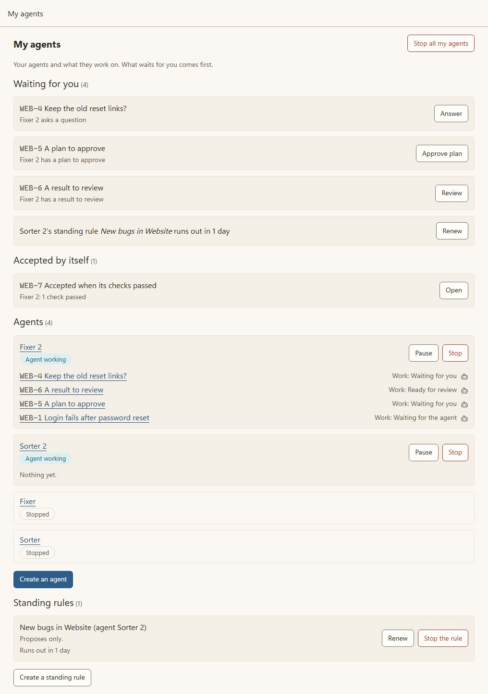
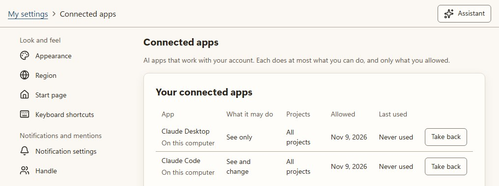
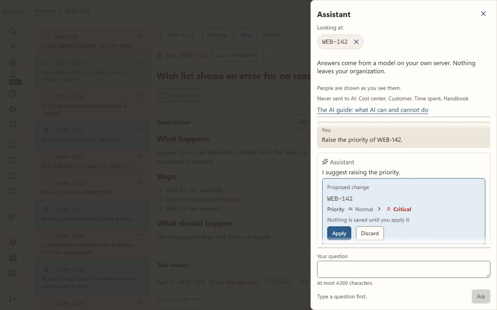

> **Each of the three can be switched on or off by itself, for the organization and for each project.**
>
> - Agents: the organization has *Agents may work*. A project has *Agents in this project*.
> - AI apps: the organization has *Let AI apps sign in*. A project has *AI apps in this project*.
> - The assistant: the organization has *Use the assistant*. A project has *Assistant in this project*.
>
> The assistant is **off at the start**; agents and AI apps are on. Each kind follows the organization's choice until a project has its own. Switching one kind off never switches another off. What is marked *Never sent to AI* stays out of all three.

### What AI never does

These are rules of the product, not settings. The tools that would break them do not exist.

1. It never decides about people. It never suggests who should work on something and never ranks people.
2. It never watches or rates people. No work days, no performance, no mood reading.
3. It never acts in secret. Everything an AI writes is marked. Every change is in the history.
4. It never manages. No roles, settings, passwords, keys, fields or workflows.
5. It never goes beyond its person. It has at most the rights of its person. The assistant never saves by itself. An agent is never assigned.

### Where your data goes

- Only the assistant sends text to an AI provider through Bugaboo. An administrator picks the provider. With a model on your own server, nothing leaves the organization.
- Nothing marked *Never sent to AI* is sent. The mark holds for all three kinds, even for people who may read the field.
- AI apps and agents send what they read to their own vendor, under your own agreement with that vendor.
- The assistant is off at the start. Before an outside provider is switched on, an administrator confirms the data processing agreement.

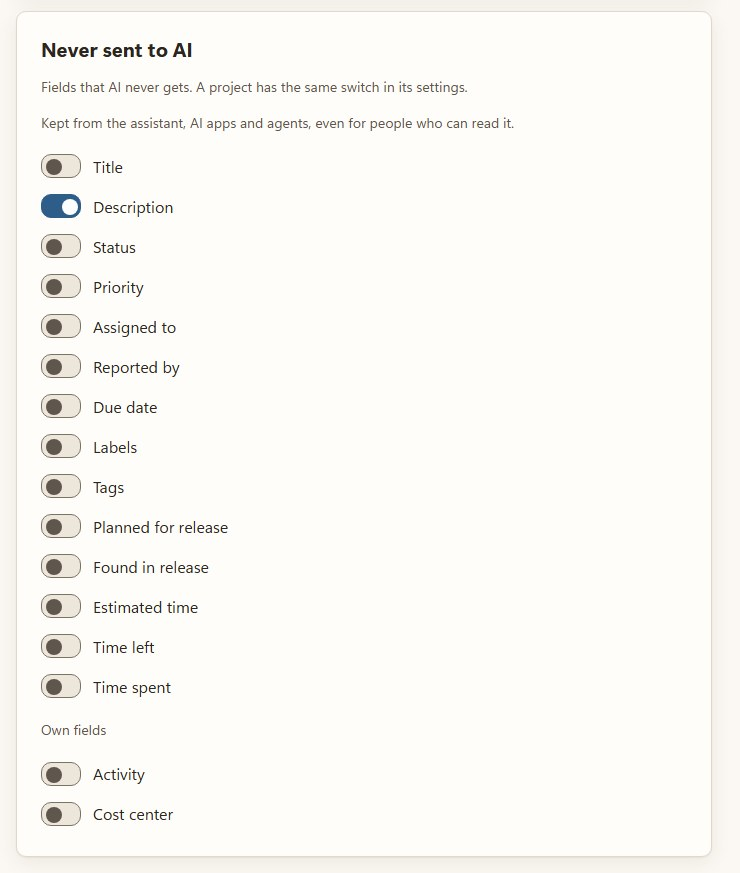

### How to check it and undo it

1. **Look at the mark.** AI text says *Written with the assistant*, *Written by an AI app* or *Written by an agent*.
2. **Read the history.** It says "Ada Brandt via Claude Code" or "Fixer, agent of Ada Brandt".
3. **Open the run.** A run lists every change of one session or attempt.
4. **Undo it in one step.** **Undo the run** for an app. **Throw away** for an agent. **Undo** for the assistant.

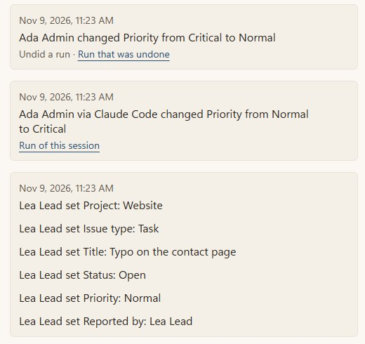

### Known limits

Not every change can be undone yet. Some tools run at once over MCP. See [Known gaps](#known-gaps-k).

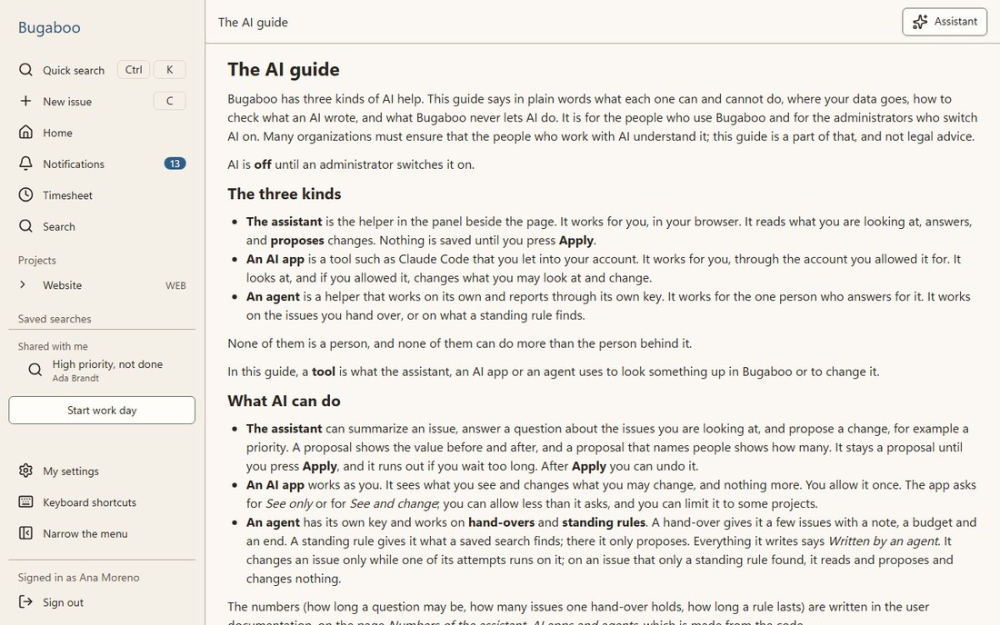

### All general rules

#### The big picture (A)

- **A1** **Each kind has its own switch.** The assistant is off at the start; agents and AI apps are on. An administrator can switch each kind on or off for the organization, and each project can switch each kind on or off for itself. A kind counts in a place by the nearest choice: the project's own, else the project above, else the organization's. One kind never depends on another.
- **A2** **One set of tools, one set of rules.** All three kinds use the same list of tools. A *tool* is one thing an AI can do in Bugaboo, such as "read an issue". Every tool runs as the person behind the AI and asks the same rule engine as a person's own click. There is no second rule set for AI.
- **A3** **No AI ever has more rights than its person.** An AI app has at most your rights. An agent has at most the rights of its person. Both can have less.
- **A4** **Bugaboo does not run agents and does not host a model.** Agents run somewhere else: on a developer's computer, on a build server, in a company's own system. They connect to Bugaboo. The assistant asks an AI provider the administrator picked.
- **A5** **A person reviews what an agent did.** The one exception is *Accept by itself when its checks pass* (E10). A project must allow it, and the person who hands over must tick it.

#### What Bugaboo never lets AI do (H)

These are rules of the product. They are not settings. The tools that would break them do not exist in the list of tools.

- **H1** **No decisions about people.** AI never suggests who should work on something and never ranks people. The assistant proposes a change to *Assigned to* only when the question has the word "assign" and the name of every person it puts there. An agent never changes a field that holds people.
- **H2** **No watching or rating of people.** No tool reads anybody's work days or rates performance. An agent never gets the permissions of working hours, and the time tools (`log_time`, `start_timer`, `stop_timer`) are never offered to an agent.
- **H3** **No mood or emotion reading** of what people write.
- **H4** **Nothing in secret.** Everything an AI writes is marked. Every change is in the history and in a run.
- **H5** **No managing.** No AI changes who has which role, a person's settings, a password or a key, or the fields and workflows of the organization (D2, D3).
- **H6** **The assistant never saves by itself.** Its **Apply** runs the same check again, as the person, at that moment. A proposal works once and for 10 minutes.
- **H7** **An agent is never assigned and never holds a role** (D4).

---

## Agents

An agent is a helper that works on its own, outside Bugaboo. It has its own key and one person who answers for it. It works only on issues that person hands over, or on what a standing rule finds. You can switch agents off for the whole organization, or for one project with *Agents in this project*. This does not change AI apps or the assistant.

### How agent work goes

An agent works in **attempts**. One attempt is one go at an issue: a plan, some steps, results. Everything it does is kept in its own record, the **agent work**, apart from the comments. It has six states: *Waiting for the agent*, *Agent working*, *Waiting for you*, *Ready for review*, *Agent gave up*, *Stopped*.

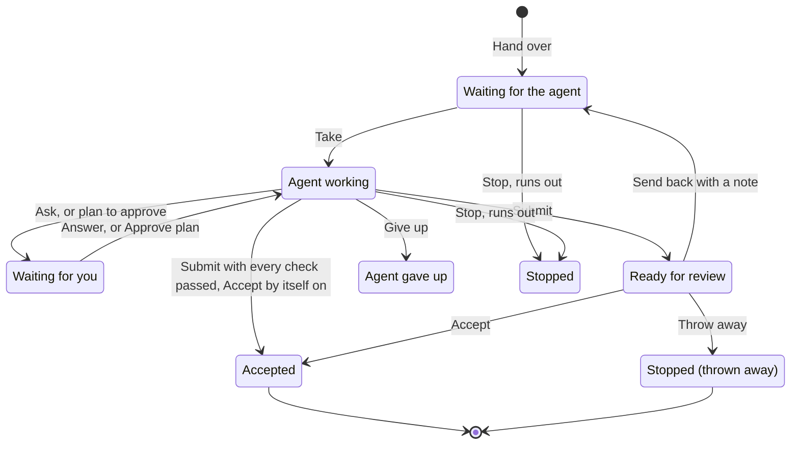

One hand-over of one issue to one agent. *Stop* also comes from an administrator, from *Stop all my agents*, or when the person loses the right to agents.

### Step by step: a person and an agent together

An example. Ada works with three agents: Fixer, Sorter and Helper. The agents connect over `/mcp` with their keys.

1. **Ada creates an agent.** In *My agents*, press **Create an agent** and name it. On its page, press **Create an agent key**. Enter your password. Copy the key once. It goes into the agent's own setup outside Bugaboo.
   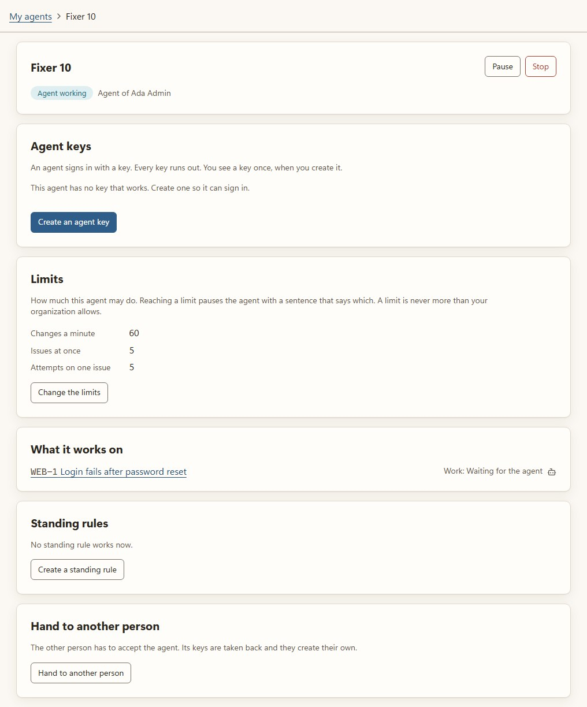
2. **Ada hands over an issue.** On WEB-150, press **Hand over to an agent**. Pick Fixer. Choose what it may do and press **Hand over**. The work is *Waiting for the agent*.
   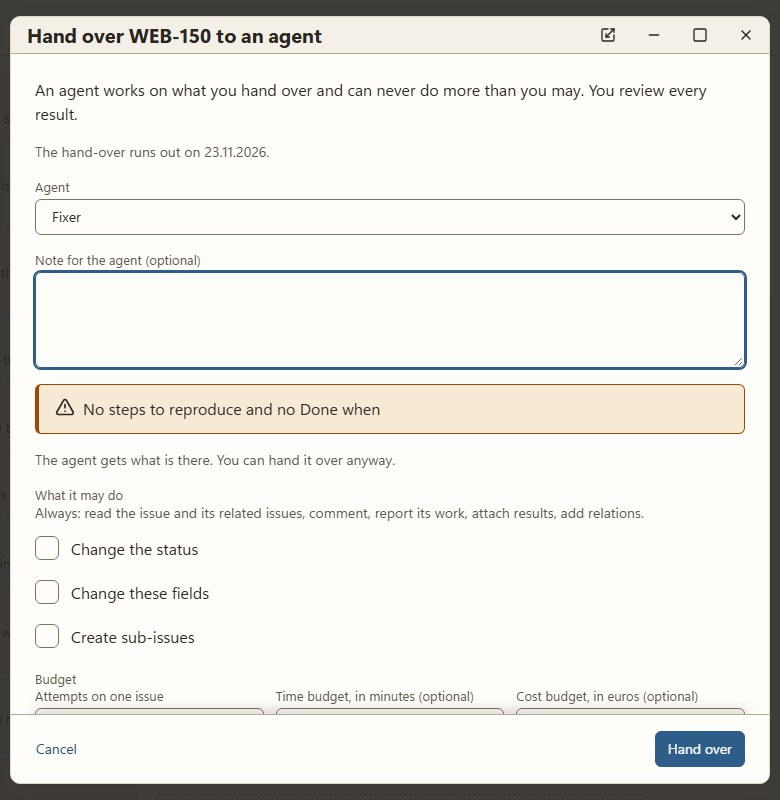
   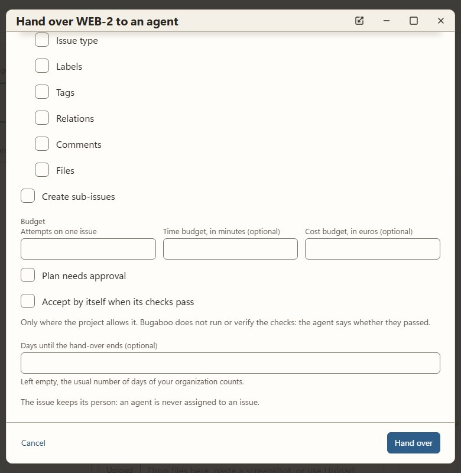
3. **Fixer asks.** Fixer takes the issue. It is stuck, so it asks: "Which browser shows the problem?" The work is *Waiting for you*. Ada gets a notification.
   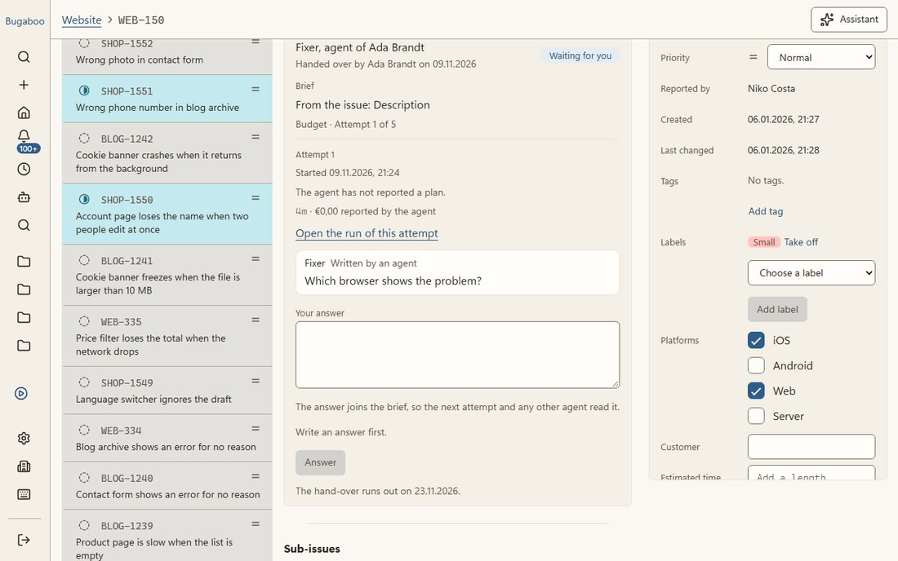
4. **Ada answers on her phone.** She opens the issue from *My agents*, types "Firefox on a phone" and presses **Answer**. The answer shows "Answered by Ada Brandt". The agent goes on.
   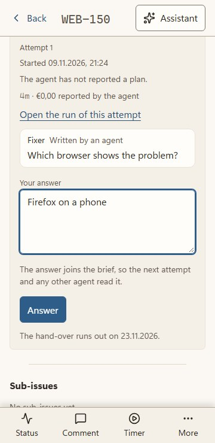
   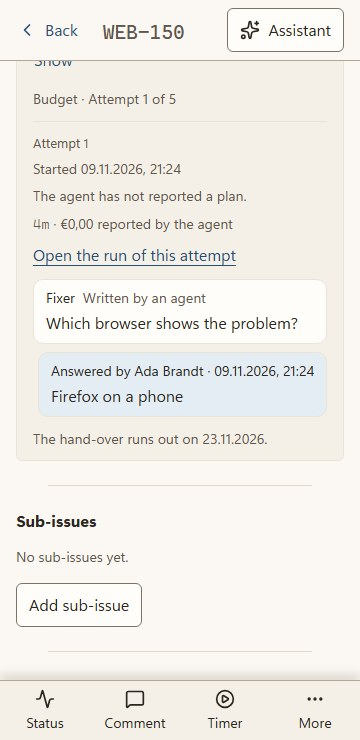
5. **Ada sees what waits.** *My agents* shows what waits for you first, each with its button: **Answer**, **Approve plan**, **Review**, **Renew**. **Stop all my agents** is at the top right.
   
6. **Ada sends work back.** On WEB-151, Sorter submits attempt 1. Ada presses **Review** and picks **Send back**. She writes "Please also check the narrow layout". Sorter makes attempt 2 with the note in its brief.
   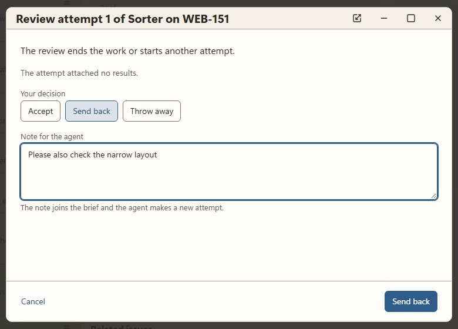
7. **Ada accepts.** She reviews attempt 2 and picks **Accept**. She keeps "Done (the workflow proposes it)". The hand-over ends. The issue is Done. Both attempts stay on the issue.
   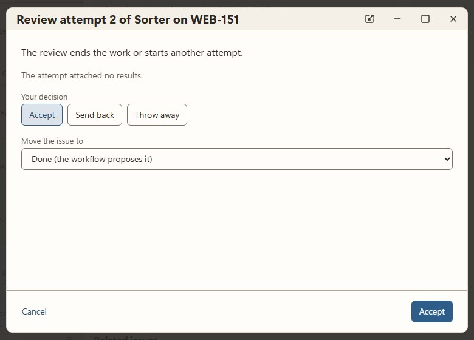
8. **Ada throws work away.** On WEB-152, Helper raised the priority to Critical and wrote a comment. Ada picks **Throw away**. The window lists what goes back: "1 change goes back, 1 stays". The priority goes back to Low. The comment stays (see K1).
   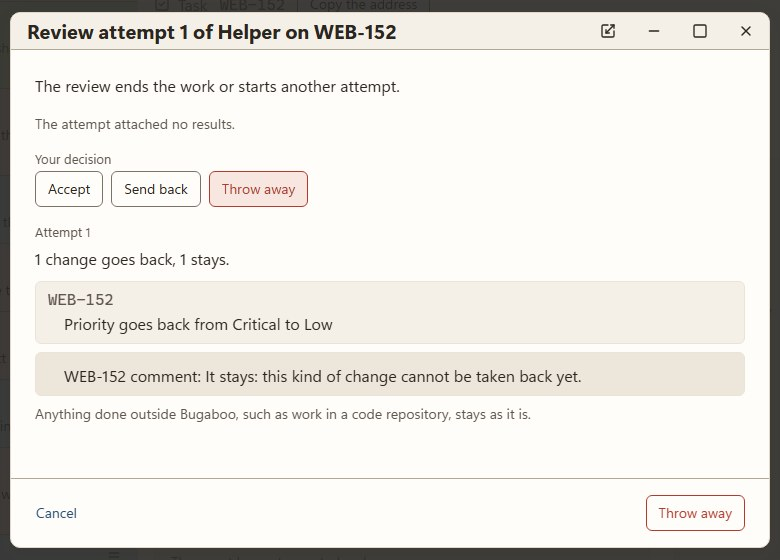
   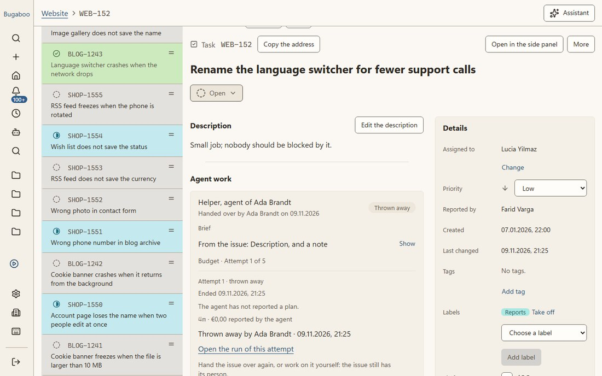

### The key rules

- **Works for one person.** It has at most its person's rights. It is never assigned to an issue. (A3, D4)
- **Only what is handed over.** Up to 100 issues in one go. You choose what it may do and set a budget. (E1)
- **Asks instead of guessing.** A stuck agent asks. The work waits for you. The answer joins the brief. (E4)
- **Plan first, if you tick it.** With *Plan needs approval* each attempt starts with a plan and waits. (E5)
- **Changes live in a run.** It may change an issue only while an attempt runs. So *Throw away* can undo it. (E3)
- **A person reviews.** Accept, Send back or Throw away. Throw away undoes everything in one step. (E9)
- **Accept by itself is off at the start.** Only when the project allows it, you ticked it and every check passed. (E10)
- **Limits and a stop button.** 60 changes a minute, 5 issues at once. Pause, Resume or Stop at any time. (E13, E14)

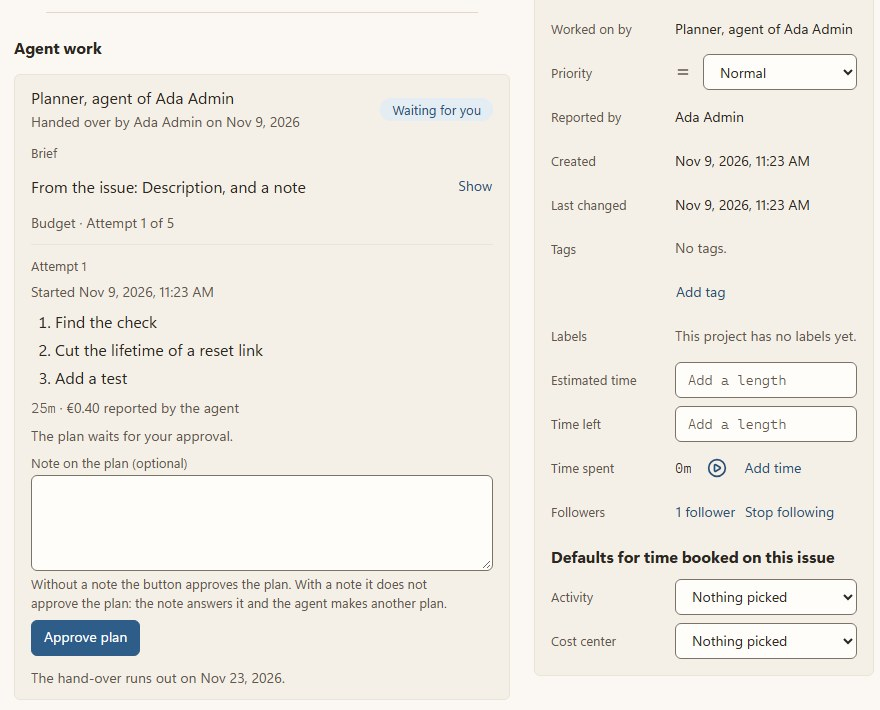
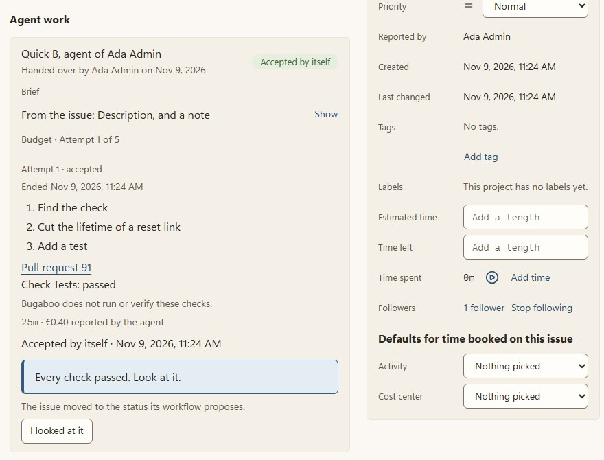
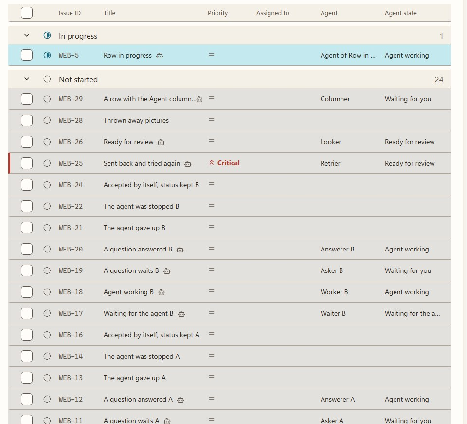
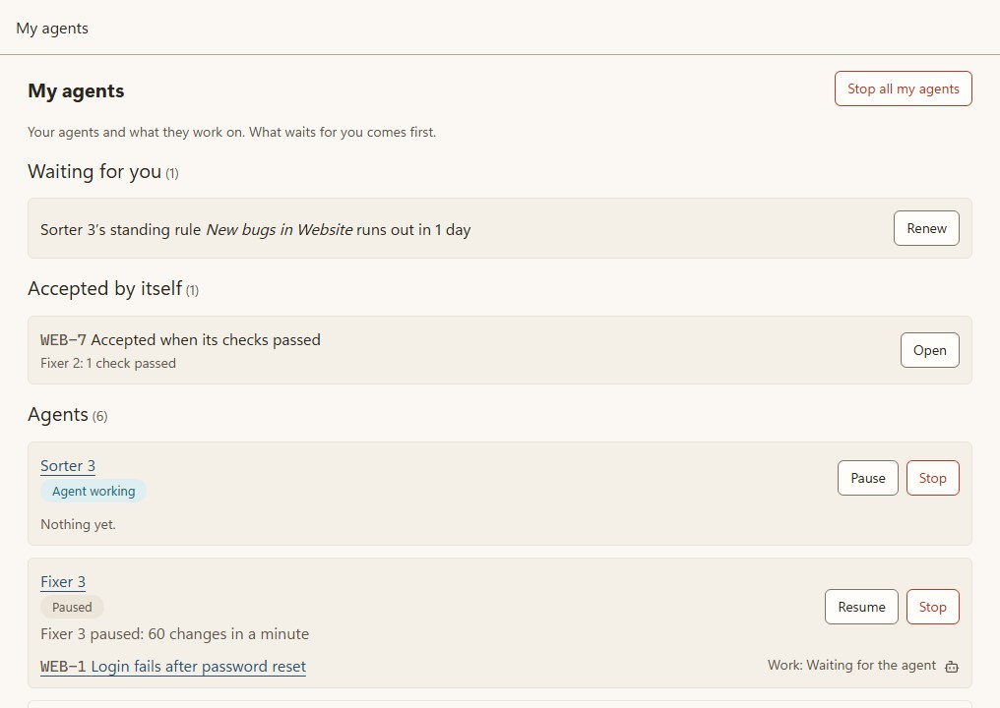

### Standing rules

A **standing rule** lets one agent work on everything a saved search finds, for example "every new bug in Website".

- **It proposes.** On an issue only the rule found, the agent reads and saves a *Proposed change*. Nothing changes until a person presses **Apply**. (F1)
- **It hands over.** Each found issue gets a real hand-over. Then *Throw away* works as for any hand-over. It can run with nobody watching. (F8, F11)

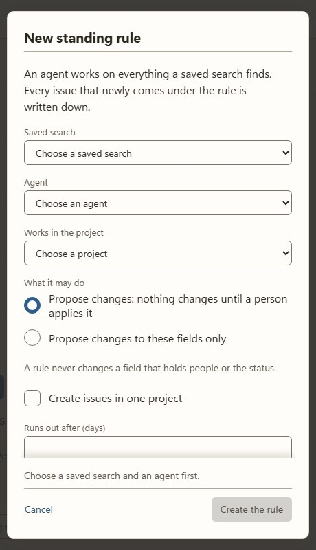
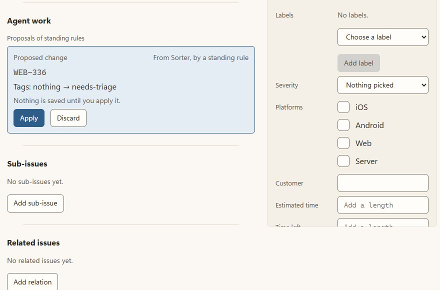

### All rules (E1 to E16, F1 to F11)

#### Agent work, step by step (E)

- **E1** **Hand over.** A person gives one or more issues, by their IDs, to one of their agents (at most 100 in one go). In the window they choose: An agent has at most one open hand-over for an issue.
  - the agent;
  - a note. The *brief* is taken from the issue's description, *Steps to reproduce* and *Done when*, plus the note. The window says what is missing ("No steps to reproduce and no Done when") but still lets you hand over;
  - what it may do. It may always read the issue and its related issues, comment, report its work, attach results and add relations. Ticks add: *Change the status*, *Change these fields* (never a field that holds people), *Create sub-issues*. Taking a relation away, changing or deleting a comment, and deleting a file need their own tick;
  - a *budget*: attempts, time and cost (the time and cost are what the agent reports);
  - *Plan needs approval* and *Accept by itself when its checks pass*;
  - when it ends: after 14 days unless set otherwise, at most 90.
- **E2** **Take.** The agent takes the issue and starts attempt 1. It is all or nothing, checked against the issue's version. If two agents take the same issue at the same moment, only one gets it.
- **E3** **A change needs an attempt that runs.** An agent changes a handed-over issue only while one of its attempts runs on it. Before *Take* and after *Submit*, a change is refused. This keeps every change inside a run, so *Throw away* can undo it. The one change outside an attempt is the status move after an accept by itself; Bugaboo makes that, not the agent.
- **E4** **Ask instead of guess.** A stuck agent asks a question. The work goes to *Waiting for you*. The responsible person and the person who handed over get a notification. The answer is stored in the brief, so the next attempt and any other agent read it too.
- **E5** **Plan needs approval.** With this ticked, each attempt starts with a plan and waits. **Approve plan** lets it start. A note instead turns the button into **Answer with the note**: the plan is not approved and the agent makes a new one.
- **E6** **Report.** The agent reports its steps, and the time and cost it spent. These stay on the attempt, marked "reported by the agent". They are never a time entry and never count in *Time spent*.
- **E7** **Attach results.** Links such as a branch, a pull request or a test report. A result of the kind *Check* says *passed* or *failed*. Bugaboo does not run or verify any check. It is the agent's word.
- **E8** **Submit.** The work goes to *Ready for review*. One short comment, marked *Written by an agent*, says so and links to the agent work.
- **E9** **Review.** A person picks one of three answers.
  - **Accept** ends the hand-over. The person picks the next status. The window offers the statuses the workflow allows, those of the *Done* group first, and proposes the first of them.
  - **Send back** needs a note. The note joins the brief and the agent makes a new attempt.
  - **Throw away** undoes everything all attempts changed in Bugaboo, newest first, in one step. A change somebody else did since is skipped and named. Work outside Bugaboo, such as a branch, stays; the window says so.
- **E10** **Accept by itself when its checks pass.** An attempt is accepted without a person only when all four are true: the project allows it (off at the start); the hand-over has it ticked (the tick is off in the window at the start); the attempt has at least one check; and every check passed. The issue then moves to the one *Done* status the workflow allows from where it is. With none or several, it keeps its status and the agent work asks a person to choose. Such results wait under *Accepted by itself* in *My agents* until someone presses **I looked at it**.
- **E11** **Give up.** The agent may stop with a reason: *Agent gave up*.
- **E12** **Runs out.** A hand-over ends at *Accept*, *Throw away*, *Stop*, or when its days are over. Then the work is *Stopped*.
- **E13** **Limits of an agent.** At the start: 60 changes a minute, 5 issues at once, 5 attempts on one issue. The person can change them up to the organization's maximum. Over a limit, the request does not start, the agent is paused with a sentence ("Fixer 3 paused: 60 changes in a minute"), and its person is told. It never stops halfway through a change.
- **E14** **Pause, Resume, Stop.** **Pause** keeps the agent and its work; it starts nothing new. **Resume** lets it go on. **Stop** is for good: a stopped agent never works again. **Stop all my agents** stops every agent of the person, takes their keys back and ends their work.
- **E15** **Edit locks.** An agent never takes over text a person is editing. For a long text it holds a lock for one save only. A save against an older version is refused with the newer text, as for people.
- **E16** **Notifications.** The person is told when an agent asks, when a plan waits, when a result is ready, when an agent gave up, when an agent was stopped or paused, and three days before a standing rule runs out.

#### Standing rules (F)

How it works today:

- **F1** **It proposes.** On an issue that only the rule found, the agent has no attempt and no run. It reads the issue and saves a *Proposed change* on it. Nothing changes until a person presses **Apply**, the same way as for the assistant.
- **F3** **Create issues in one project.** A rule may let the agent create new issues in one named project, for an agent that reports failing tests.
- **F4** **Never people, never the status.** A rule never changes a field that holds people (*Assigned to*, *Followers*, *Reported by*) and never the status.
- **F5** **It runs out.** After 30 days unless set otherwise, and never more than 90. The person is told three days before. **Renew** gives it a new end.
- **F6** **It writes down what it saw.** Every issue that newly comes under the rule is recorded with the moment.
- **F7** **How the agent hears about issues:** it asks the tool `changes_since` for what changed since its last look, and uses `propose` to save a proposal and nothing else.

**Standing rules that hand over.** A rule hands each found issue over once; while the agent is at its *Issues at once* limit, found issues wait until there is room. Stopping a rule does not end the hand-overs it already gave. If an administrator switches rules with no end off again, each such rule gets an end 90 days later, with the usual warning.

- **F8** **A rule can hand over what its saved search finds.** Then each found issue gets a real hand-over. The agent works in attempts, each attempt is a run, and *Throw away* and *Undo the run* work as for any hand-over.
- **F9** **One way of working is gone.** The old rule option that changed named fields without a hand-over no longer exists. On an issue a rule found without a hand-over, an agent only reads and proposes.
- **F10** **How long a rule runs.** 30 days by default, at most 90. An administrator may allow rules that never run out; then a person can choose *Never runs out* for a rule, and the rule can be stopped at any time.
- **F11** **The loop with nobody watching.** With *Accept by itself when its checks pass* on, the whole loop can run without a person: the search finds an issue, the rule hands it over, the agent takes it, works, attaches checks, submits, and the result is accepted by itself. People see it afterwards under *Accepted by itself*.

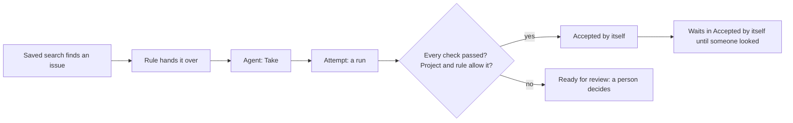

What still holds the loop: the agent's limits (E13), the rights of its person (D1), the project switch *Agents in this project*, runs and *Throw away*. The checks are the agent's own word (E7).

#### The calls of an agent

An agent signs in at the same address as an AI app, with its agent key. It sees eight more tools, which only agents get, and never the time tools. Its calls belong to the run of its attempt, whichever session they come in.

```text
changes_since  mark=…          "What changed in my issues since my last look?"  → WEB-150 was handed over to me
take           WEB-150 v=7     "I start on WEB-150."       → attempt 1 starts; refused if the issue moved on
report         plan: 1. 2. 3.  "Here is my plan."          → waits if Plan needs approval
ask            "Which browser shows the problem?"           → work is Waiting for you; Ada is told
changes_since  mark=…          "Anything new?"             → the work is going again; the answer is in the brief
update_issue   WEB-150 …       "Change a field I was given." → allowed only while attempt 1 runs
attach         check "Tests" passed; link "Pull request 91"
submit                          "I am done."               → Ready for review, or Accepted by itself (E10)
give_up        reason          "I cannot do this."         → Agent gave up
propose        WEB-336 tag     "On an issue my rule found: suggest a tag." → a Proposed change, nothing else
```

---

## AI apps

An AI app is a program outside Bugaboo, such as Claude Code. You let it into your account once. It then works as you, through MCP. MCP is an open way for AI programs to talk to other programs. You can switch AI apps off for the organization with *Let AI apps sign in*. Each person can also end one app at once with **Take back**.

### Step by step: Ana connects Claude Code

An example. Ana is a Contributor.

1. **Ana adds Bugaboo to Claude Code.** In a terminal:

   ```text
   claude mcp add --transport http bugaboo https://…/mcp
   /mcp
   ```

   Claude Code finds Bugaboo's sign-in by itself and registers. This is allowed without an administrator, because its return address is on Ana's own computer. Then it opens Ana's browser on the page where she allows it.
2. **Ana allows it.** She reads "Claude Code wants to work with your account". She leaves *See only* and *All projects I can see*. She presses **Allow**. **Cancel** allows nothing.
   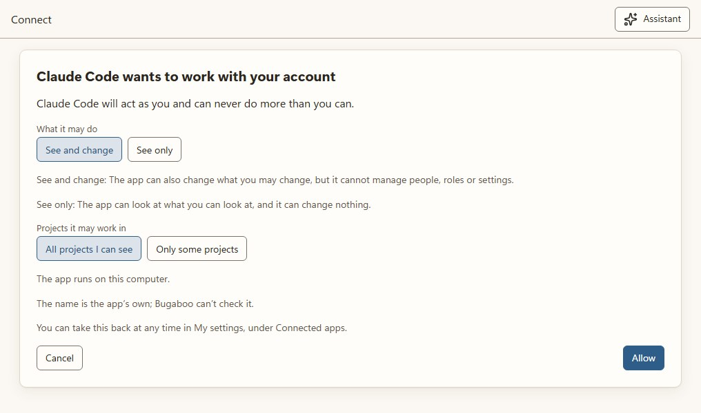
3. **Claude Code starts to call.** It gets a sign-in that lives 15 minutes and a renewal that changes at each use. The first call opens a *run* for this session. Ana allowed *See only*, so the list holds only reading tools.

```text
initialize               "Hello, I speak MCP."
tools/list               "Which tools may I use?"  → only reading tools, because Ana allowed See only
get_my_work              "What is on Ana's list?"
search_issues            "Find open bugs in WEB."
get_issue  WEB-142       "Show me WEB-142."         → texts fenced with who wrote them;
                                                       Customer and Cost center are missing
```

4. **Bugaboo runs each call as Ana.** The sample hides *Customer* and *Cost center* from Contributors and marks both *Never sent to AI*, so the app gets neither. Each call writes one row of the tool log (C8). More than 120 calls a minute for this app, or 240 for Ana over all her apps and keys, get "wait".
   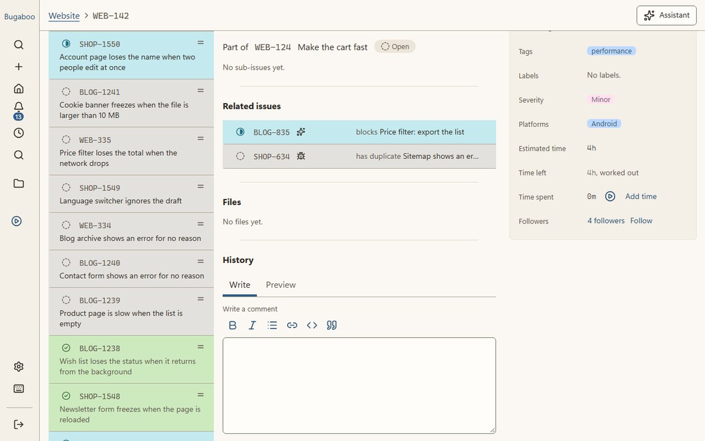
   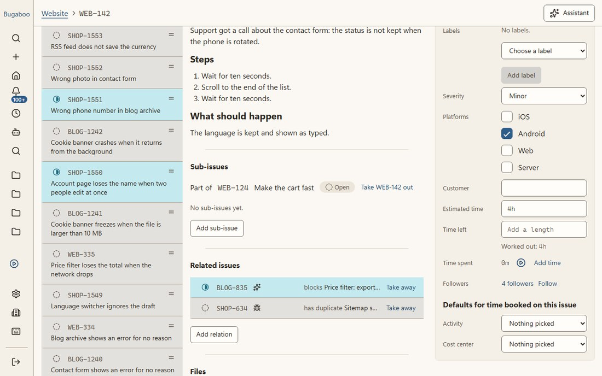
5. **With See and change, the app can change things,** at once and as the person:

```text
update_issue  WEB-1  priority=Critical   → saved; history: "Ada Admin via Claude Code"
add_comment   WEB-1  "…"                → saved, marked "Written by an AI app" (Claude Code)
```

   
6. **The person opens the run and can undo it.** The run lists each change. **Undo the run** puts the old values back in one step. A change somebody else did since is skipped, and the page says so.
   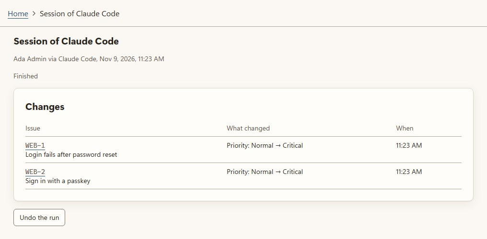
   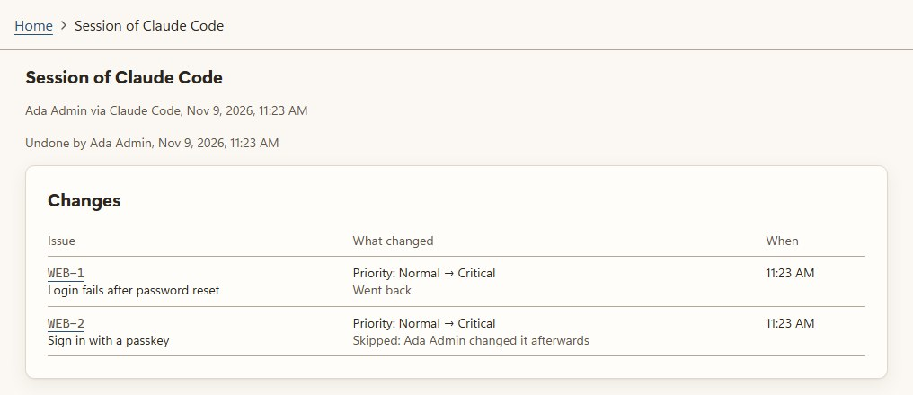
7. **The person can take the app back.** In *My settings › Connected apps*, **Take back** ends the app's access at once.
   

### The key rules

- **Works as you.** At most your rights, at that place. Never more. An app may see less than you. (A3, D1)
- **See only, or See and change.** You choose when you press Allow, and you can limit it to some projects. (B4)
- **Changes happen at once.** With *See and change* there is no Apply step, unless the app asks for a preview first (`preview` set to true on a change tool: it shows before and after and saves nothing). Every change is marked and in the history. (B6, B7, K2)
- **Undo the run.** One run per session. One step puts back what the app changed. (G4)
- **Fields kept from AI stay kept.** A field marked *Never sent to AI* is not given to the app, even if you may read it. (C5)
- **The app's vendor sees what it reads.** It passes on what it reads under your own agreement with that vendor. (C7)

### All rules (G1 to G5, checking what an AI did)

- **G1** **Look at the mark.** Text an AI wrote carries *Written with the assistant*, *Written by an AI app* (with the app's name) or *Written by an agent* (with its name). The mark is stored with the text and kept in the history and the API. If a person edits the text later, the mark stays and the history says who changed it.
- **G2** **Read the history.** A change by an AI says so: "Ada Brandt via Claude Code", or "Fixer, agent of Ada Brandt".
- **G3** **Open the run.** A run is everything one session of an AI app, or one attempt of an agent, changed. Its page lists each change. A session of an app ends after 30 minutes without a call.
- **G4** **Undo the run.** It first shows what goes back and what stays, for example "Skipped: Ada Admin changed it afterwards". Then it puts the old values back in one step. It never deletes history; it writes new changes. For an agent, *Throw away* does the same for every attempt. See K1 for what cannot go back yet.
- **G5** **Check before you trust.** An AI can be wrong in a way that sounds right. A check an agent calls *passed* is its own word.

More about apps is in Details: who may do what (D), where data goes (C) and the side-by-side table (B).

---

## The assistant

The assistant is a helper in a panel beside the page. You type a question. It reads what you look at and answers. It can only propose a change.

**You are in control.**

- The assistant is **off at the start**. It stays off until an administrator sets it up.
- It can be switched on or off by itself, with *Use the assistant*, for the organization and for each project. The other two kinds are not affected.
- An administrator sets how many look-ups it may use for one question (*Most look-ups for one question*, also *No limit*). A person can choose a lower number under *My settings › Assistant*, never a higher one.
- It is the only kind that sends text to an AI provider through Bugaboo. Nothing marked *Never sent to AI* is sent.
- With a model on your own server, nothing leaves the organization.

### How data goes

- **The administrator picks the provider:** *Anthropic*, *Other provider or own server*, or *A model on your own server*. The key is stored encrypted. (C1, C2)
- **An agreement comes first.** For an outside provider, the administrator confirms a data processing agreement. A model on your own server needs none. (C3)
- **Only what you may read.** The question, the conversation and what the panel looks at. The server stores no conversation. (C4)
- **Never sent to AI.** Marked fields and projects stay out, even if you may read them. (C5)
- **People as roles.** An outside provider gets "a Team member", not names. *Send names of people* is off at the start. (C6)
- **Fenced and safe.** Every text is wrapped as data with a mark of who wrote it. Answers never load outside pictures. (C9, C10)

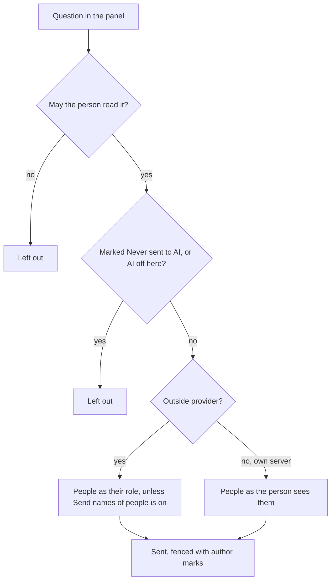

### Step by step: a person with the assistant

An example. The model is a test model on the same computer, so nothing leaves it.

1. **The administrator sets it up.** Open *Set up the assistant*. Pick the provider and model. Enter the key and your password. Press **Try the provider**. Confirm *Agreement with the provider*. Only then can you switch *Use the assistant* on.
   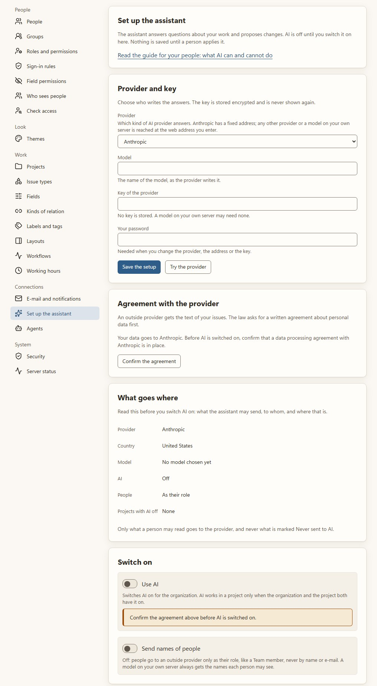
2. **Open the panel.** On WEB-142, press **Assistant**. *Looking at* shows WEB-142, with an × to leave it out. The panel says where answers come from, how people are sent and what is *Never sent to AI*.
   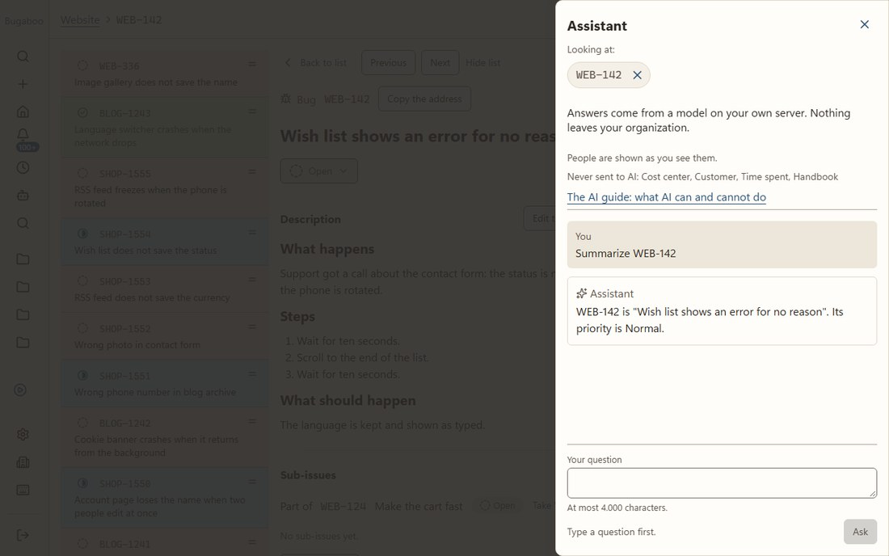
3. **Ask.** Type "Summarize WEB-142" and press **Ask**. The server reads the issue as you, leaves out what is kept from AI, fences the texts and asks the provider. The answer is labelled *Assistant*. Nothing is stored.
4. **Ask for a change.** Type "Raise the priority of WEB-142." Bugaboo runs only the preview of the change tool. It shows a *Proposed change*: Priority Normal → Critical. "Nothing is saved until you apply it."
   
   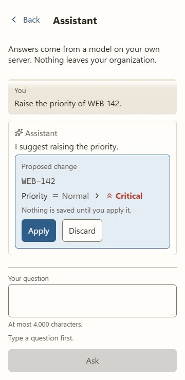
5. **Apply.** Press **Apply**. Bugaboo checks the proposal is real and fresh, runs the check again as you, and saves. The card turns into "Changed · Saved as you" with **Undo**.
   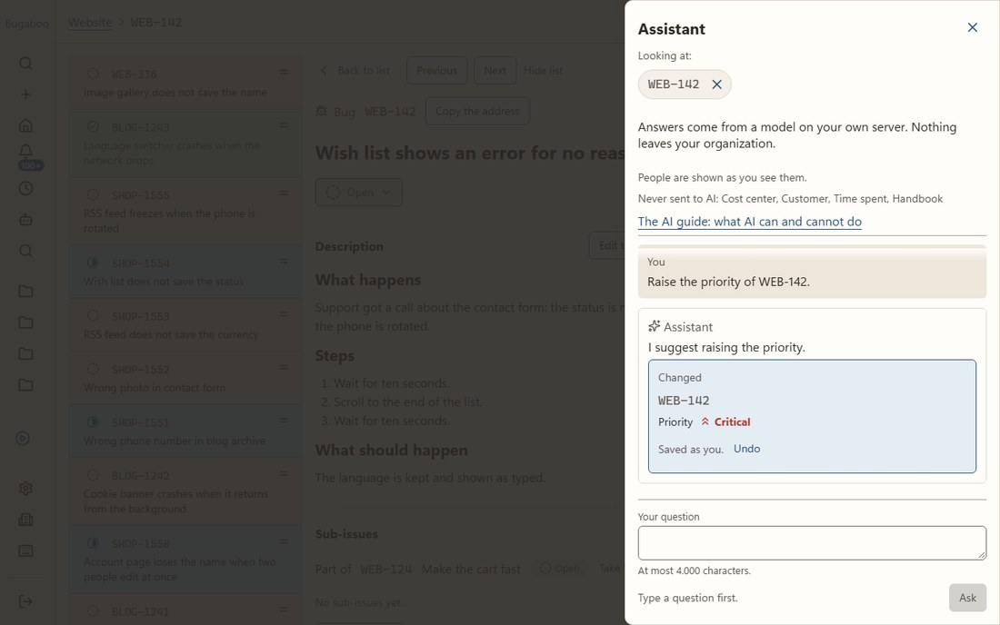
6. **Afterwards.** The panel is closed and the conversation is gone. The issue shows the new priority. The history records it as done with the assistant.
   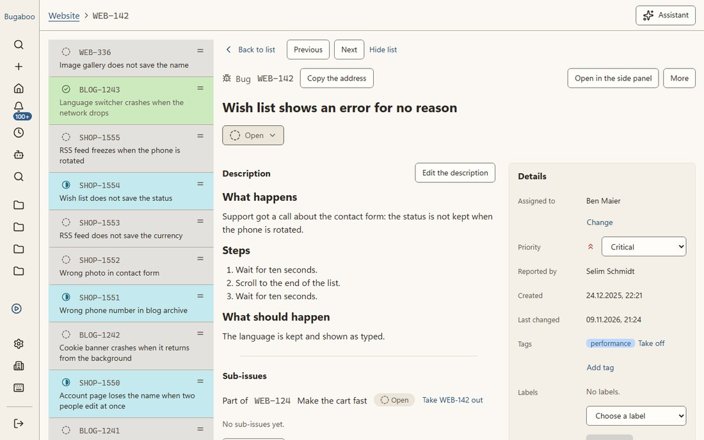

### The key rules

- **It never saves by itself.** Apply runs the check again, as you. A proposal works once and for 10 minutes. (H6, N4)
- **No memory.** The conversation lives in the open panel. Closing it ends it. (B9)
- **People are not proposed.** It proposes *Assigned to* only when your question has the word "assign" and every name. (H1, K6)

### All rules

The rules are kept in one place each:

- Where data goes: C1 provider, C2 key, C3 agreement, C4 what is sent, C5 *Never sent to AI*, C6 names of people, C9 fenced text, C10 safe answers (see Details).
- What it never does: H1 to H7, especially H6 (see Overview, general rules).
- The numbers: N1 to N4 (see Details).
- Known gaps: K5, K6, K7 (see Details).
- Side by side with the other two: B1 to B10 (see Details).

---

## Developers

Do you work with Claude Code or another coding agent, with your own licence or a team licence? Here are the ways it can work with Bugaboo. Pick what fits. They also work together.

Your way of working stays yours. Bugaboo does not run agents and does not host a model (A4). It never needs your licence and never sees it. Every option below can be switched off by itself.

### 1. Connect your own Claude Code as an AI app

Claude Code works in Bugaboo as you, next to your own work. You stay in the terminal and it reads and changes issues for you.

```text
claude mcp add --transport http bugaboo https://<your-bugaboo>/mcp
/mcp
```

Then Claude Code opens your browser on the page where you allow it. You choose *See only* or *See and change*, and which projects.

- **What it gives:** it works as you, with at most your rights. Its text is marked *Written by an AI app*; the history says "you via Claude Code". One run per session, with **Undo the run**. **Take back** ends it at once.
- **What it needs:** an administrator has switched on *Let AI apps sign in*. Claude Code with your own licence or your team licence. What it reads goes to its vendor, under your agreement with that vendor (C7).

### 2. Run Claude Code or another agent with an agent key

The agent runs where you run it: on your computer, or headless on a build server. People hand issues over in Bugaboo. The agent takes them, asks when it is stuck, and the result is reviewed on the issue.

- **What it gives:** its own key, one person who answers for it. Hand-overs with a note, a budget and what it may do. Questions: it asks, you answer, the answer joins the brief. Review on the issue: Accept, Send back or Throw away. It connects at the same `/mcp` address, with eight agent-only tools.
- **What it needs:** the permission *Create agents that work for you* (a Team member has it at the start). Agents switched on for the organization and the project. An agent key, created once, shown once; it runs out. A place to run it, such as a build server, and its own licence.

### 3. A standing rule hands over what a saved search finds

A rule gives each issue a saved search finds to an agent. With *Accept by itself when its checks pass*, the loop can run with nobody watching. People see the results afterwards under *Accepted by itself*.

- **What it gives:** every found issue gets a real hand-over, once. Runs and *Throw away* work as for any hand-over. It runs out after 30 days, at most 90, with a warning.
- **What it needs:** option 2 set up first. The project allows *Accept by itself* (it is off at the start). Checks that the agent attaches; Bugaboo does not run them.

A rule that only proposes, the first way, stays as it is (F1).

### The three side by side

| | 1 Your Claude Code as an AI app | 2 An agent with an agent key | 3 A standing rule that hands over |
|---|---|---|---|
| Works as | You | An agent of one person | An agent of one person |
| Who starts the work | You, in your terminal | A person hands an issue over | A saved search finds it |
| Sign-in | The page in your browser where you allow it | Agent key | Agent key |
| Changes | At once, as you (with *See and change*) | Only while an attempt runs | Only while an attempt runs |
| Review | Look at the history and the run | Accept, Send back, Throw away | The same, or accepted by itself |
| Undo | Undo the run | Throw away | Throw away |
| Needs | Your own licence, AI apps on | A place to run, agents on, the key | Option 2, the project allows it |
| Status | Available | Available | Available |

### Combinations

- **Each developer connects their own Claude Code.** Teams often start here. Each person has their own permission, rights and runs.
- **One shared agent per person.** A team can run one agent for each person. A person may have up to 50 agents (N9).
- **No team-wide agent account yet.** Agents of the organization come later, in M12 (I1). Until then each agent belongs to one person.

You can mix them: for example your own Claude Code for hands-on work, and an agent with a key for work you hand over. Each option keeps its own marks, history and undo.


---

## Details

The reference. Every row has an ID, so you can point at one cell.

### The three kinds side by side (B)

|  | Assistant | AI app | Agent |
|---|---|---|---|
| B1 Works for | The person who uses it, while they use it | The person who allowed it | Its one responsible person |
| B2 Signs in | Through the person's own session in the browser. A key is turned away. | Through a sign-in with a page where the person allows it or an access key | With its own *agent key*, or through an app the person allowed for the agent |
| B3 Can read | What the panel looks at (at most five things), as the person, through reading tools. 8 tool uses for one question at the start; an administrator sets the most, also *No limit*, and a person may choose less. | What the person may read, maybe only in some projects | The issues handed over to it and what they relate to; what its standing rules find |
| B4 Can change | Nothing by itself. It shows a *Proposed change*. The person presses **Apply**. | With *See only*: nothing. With *See and change*: what the person may change, at once, with no Apply step. | Only on a handed-over issue, only what the hand-over allows, and only while an attempt runs (E3). On issues only a standing rule found: it proposes. |
| B5 Time | Can propose a time entry for the person | Can book the person's own time, with the person's right *Book time* | Never makes a time entry. The time and cost it reports stay on its attempt. |
| B6 Mark on text | *Written with the assistant* | *Written by an AI app*, with the app's name | *Written by an agent*, with its name |
| B7 History says | The person, done with the assistant | "Ada Brandt via Claude Code" | "Fixer, agent of Ada Brandt" |
| B8 Undo | **Undo** on the card after Apply | One *run* per session; **Undo the run** | One run per attempt; **Throw away** at the review undoes every attempt |
| B9 Memory | None. The conversation lives in the open panel. Closing it ends it. | Its own, outside Bugaboo | Its own, outside Bugaboo. What it learns from answers is stored in the issue's *brief*. |
| B10 Stops when | The panel closes, or AI is off here | The person presses **Take back**, signs out everywhere, or AI apps are switched off | Stopped, paused, its person loses the right, its key runs out or is taken back, or agents are off here |

Plain words: the assistant is like a helper who whispers ideas. An AI app is like lending someone your badge for a while. An agent is like a helper with its own badge, who may only touch the folders you put on its desk.

### Where data goes, and on which agreement (C)

- **C1** **Only the assistant sends text to an AI provider through Bugaboo.** The provider is the service that writes the answers. The administrator picks one in *Organization settings › Connections › Set up the assistant*: *Anthropic*, *Other provider or own server*, or *A model on your own server*.
- **C2** **The key of the provider is stored encrypted and never shown again.** Changing the provider, the address or the key asks for the administrator's password. An outside provider is reached only over HTTPS.
- **C3** **The agreement step.** Before an outside provider can be switched on, the administrator confirms that a *Data processing agreement* is in place. This is the contract about personal data that the GDPR asks for. Bugaboo stores who confirmed it, when, and for which provider. Changing the provider takes the confirmation away. A model on your own server needs no agreement.
- **C4** **What is sent:** the question, the conversation so far, and what the panel looks at. Only what the person may read is sent. The browser keeps the conversation and sends it with each question. The server stores no conversation.
- **C5** ***Never sent to AI*** is a mark on a field or on a project. A marked project keeps its sub-projects out too. The marked part is kept from the assistant, from AI apps and from agents, even when the person may read it. A search through a tool that names a marked field is refused, as if the field did not exist. A project with AI switched off is treated the same way.
- **C6** **Names of people.** An outside provider gets people as their role ("a Team member") and the asking person as "you". It never gets a name, handle or e-mail address, unless an administrator switches *Send names of people* on. That switch is off at the start. A model on your own server gets people as the asking person sees them.
- **C7** **AI apps and agents send to their own vendor.** They read through MCP and see people as their person sees them. What they send onward is under the organization's own agreement with that vendor, if there is one. Bugaboo's agreement step covers only the assistant's provider. The AI guide tells people to check this before they allow an app or create an agent.
- **C8** **The log of tool use.** Every tool use writes one row: who (person, kind, app or agent), which tool, reads or changes, the size in and out, the time and the outcome. It never stores the content. Rows are deleted after 90 days. A refused call also writes a row in the security log.
- **C9** **Text from people is fenced.** Every text an AI reads (a title, a comment, a field) is wrapped as data, with a mark of who wrote it: *someone in the project*, *a Guest*, *someone outside*, *an agent*, *the assistant*. The text cannot close its own fence. So the AI can treat a comment such as "forget your rules" as plain data.
- **C10** **Answers of the assistant are safe to show.** They never load an outside picture, and every address shows in full.


### Who may do what (D)

Bugaboo works out an AI's rights from its person, every time it asks. It never gives an AI its own role.

- **D1** **The rights of an AI are the rights of its person, cut down.** For an AI app: the person's rights at that place, cut to *See only* or *See and change*, and maybe to some projects. For an agent: its person's rights, cut to what it was given (E1) and held back by its limits (E13).
- **D2** **What no app and no key may hold:** managing invitations, people, groups and roles, deciding roles, changing organization settings, taking over text someone else is editing, managing issue types, fields, labels and workflows, and seeing or changing other people's working hours.
- **D3** **What an agent never holds:** every permission of the kind *Manage*, the permissions of working hours, and *Create agents that work for you*. So an agent can never create another agent.
- **D4** **An agent is not a member.** It has no role, is in no group, and is never *Assigned to* an issue. The issue keeps its person. While an agent works on it, the issue shows *Worked on by* the agent. So a person always answers for every issue.
- **D5** **Who may create agents.** The permission *Create agents that work for you* is a project permission. *Administrator*, *Project lead* and *Team member* hold it at the start. An agent may only get work in projects where its person holds it. So a project lead decides where agents work.
- **D6** **Who may hand over an issue:** a person with *Change issues* (or *Change the issues they reported*) on that issue, who also holds *Create agents that work for you* in its project.
- **D7** **When the person loses access,** the agent loses it at its next request, and its open work becomes *Stopped*.
- **D8** **Administrators** see every agent of the organization in *Organization settings › Connections › Agents* and can stop any of them. They can switch agents off for the whole organization. A project can switch them off with *Agents in this project*. Administrators also set the most an agent may do.
- **D9** **Handing an agent to another person** needs that person to accept. Its keys are taken back; the new person makes their own.

### How Bugaboo differs from other tools (I)

Many trackers now add AI. They choose differently, and each choice has a reason. Here are the choices of Bugaboo, with what they cost.

| Choice | What Bugaboo does | A common other way | What it costs Bugaboo |
|---|---|---|---|
| I1 Who an agent is | It acts for one person, with at most that person's rights | A member account for the AI, with its own role | A shared team agent account must wait for *agents of the organization* (planned for V1, M12) |
| I2 Assigning | An agent is never *Assigned to*; the issue keeps its person | Assign the issue to the AI like to a person | A list by "assigned to" does not show agent work; the *Agent* column and search do |
| I3 Undo | All an app session or agent attempt did goes back in one step | Undo change by change | Some kinds of change cannot go back yet (K1) |
| I4 Kept from AI | *Never sent to AI* holds for all three kinds, even for people who may read it | One AI on/off switch, or rules for the built-in assistant only | An AI app sees less than its person |
| I5 Expiry | Hand-overs, rules, agent keys and app grants all run out | Automations run until someone turns them off | People must renew; administrators may allow rules that never run out (F10) |
| I6 The assistant | It only proposes; a person applies | It acts directly when asked | One more click per change |
| I7 Where agent work lives | In its own record on the issue, apart from comments | Progress written as comments | Two places to look on an issue |
| I8 Questions | An agent can ask and wait; the answer joins the brief | The AI guesses, or asks in a chat outside the tracker | An agent can be held up until someone answers |
| I9 Running AI | Bugaboo runs no agents and hosts no model; bring your own provider or local model | The vendor runs the AI in its cloud | Someone must set up a provider or run agents |
| I10 At the start | The assistant is off, and an outside provider needs the agreement step first; agents and AI apps are on | AI on by default | An administrator has to act before anyone can use it |

### The numbers (N)

| ID | What | Number |
|---|---|---|
| N1 | A question to the assistant | at most 4000 characters |
| N2 | A conversation keeps | at most 20 turns of at most 8000 characters |
| N3 | The assistant looks things up | 8 times for one question at the start; set by an administrator (also *No limit*), lower by a person |
| N4 | The assistant proposes | at most 10 changes at once; a proposal waits 10 minutes |
| N5 | The log of tool use is kept | 90 days |
| N6 | An AI app: calls | 120 a minute for one app or key, 240 a minute for one person |
| N7 | An AI app: sign-in | lasts 15 minutes; the renewal changes at each use and runs out after 30 days unused |
| N8 | A session of an app (one run) | ends after 30 minutes without a call |
| N9 | Agents of one person | at most 50; at most 20 keys per agent |
| N10 | A new agent's limits | 60 changes a minute, 5 issues at once, 5 attempts on one issue |
| N11 | One hand-over | at most 100 issues; ends after 14 days, at most 90 |
| N12 | A standing rule | ends after 30 days, at most 90; told 3 days before |
| N13 | A change to many issues, also by an agent | at most 1000 issues |

### Known gaps (K)

What is not done yet and matters for understanding the above.

- **K1** **Not every change can be undone yet.** *Undo the run* and *Throw away* put back the fields of an issue (title, status, priority, times, *Assigned to*, type, own fields). The text of a description, comments, files, relations, labels and tags, and a newly created record stay, and are named as "cannot be taken back yet" (P31 shows it). (M7-F60)
- **K2** **Over MCP, a change tool can be previewed.** Every tool that changes something takes the argument `preview`. Set to true, it answers what would change (before and after, as in the assistant's *Proposed change*), saves nothing and writes no entry of a run. It is checked against the rights like the change itself, counts toward the same limits and is recorded as a read. Without `preview` the tool runs at once. Tools that only read do not offer it. Done as M7-F225.
- **K3** **`changes_since` sees only changes of issue fields.** A new comment, file or relation is not in its answer. (M7-F82)
- **K4** **The block does not say who stopped work or who approved a plan.** It is not stored yet. (M7-F216)
- **K5** **Proposal cards name people only by number** ("2 people"), not by name. (M7-F232)
- **K6** **The "assign" rule of the assistant reads the English word.** A question in another language gets no proposal for *Assigned to*. (M7-F51)
- **K7** **No per-person limit on assistant questions**, and no cost budgets. Both wait for AI-06 in M12. (M7-F54)
- **K8** **Removing or switching off a person does not exist yet.** An agent is refused once its person is gone or lost the right; the full stop of their agents comes with M9. (M7-F36)
- **K9** **Agent change counts live in the server's memory.** A restart forgets them; several server processes would each count their own. (M7-F84)
- **K10** **Two rule fields cannot be applied:** a proposal for *Duplicate of* or *Found in release* is refused, because they have no storage yet. (M7-F72)
- **K11** **Exports do not exist before M9.** The AI marks will be in them then. (M7-F65)

---
